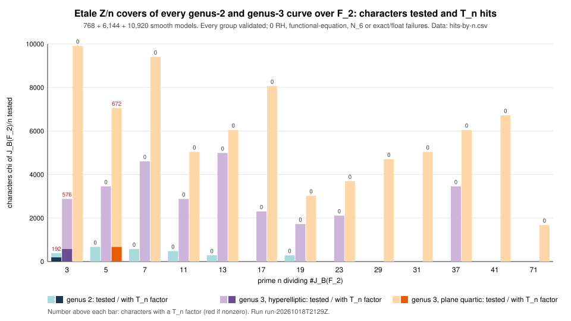
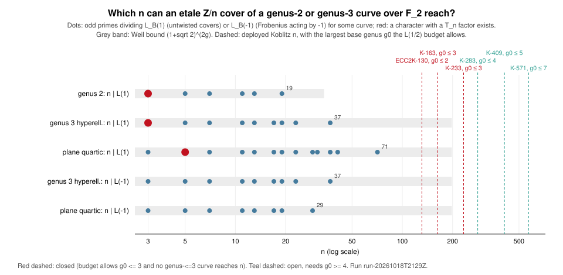

# Run report: étale-cover search for T_n over every genus-2 and genus-3 curve (lead L8), run-20261018T2129Z

**Kind.** Exact enumeration, not a timing or statistical measurement. **Study.**
[`research/ecdlp_leads_20261018`](../../README.md), lead L8. **Code.**
[`etale_search/`](../../etale_search/src/main.rs) at commit `483bda1bdc731d388bd810cdf21d5b3941927399`. **Host.**
Shared cloud container, Intel Xeon @ 2.80 GHz, 4 cores, Linux 6.18, rustc
1.97.0. Isolation L0. Wall time is in `RUN.txt` but is not a result. **Builds
on** [`run-20261018T2043Z`](../run-20261018T2043Z/README.md), which covered
genus 2 and hyperelliptic genus 3.

## What ran

```sh
etale-search 2 > genus2.jsonl 2> genus2.err
etale-search 3 > genus3.jsonl 2> genus3.err
etale-search q > quartic.jsonl 2> quartic.err
```

New since the first run:

1. **Plane quartics.** Every nonzero quartic form over F₂ (2¹⁵ − 1 of them)
   is tested for smoothness over P²(F₈) and P²(F₁₆). A singular point of a
   plane quartic has degree at most 4, so that is enough. Together with the
   hyperelliptic models this covers every genus-3 curve over F₂.
2. **Factor base and relations for quartics.** All places of degree 1, 2, 3,
   4 and 6 are used; points live in F_{2¹²}. Relations come from three
   sources, each with a stated reason it is exact:
   - Line sections over F₂, F₄, F₈ and F₁₆, as norms. Roots come from
     equal-degree splitting, with multiplicities.
   - Conic and cubic sections over F₂. These are accepted only when G
     vanishes at 4·deg G distinct factor-base points. By Bézout every
     intersection is then transversal and nothing lies outside the factor
     base.
   - Quartic sections, G ≠ F, under the same rule. These are used only for
     curves the first two sources do not validate.
3. **Validation is a proof of the group.** Places of degree ≤ 3 generate
   Pic. By Riemann–Roch every class of degree 3 is effective, so given a
   degree-1 place this holds. A lattice of principal divisors with free rank
   1 and torsion of order #J = L(1) is therefore the full relation lattice
   *(derived)*. The same argument covers the first run.
4. **Checks on every character.**
   - |top coefficient| = 2^{g−1} (RH).
   - The full functional equation c_{2g−2−k} = ε·2^{g−1−k}·conj(c_k).
   - For quartics, an out-of-sample test: N₆(χ) is computed directly from
     the degree-6 places and must equal the value the L-polynomial predicts.
     The L-polynomial was built from N₁ to N₄ only.
5. **Exact test.** The factor test is repeated exactly in Z[ζ_n]: the
   Newton identities with integrality asserted at every division, then
   power-series division by 1 − ctX + 2c²X². The floating-point and exact
   verdicts must agree on every (χ, t, c).
6. **Pointless curves.** Characters are extended from Pic⁰ to Pic through a
   degree-1 divisor of the factor base. That is a degree-1 place when one
   exists, otherwise P_j − b·P_i for places of coprime degree. The first run
   skipped curves with no F₂-point. Here `pointless_tested` counts them, and
   it is 0 in every family: every validated curve with an odd prime dividing
   #J has an F₂-point. A verbose run confirmed this independently, with no
   curve record having a₁ = −3.
7. **Twists and classes.**
   - The odd primes dividing L(1) and L(−1) are recorded, for the twisted
     covers (see "Twisted covers" below).
   - The PGL₃(F₂)-orbits of the smooth models and of the hit models are
     counted, with a check that smoothness and the hit property are
     invariant.

## Recorded values

| quantity | genus 2 | genus 3 hyperelliptic | genus 3 plane quartic |
|:--|--:|--:|--:|
| smooth models | 768 | 6,144 | 10,920 |
| validated, with an odd prime dividing #J | 520 | 4,128 | 9,152 |
| failed validation | 0 | 0 | 0 |
| needed quartic sections | – | – | 168 |
| without an F₂-point (tested via P_j − b·P_i) | 0 | 0 | 0 |
| characters failing RH / functional equation | 0 / 0 | 0 / 0 | 0 / 0 |
| N₆ predictions checked / failed | – | – | 76,440 / 0 |
| exact/float disagreements | 0 | 0 | 0 |
| largest #J = L(1) | 19 | 56 | 71 |
| largest \|L(−1)\| | 19 | 56 | 64 |
| largest odd prime dividing L(1) | 19 | 37 | 71 |
| largest odd prime dividing L(−1) | 19 | 37 | 29 |
| characters with a T_n factor | 192, all n = 3 | 576, all n = 3 | **672, all n = 5** |

**Enumeration check** *(sourced: Bergström 2008 and 2009; not re-fetched this
session)*. Each family's model count is the group of coordinate changes times
the curves of that family, each weighted by 1/|Aut|:

- **Genus 2.** 768 = 96 · 8. The group is GL₂(F₂) ⋉ F₂[x]_{≤3}, and
  #M₂(F_q) = q³.
- **Hyperelliptic genus 3.** 6,144 = 192 · 32, with #H₃(F_q) = q⁵.
- **Plane quartics.** 10,920 = 168 · 65, with
  #M₃(F_q) − #H₃(F_q) = (q⁶ + q⁵ + 1) − q⁵ = q⁶ + 1.

So no curve is missed or double-counted by the smoothness tests.

The genus-2 and hyperelliptic genus-3 hit records are byte-identical to the
first run. Only the summary line changed: it gained the new checks, and it
is now valid JSON (the first run printed Rust tuples).

Characters tested and hits, per n ([`hits-by-n.csv`](hits-by-n.csv)):

| n | genus 2: tested / hit | genus 3 hyperelliptic | genus 3 plane quartic |
|--:|--:|--:|--:|
| 3 | 384 / 192 | 2880 / 576 | 9912 / 0 |
| 5 | 672 / 0 | 3456 / 0 | 7056 / 672 |
| 7 | 576 / 0 | 4608 / 0 | 9408 / 0 |
| 11 | 480 / 0 | 2880 / 0 | 5040 / 0 |
| 13 | 288 / 0 | 4992 / 0 | 6048 / 0 |
| 17 | – | 2304 / 0 | 8064 / 0 |
| 19 | 288 / 0 | 1728 / 0 | 3024 / 0 |
| 23 | – | 2112 / 0 | 3696 / 0 |
| 29 | – | – | 4704 / 0 |
| 31 | – | – | 5040 / 0 |
| 37 | – | 3456 / 0 | 6048 / 0 |
| 41 | – | – | 6720 / 0 |
| 71 | – | – | 1680 / 0 |



## The n = 5 hit

The 10,920 smooth quartic models fall into 78 isomorphism classes
(PGL₃(F₂)-orbits). The 168 hit models form exactly one orbit, which is one
curve up to F₂-isomorphism, with trivial automorphism group:

```text
B: x³y + x²z² + xy²z + xz³ + y³z = 0        (model 0xaa2 in quartic.jsonl)
```

- **What is common.** All 168 hit models share N = (4, 8, 19) over F₂, F₄
  and F₈, L(X) = 1 + X + 2X² + 5X³ + 4X⁴ + 4X⁵ + 8X⁶ and J(F₂) ≅ Z/25. Every
  one of the four characters of J/5 has the factor, always with t = −1. That
  is the a = 0 Koblitz curve E: y² + xy = x³ + 1, with π = (−1 ± √−7)/2.
- **What it gives.** For each such χ, one of the five extensions of χ to
  Pic(B) defines an unramified Z/5 cover D → B over F₂. D has genus
  1 + 5·2 = 11 and its Prym contains T₅ up to isogeny *(derived from the
  measured factor)*. The extension is the one that makes c primitive. The
  `c_exp` field depends on the base place P₀; changing P₀ is the
  constant-field twist.
- **Is it new?** These are the first characters with a T_n factor for any
  n ≥ 5 in this search. L(B, X) itself has no factor 1 + X + 2X²: E is not
  in J_B. The T₅ factor appears only in the twisted L-functions.

## Twisted covers, and what the run closes

An F₂-rational cover D → B that is geometrically Z/n-Galois can have
Frobenius act on the Galois group by some λ ∈ (Z/n)^×. Such covers exist iff
λ is an eigenvalue of Frobenius on J_B[n], that is iff n | P_B(λ). For
λ = ±1 this means n | L_B(±1).

If T_n is in the Prym, the eigenvalues of Frobenius on the Prym are closed
under multiplication by μ_k, where k = ord(λ). Since μ_k ∩ μ_n = 1 and E is
ordinary, the Prym then holds 2k(n − 1) distinct eigenvalues. Its dimension
gives 2k(n − 1) ≤ 2(n − 1)(g₀ − 1), so k ≤ g₀ − 1 *(derived)*:

- genus 2 allows only k = 1, the case searched;
- genus 3 allows k ≤ 2, so λ = −1 and n | L(−1).

The study's L(1/2) budget (`cover-genus-budget.csv`, *derived*) bounds g₀
for each deployed size:

| curve | n | budget genus | g₀ allowed | status |
|:--|--:|--:|:--|:--|
| ECC2K-130 | 131 | 245 | ≤ 2 | **closed**: needs n ≤ (1+√2)⁴ ≈ 34 *(derived)* |
| K-163 | 163 | 368 | ≤ 3 | **closed**: no genus-≤3 curve over F₂ has 163 \| L(±1) *(measured, exhaustive)* |
| K-233 | 233 | 691 | ≤ 3 | **closed**: needs n ≤ (1+√2)⁶ ≈ 198 *(derived)* |
| K-283 | 283 | 980 | ≤ 4 | open: genus 4, k ≤ 3 |
| K-409 | 409 | 1,901 | ≤ 5 | open: genus 4–5, k ≤ 4 |
| K-571 | 571 | 3,471 | ≤ 7 | open: genus 4–7, k ≤ 6 |



## Records

- `RUN.txt`: commit, host, timing and SHA-256 of every output.
- `genus2.jsonl`, `genus3.jsonl`, `quartic.jsonl`: hit records (`kind: hit`),
  the quartic class record (`kind: classes`), and a `summary` per family.
  The `*.err` files are empty: there were no unvalidated curves and no failed
  checks.
- `hits-by-n.csv`, `reach.csv`: derived from the JSONL by `awk`
  (`tables.awk`).
- `hits-by-n.plot.awk`, `reach.plot.awk`: the graph sources.
- `report.typ`, `report.pdf`.

## Not covered

- Genus ≥ 4 bases. These are needed for K-283, K-409 and K-571, with twists
  of order up to g₀ − 1.
- Ramified covers. That is L7, the Klein family.
- Non-cyclic covers.
