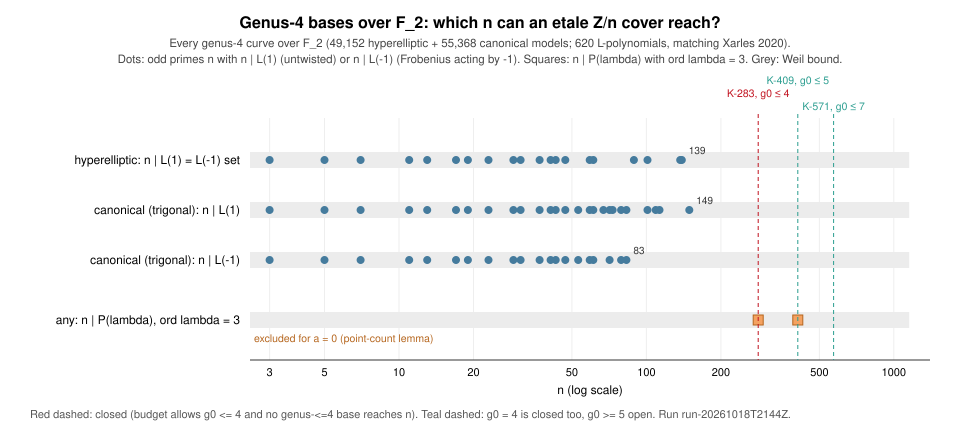

# Run report: genus-4 screen for étale covers at K-283, K-409 and K-571 (lead L8), run-20261018T2144Z

**Kind.** Exact enumeration, and a screen on a necessary condition. It is not
a timing or statistical measurement. **Study.**
[`research/ecdlp_leads_20261018`](../../README.md), lead L8. **Code.**
[`etale_search/`](../../etale_search/src/main.rs) (`screen.rs`, `genus4.rs`)
at commit `4369a50a3a52da3e457666e099196b7382c2adcd`. **Host.** Shared cloud
container, Intel Xeon @ 2.80 GHz, 4 cores, Linux 6.18, rustc 1.97.0.
Isolation L0. Wall time (5 s) is in `RUN.txt` but is not a result.
**Builds on** [`run-20261018T2129Z`](../run-20261018T2129Z/README.md), which
closed the étale route for bases of genus ≤ 3.

## Why genus 4

The study's L(1/2) budget (`cover-genus-budget.csv`, *derived*) bounds the
base genus g₀ of an étale Z/n cover of genus 1 + n(g₀ − 1):

| curve | n | g₀ allowed |
|:--|--:|:--|
| K-283 | 283 | ≤ 4 |
| K-409 | 409 | ≤ 5 |
| K-571 | 571 | ≤ 7 |

Genus ≤ 3 was closed in the previous run, so genus 4 decides K-283.

The condition screened *(derived, previous run report)*:

- A cover D → B that is F₂-rational and geometrically Z/n-Galois, with
  Frobenius acting on the group by λ, exists iff n ∣ P_B(λ), where
  P_B(T) = T^{2g} L_B(1/T).
- T_n in the Prym forces ord λ ≤ g₀ − 1, so ord λ ≤ 3 for genus 4.
- The run tests λ of order 1, 2 and 3. That is n ∣ L(1), n ∣ L(−1), and
  n ∣ P(ω) for ω a primitive cube root of unity mod n. Such ω exist because
  283, 409 and 571 are all ≡ 1 (mod 3).

## What ran

```sh
etale-search s4 > genus4.jsonl 2> genus4.err
```

1. **Hyperelliptic genus 4.** Every model y² + h(x)y = f(x) over F₂ with
   deg h ≤ 5 and deg f ≤ 10, kept when smooth of genus 4. L comes from point
   counts over F₂, F₄, F₈ and F₁₆.
2. **Non-hyperelliptic (trigonal) genus 4.** These are canonical curves
   X = Q ∩ C in P³.
   - Q is the unique quadric through X, with three normal forms over F₂:
     hyperbolic x₀x₁ + x₂x₃, elliptic x₀x₁ + x₂² + x₂x₃ + x₃², and the cone
     x₀x₁ + x₂² (sourced: Xarles 2020, Lemma 9).
   - C is a cubic modulo Q·(linear forms). The 16 cubic monomials not
     divisible by x₀x₁ span a complement, so all 2¹⁶ − 1 nonzero C are run
     per quadric, by Gray code.
3. **Smoothness test.** X is smooth iff no point has
   rank[∇Q; ∇C] < 2. The test runs over P³(F₁₆), P³(F₃₂) and P³(F₆₄), which
   contain every point of degree ≤ 6. Every singular point has degree ≤ 6
   *(derived)*:
   - an irreducible X has at most 4 singular points;
   - the components of a reducible X meet in at most 9 points, which
     Frobenius permutes in orbits of size ≤ 6.
4. **Checks.**
   - Every L-polynomial meets the Weil bounds on its coefficients.
   - For canonical curves, N₅ and N₆ predicted from L (built from N₁ to N₄)
     must equal the direct counts over F₃₂ and F₆₄.
   - The L-polynomial sets are compared with Xarles's census (below).

## Recorded values

| quantity | hyperelliptic | canonical (trigonal) | all genus 4 |
|:--|--:|--:|--:|
| smooth models | 49,152 | 55,368 (hyperbolic 16,020, elliptic 27,060, cone 12,288) | 104,520 |
| distinct L-polynomials | 217 | 521 | 620 (118 shared) |
| largest #J = L(1) | 139 | 260 | **260** |
| largest \|L(−1)\| | 139 | 144 | **144** |
| largest #X(F₂) | 6 | 8 | 8 |
| N₅/N₆ predictions checked / failed | – | 110,736 / 0 | |
| Weil-bound failures | 0 | 0 | |
| n ∣ L(±1) for n ∈ {283, 409, 571} | none | none | **none** |
| n ∣ P(λ), ord λ = 3 | 283 (192 models), 409 (192) | 283 (72), 409 (456) | |

**Census check** *(sourced: Xarles, "A census of all genus 4 curves over the
field with 2 elements", arXiv:2007.07822, Theorem 10 and Tables 1 and 5)*.
The census has 264 hyperelliptic and 780 trigonal isomorphism classes, and
620 L-polynomials in all. Of those, 403 do not occur for hyperelliptic
curves and 99 do not occur for trigonal curves, which leaves:

- 217 for hyperelliptic curves (measured here: 217);
- 521 for trigonal curves (measured: 521);
- 118 shared by both (measured: 118).

The largest numbers of F₂-points are 6 (hyperelliptic) and 8 (trigonal),
both matched. The hyperelliptic model count also matches the mass
#H₄(F₂) = 2⁷ times |GL₂(F₂) ⋉ F₂[x]_{≤5}| = 384. So the enumeration covers
every genus-4 curve over F₂.

The only candidates have ord λ = 3:

| family | n | L_B(X) coefficients | #J | models |
|:--|--:|:--|--:|--:|
| hyperelliptic | 283 | [1, −3, 5, −7, 9, −14, 20, −24, 16] | 3 | 192 |
| hyperelliptic | 409 | [1, −1, 0, 0, 2, 0, 0, −8, 16] | 10 | 192 |
| canonical | 283 | [1, 0, 1, 1, 0, 2, 4, 0, 16] | 25 | 72 |
| canonical | 409 | [1, −1, 0, 0, 2, 0, 0, −8, 16] | 10 | 336 |
| canonical | 409 | [1, −1, 2, −1, 2, −2, 8, −8, 16] | 17 | 120 |



## The point-count lemma, which removes the order-3 candidates

**Lemma** *(derived)*. Let D → B be an étale Z/n cover over F₂ with
Frobenius acting by λ of order k = g₀ − 1, and suppose T_n is in the Prym.
Then #D(F_{2^k}) = #B(F_{2^k}) + k·t_k, where t_k = π^k + π̄^k. Also
#D(F_{2^k}) ≡ 0 (mod n).

*Proof.*

1. **The Prym's eigenvalues.** Frobenius permutes the Z/n-eigenspaces of
   the Prym's Tate module in orbits of size k. So its eigenvalues are closed
   under multiplication by μ_k. They contain the 2(n − 1) eigenvalues ζ^jπ
   and ζ^jπ̄ of T_n, hence the 2k(n − 1) distinct values ωζ^jπ^±. That is
   the whole Prym, because 2·dim = 2(n − 1)(g₀ − 1).
2. **The trace.** Summing the k-th powers gives
   k·t_k·Σ_{j≠0} ζ^{jk} = −k·t_k.
3. **Divisibility.** Over F_{2^k} the cover is untwisted. Each
   F_{2^k}-point of B has 0 or n rational points above it, so
   #D(F_{2^k}) ≡ 0 (mod n).

**Consequence.** For n > 2^k + 1 + 2g₀·2^{k/2} + k|t_k| the only possibility
is #D(F_{2^k}) = 0, which needs #B(F_{2^k}) = −k·t_k. For the a = 0 Koblitz
curve (K-233, K-283, K-409, K-571) the traces are:

| k | 1 | 2 | 3 | 4 | 5 | 6 | 7 |
|:--|--:|--:|--:|--:|--:|--:|--:|
| t_k | −1 | −3 | 5 | 1 | −11 | 9 | 13 |

The maximal twist is therefore impossible at:

- g₀ = 4 (k = 3, t₃ = 5 > 0);
- g₀ = 5 (k = 4, t₄ = 1 > 0);
- g₀ = 7 (k = 6, t₆ = 9 > 0).

At g₀ = 6 (k = 5) it would need #B(F₃₂) = 55 exactly. So every order-3
candidate above is excluded at g₀ = 4.

## What this closes

| curve | g₀ allowed | genus 2 | genus 3 | genus 4 | status |
|:--|:--|:--|:--|:--|:--|
| K-283 | ≤ 4 | Weil | Weil | measured + lemma | **closed** |
| K-409 | ≤ 5 | Weil | Weil | measured + lemma | open at g₀ = 5 (k ≤ 3; k = 4 is excluded by the lemma) |
| K-571 | ≤ 7 | Weil | Weil | measured + lemma | open at g₀ = 5, 6, 7 (k = 6 is excluded; k = 5 needs #B(F₃₂) = 55) |

The Weil bound on #J at genus 3 is 198, below 283. With the earlier runs, the
étale route is now closed for ECC2K-130, K-163, K-233 and K-283.

## Records

- `RUN.txt`: commit, host, timing and SHA-256 of the output.
- `genus4.jsonl`: candidate records, the two family summaries, and the
  `genus4_all` record. `genus4.err` is empty.
- `reach.csv`: derived from the JSONL by `tables.awk`. `reach.plot.awk` is
  the graph source.
- `report.typ`, `report.pdf`.

## Not covered

- Genus ≥ 5 bases, needed for K-409 and K-571.
- The lemma takes the cyclic étale setting as given. Ramified covers are L7.
- The census comparison checks the sets of L-polynomials, not the curves one
  by one.
