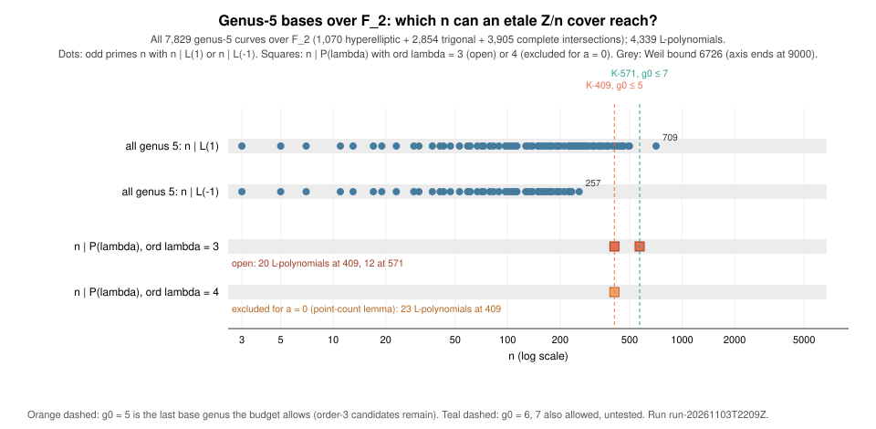

# Run report: genus-5 screen for étale covers at K-409 and K-571 (lead L8), run-20261103T2209Z

**Kind.** Exact enumeration of two families, an exact recount of a published
list for the third, and a screen on a necessary condition. It is not a timing
or statistical measurement. **Study.**
[`research/ecdlp_leads_20261018`](../../README.md), lead L8. **Code.**
[`etale_search/`](../../etale_search/src/genus5.rs) (`genus5.rs`) at commit
`579d02b3a`. **Host.** Shared cloud container, Intel Xeon @ 2.80 GHz, 4 cores,
Linux 6.18, rustc 1.97.0. Isolation L0. Wall times are in `RUN.txt` and are
not results. **Builds on**
[`run-20261018T2144Z`](../run-20261018T2144Z/README.md), which closed K-283 at
genus 4.

## Why genus 5

The L(1/2) budget (`cover-genus-budget.csv`, *derived*) allows a base genus
g₀ ≤ 5 for K-409 and g₀ ≤ 7 for K-571. Genus ≤ 4 is closed for both (genus 4:
every curve has #J ≤ 260 < 409). Genus 5 is the first base genus whose Weil
bound, (1+√2)¹⁰ ≈ 6,726 on #J_B(F₂), exceeds 409 and 571, so the bound no longer
closes it and the screen has to.

The condition screened *(derived, earlier run reports)*: an F₂-rational cover
D → B that is geometrically Z/n-Galois, with Frobenius acting on the group by
λ, exists iff n ∣ P_B(λ), P_B(T) = T^(2g) L_B(1/T). T_n in the Prym forces
ord λ ≤ g₀ − 1 = 4. The run tests λ of order 1, 2, 3 and 4. For n = 409 all four
orders occur (409 ≡ 1 mod 12); for n = 571 orders 1, 2 and 3 occur (571 ≡ 3 mod 4,
so no order 4).

## What ran

Every genus-5 curve over F₂ is hyperelliptic, trigonal (a plane quintic with one
singular point, of delta invariant 1) or a complete intersection of three
quadrics in P⁴ (*sourced*: Dragutinović, arXiv:2202.07809, §1 and Theorem 3.1).
That paper lists all three families with point counts and automorphism-group
sizes (1,070 + 2,854 + 3,905 = 7,829 curves). Those lists were read as
**untrusted data**: none of their Sage or Python code was run.

1. **`g5 hyp-enum`, independent.** Every model y² + q(x)y = p(x) with
   deg q ≤ 6 and deg p ≤ 12 (2²⁰ of them). A model is smooth iff q ≠ 0, no root x
   of q (over F_(2^k), k ≤ 6) has q′(x)√p(x) + p′(x) = 0, and the chart at
   infinity is smooth (*derived*).
2. **`g5 trig-enum`, independent.** Every plane quintic singular at (0:0:1)
   (2¹⁸ forms), kept when it has no other singular point over F_(2^k), k ≤ 6, and
   the singularity is a node or an ordinary cusp. A quintic with one such
   singular point is irreducible, because components of a reducible quintic
   meet in at least 4 points (*derived*). The normalisation has
   N_k = N_k(plane) − 1 + b_k, with b_k = 1 (cusp), 2 (split node), 2 or 0
   (non-split node, k even or odd).
3. **`g5 sourced`.** Every published model is recounted over F₂, …, F₆₄
   (hyperelliptic and trigonal also over F₁₂₈), L is recomputed from N₁..N₅,
   and the counts are compared with the published ones.
   - Complete intersections: the 15 monomial products at every point of
     P⁴(F_(2^k)), k ≤ 6 (17,043,521 points at k = 6), XOR-combined per quadric.
   - Smoothness of the complete intersections is **not** re-tested here (it
     needs P⁴ over fields of degree up to the singular-point degree bound); it
     is carried by the published Sage check.
4. **Checks on every curve.** Weil bounds on the coefficients of L; N₆ predicted
   from L against the direct count (and N₇ for hyperelliptic and trigonal).
5. **The screen.** For n ∈ {409, 571}: which L have n ∣ P(λ) for λ of order ≤ 4.

## Recorded values

| quantity | hyperelliptic | trigonal | complete intersections | all genus 5 |
|:--|--:|--:|--:|--:|
| curves (published list) | 1,070 | 2,854 | 3,905 | **7,829** |
| N₁..N₅ recounted = published | 1,070 / 1,070 | 2,854 / 2,854 | 3,905 / 3,905 | |
| Weil, N₆ (N₇) failures | 0 | 0 | 0 | 0 |
| distinct L-polynomials | 841 | 2,036 | 2,827 | **4,339** |
| Σ 1/\|Aut\| (published sizes) | 512 | 2,817 | 3,584 | **6,913** |
| independent enumeration | 393,216 models | 67,608 forms at one point | – | |
| …divided by group order | 393,216 / 768 = **512** | 7 · 67,608 / 168 = **2,817** | – | |
| L-set of the enumeration = published | 841 = 841 | 2,036 = 2,036 | – | |
| largest #J = L(1) | 342 | 710 | 975 | 975 |
| largest \|L(−1)\| | 342 | 176 | 392 | 392 |
| n ∣ L(±1), n ∈ {409, 571} | none | none | none | **none** |

**Census check.** The union has 4,339 distinct L-polynomials, the count the
paper gives for isogeny classes of genus-5 Jacobians over F₂ *(sourced)*. The
stack counts 512 = 2⁹, 2,817 = 2¹¹ + 2¹⁰ − 2⁸ + 1 (Wennink) and 3,584 = 2¹² − 2⁹
add to |M₅(F₂)| = 6,913. The hyperelliptic and trigonal families are
*measured independently here* (model counts, stack counts and L-sets all agree).
The complete-intersection family is **sourced**: its completeness is the paper's
Theorem 4.1 plus the mass 3,584; this run verifies its point counts, Weil
bounds and N₆ consistency, not its smoothness or its isomorphism classes.

## The screen

| n | ord λ | L-polynomials | curves | #J(F₂) range | status |
|:--|--:|--:|--:|:--|:--|
| 409 | 1, 2 | 0 | 0 | – | **closed** |
| 409 | 3 | 20 | 40 | 10 – 166 | **open** |
| 409 | 4 | 23 | 44 | 6 – 249 | excluded by the point-count lemma |
| 571 | 1, 2 | 0 | 0 | – | **closed** |
| 571 | 3 | 12 | 19 | 8 – 122 | **open** |

By family (curves): order 3 at n = 409 is 6 hyperelliptic, 14 trigonal, 20
complete intersections; at n = 571 it is 3, 4, 12. `candidates.csv` lists every
L-polynomial with #J(F₂), N₁, N₃ and #J(F₈) (n ∣ #J(F₈) holds for all 32 order-3
classes, as it must).



**Order 4 (derived).** For n = 409 the lemma of the genus-4 run applies at
k = g₀ − 1 = 4: if T_n is in the Prym, #D(F₁₆) = #B(F₁₆) + 4t₄ ≡ 0 (mod 409),
and 409 > 2⁴ + 1 + 10·2² + 4|t₄| = 61 forces #B(F₁₆) = −4t₄. For the a = 0 curve
t₄ = 1 > 0, so #B(F₁₆) < 0, which is impossible.

**Order 3 is not excluded.** At g₀ = 5 the lemma needs the Prym's eigenvalues to
be exactly the μ₃-closure of T_n's, and a dimension count only gives 3·(n − 1)
of the 4·(n − 1) dimensions of the Prym. The remaining n − 1 dimensions are unconstrained, so
#D(F₈) = #B(F₈) + 3t₃ − 3s′ with s′ an unknown integer. Nothing in the point
counts rules the candidates out.

## What this closes, and what it does not

- **Closed (measured, with the sourced complete-intersection list):** no genus-5
  curve over F₂ has an étale Z/409 or Z/571 cover with λ = ±1, and the
  order-4 twist is excluded at n = 409.
- **Not closed:** K-409 stays open at g₀ = 5 through the 20 order-3 classes (40
  curves), and K-571 at g₀ = 5 through 12 classes (19 curves). K-571 is also
  open at g₀ = 6 and 7, which this run did not test.
- No security claim changes, and nothing here moves an index-calculus cost: it
  is a lead-level search with no cost result.

## Next

For the 59 candidate curves, compute the twisted L-function over F₈,
L(B_F₈, χ, X) of degree 8, for a character χ of J_B(F₈)[n], and test for the
factor (1 − cπ³X)(1 − cπ̄³X) with c an n-th root of unity. It needs J_B(F₈) and
effective divisors of degree ≤ 4 over F₈ on hyperelliptic, trigonal and
non-hyperelliptic models. That is the genus-5 analogue of the genus-≤3 run, and
it can only close the candidates or turn one into a T_n hit.

## Records

- `RUN.txt`: commits, host, commands, timing, SHA-256 of the outputs and of
  every input file (and the two input repositories' commits).
- `g5_hyp_enum.jsonl`, `g5_trig_enum.jsonl`: the two independent enumerations
  (per-family summary, candidate records, one `lpoly` record per distinct L).
- `g5_sourced.jsonl`: the recount of the published lists, the per-family and
  union summaries, and the candidates. `*.err` files are empty.
- `candidates.csv` (via `candidates.py`), `reach.csv` (via `tables.awk`),
  `reach.plot.awk` (graph source), `reach.svg`, `report.typ`, `report.pdf`.

## Reproduce

```sh
cd research/ecdlp_leads_20261018/etale_search && cargo build --release
./target/release/etale-search g5 hyp-enum
./target/release/etale-search g5 trig-enum
./target/release/etale-search g5 sourced <ci dir> <mt_curves dir>
```
The two input directories are clones of
`DusanDragutinovic/non-hyp-non-trig-genus-5-over-f_2` and
`DusanDragutinovic/mt_curves`, at the commits in `RUN.txt`.
