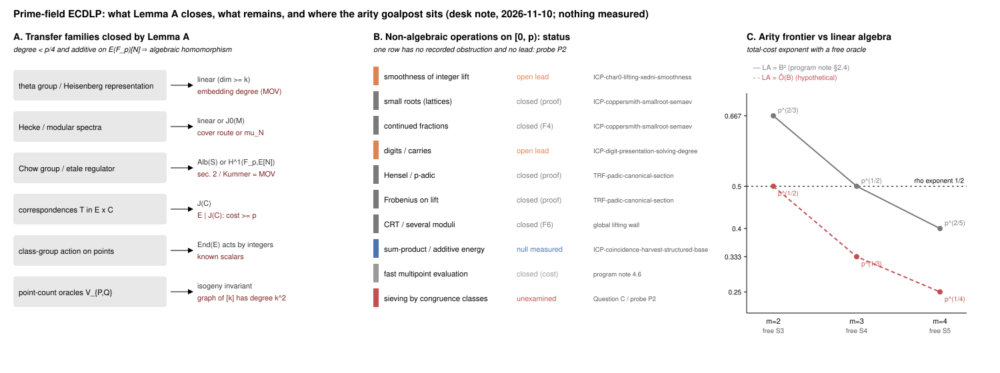

# Sub-exponential ECDLP over prime fields: new obstructions, the residual search space, three probes

**Date** 2026-11-10. **Study** `research/ecdlp_subexp_ideas_20261110/` (README with derivations and sources).
**Classification** desk note. No algorithm is claimed, nothing was measured, no disposition changes.
Labels: `[derived]` checkable from the text; `[literature]` recalled, not re-read; `[proposed]` idea or prediction; `[closed on paper]` reduces to a recorded obstruction. Quoted repository numbers: `[pcc:unverified]`. The `research-kb` server and CLI were unavailable in this session; the keyword census that replaced them is in README "Sources checked".

## 1. Lemma A: low-degree additive maps are algebraic homomorphisms `[derived]`

Let N = #E(F_p) be prime, G/F_p a connected commutative algebraic group, f : E → G a morphism of degree d with f(O) = 0 and f(X+Y) = f(X) + f(Y) for all X, Y ∈ E(F_p). If d < p/4 then f is a homomorphism of algebraic groups: h(X,Y) = f(X+Y) − f(X) − f(Y) is a morphism E × E → G of degree O(d) vanishing on all N² ≈ p² rational points, and a nonzero h vanishes on at most O(d·p) of them (Lang–Weil / Bézout + Hasse–Weil). By Chevalley, f factors through the abelian part A of G and E is an isogeny factor of A; any image in the linear part needs N | #L(F_p) = p^u ∏(p^{d_i} − ε_i), i.e. N = p or dim L ≥ k = ord_N(p), the embedding degree.

*Closed at once:* theta-group / Heisenberg representations (spectrum = Weil pairing), Hecke spectra, Chow-group and étale regulators, correspondences T ⊂ E × C (E | J(C), cost ≥ p), class-group action on points (principal ideals act as known integers because π = 1 on E(F_p)), point-count oracles (the graph of [k] has degree k²). *Limit:* degree ≥ p maps can be cheap (Frobenius); Conjecture A′ extends the lemma to straight-line complexity and is a Lean target (P1).

*Kummer = MOV.* Q ↦ [π(R) − R] ∈ E[N]/(π−1)E[N] ≅ Z/N with [N]R = Q is the discrete logarithm up to a unit; it is computable exactly when E[N] is rational over a small field, i.e. when k is small. Every cohomological reformulation inherits the pairing obstruction.

## 2. Elliptic surfaces `[closed on paper]`

For a pencil E_t with E_{t₀} = E, a curve C ∈ |D| with C·F = d through d prescribed fibre points exists iff Σ P_i = T_D (restriction of H⁰(S, D) to the fibre is the Riemann–Roch space of a degree-d bundle): the multisection relation Σ P_i = tr_C(t₀) *is* Semaev's condition. Two-fibre transfers through a nodal (G_m) or smooth-order fibre fail because the specialisation kernels Λ₀, Λ₁ ⊂ Z^r are unrelated. Ulmer's unbounded-rank families need generators of degree exponential in log p. The open question remains the section-through-a-point timing (`LEAD-EXO-global-lift-height`; frozen family α = 3 against the α < 1/2 a source needs).

## 3. The arity goalpost depends on the linear algebra `[derived]`

With a free oracle, cost(B) ≈ p/B^{m−1} + LA(B):

| m | oracle | LA = B² | LA = Õ(B) | reading |
|--:|:--|:--|:--|:--|
| 2 | free S₃ | p^{2/3} | p^{1/2} | never beats rho |
| 3 | free S₄ | p^{1/2} (tie) | **p^{1/3}** | beats rho only with structured LA |
| 4 | free S₅ | p^{2/5} | p^{1/4} | program note's first viable arity |

The target splits: (T1) an S₄ oracle at δ = 1/3 (lattice reach 1/24 asymptotic, 1/35.5 at feasible dimension) *plus* (T3) a relation matrix with a sub-quadratic solve, or (T2) an S₅ oracle at δ = 1/5. The program note's "first arity that could beat rho is m = 4" assumes B² linear algebra and should record that assumption.

*A: families Lemma A closes. B: the inventory of non-algebraic operations on [0, p) with the recorded status of each; one row (sieving by congruence classes) has neither an obstruction nor a lead. C: the arity frontier under the two linear-algebra costs. Drawn from `data/routes.json`; nothing measured.*

## 4. Residual search space and the one unexamined operation `[proposed]`

Lemma A and Shoup leave only non-algebraic integer operations on coordinates. The inventory (smoothness, lattices, continued fractions, digits, Hensel, Frobenius on lifts, CRT, sum–product, fast evaluation) is closed or an active lead in every row but one: *sieving by congruence classes*, the Eratosthenes step that makes NFS/FFS relation collection O(1) per candidate. Its elliptic form, Question C: a base F with |F| = p^δ, membership in poly(log p), *and* an indicator 1_F(Q + aG) with a Fourier coefficient ≫ √|F|/N at a frequency computable from the curve. Coordinate boxes satisfy the first (the character-sum lead measured nulls for the second); scalar bases {kG : k ≤ B} satisfy the second and not the first. Expected answer: no such base; P2 is the exact measurement.

## 5. Three falsifiable probes `[proposed]`

- **P1 (desk).** Lean statement of Lemma A: the vanishing count on E × E and the rigidity step. A proof closes §1's family with a theorem.
- **P2 (toy compute, minutes).** Full Fourier transform over Z/N of 1_{F_B}(Q + aG), B = N^{1/3}, N ≈ 2^20..2^28, ≥ 3 primes per size; statistic: max nonzero coefficient against 400 size-matched random bases; positive control: the scalar base (an interval). Closes as exhausted at scale if inside the null band at every size.
- **P3 (CPU-hours).** Relation matrices of existing toy m = 2 prime-field sessions: structured-elimination time and singular-value profile against an Erdős–Rényi null of equal row weight. Closes (T3) as a cost-model entry if nothing separates at 2^16, 2^20, 2^24.

Each runs under `controlled-experiment` if scheduled; none is run here. Expected outcomes: P1 proof, P2 null, P3 closure.

## 6. What a sub-exponential algorithm would have to contain

(1) a non-lattice small-root solver for one structured congruence (S₄ at δ = 1/3 or S₅ at δ = 1/5) that uses the roots-are-points structure no lattice uses; or (2) an affine-in-the-scalar structure on decomposability (Question C); or (3) a cheap non-algebraic additive map violating Conjecture A′; or (4) a structured relation matrix together with (1) at m = 3. This note found no candidate for any of them; its contribution is to make the closure of the transfer and surface families a theorem rather than a list, and to name the single unexamined operation.
