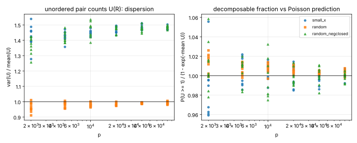
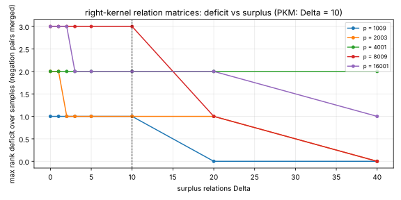
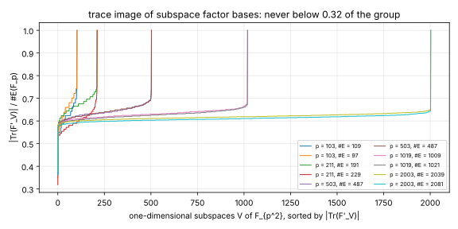
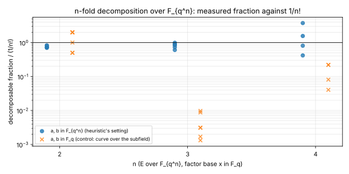

# Exact censuses against five ECDLP hardness assumptions

Date: 2026-11-04. Companion of the Lean study
[`research/ecdlp_weakness_lean_20261104/`](../ecdlp_weakness_lean_20261104/README.md)
and of [`docs/ecdlp-hardness-corpus/WEAKNESS_TRIAGE.md`](../../docs/ecdlp-hardness-corpus/WEAKNESS_TRIAGE.md).
Every census is a self-contained Rust crate with no dependencies, a deterministic
seed, in-code self-tests, and `results/*.json` + `results/*.csv` outputs; each
crate's `README.md` holds its full table and conventions. `plots.py` lays out the
recorded values as `figures/*.svg` (it computes nothing). All runs are exact
computations on small parameters, run locally in seconds to minutes; no timing is
measured, so no benchmark record applies. Every number below is an unverified
assertion under the repository's proof-carrying-claims rule: the censuses have no
signed validator report. [pcc:unverified]

| crate | assumption attacked (corpus node) | what is computed exactly |
|---|---|---|
| `pq2_rank` | `HEUR-GB-PQ-ASSUMPTION-2` (Petit–Quisquater Assumption 2, m = 2) | `d_lin`: least Macaulay degree whose row space reaches all `k` linear consequences; `sd ≥ d_lin` by `SubspaceCriterion.no_gb_in_rows_of_low_lt` (Lean). Also `|F'|/|V|` for `HEUR-BK-GG-FACTOR-BASE-SIZE`. |
| `pf_yield` | `HEUR-DECOMPOSITION-PROBABILITY` (prime field, m = 2) | representation counts for every target; zero class and dispersion vs Poisson; three factor-base shapes |
| `rank_deficit` | `HEUR-PF-PKM-RANK-DELTA`, `HEUR-RELATION-RANK` (right-kernel regime) | rank deficit of relation matrices vs surplus Δ |
| `trace_pullback` | `GAP-PF-TRACE-PULLBACK-FACTOR-BASE` | size of the trace image of every one-dimensional subspace factor base of E(F_{p²}) |
| `ext_decomp` | `HEUR-BK-GG-DECOMP-PROPORTION` (1/n!) | n-fold decomposable fraction over F_{qⁿ}, with a subfield-curve control |

## pq2_rank: a lower bound on the solving degree at m = 2

See [`pq2_rank/README.md`](pq2_rank/README.md) and `figures/pq2_dlin.svg`,
`figures/pq2_low_vs_k.svg`.

PQ2_SECTION_PLACEHOLDER

## pf_yield: the prime-field yield heuristic, with the convention fixed



Eighteen prime-order curves, p from 2003 to 80021, factor bases with μ = B²/r near
0.5, 1 and 2; every target enumerated. With ordered pairs the measured decomposable
fraction is 0.56–0.76 of 1 − exp(−μ) in all 54 rows. With unordered pairs U(R)
(mean μ/2), P(U ≥ 1) matches 1 − exp(−mean U) within about 1% on average for all
three base shapes (small-x, random, random closed under negation). The variance to
mean ratio of U is about 1.45 for both negation-closed bases and 0.97–0.99 for the
random base that is not closed under negation; the overdispersion tracks closure
under negation, not the small-x shape. [pcc:unverified]

Reading: the heuristic's zero class is right once the pairing convention is stated
(the corpus node already warns that conventions change constants); its Poisson
variance is wrong by a factor 1.45 for the bases index calculus actually uses,
because U(R) = U(−R) couples targets in pairs. The mean itself is a theorem
(`MeanCount.sum_card_reps`).

## rank_deficit: Δ = 10 surplus relations do not give full rank



Ten prime-order curves, p from 1009 to 16001, B ≈ √r small-x factor bases,
relations a·G = P₁ + P₂, five samples each. With negation pairs merged into B/2
unknowns, Δ = 10 gave full rank in all five samples on 2 of the 10 curves; the
maximal deficit at Δ = 10 was 1 to 3, and at Δ = 40 still up to 2 on three curves.
On the unmerged B columns the deficit is at least about B/4 at every Δ, as it must
be: a column and its negative carry one unknown. Free relations P₁ + P₂ = P₃ among
factor-base points span only 3 to 15 of the B/2 unknowns. [pcc:unverified]

Reading: in the right-kernel regime (one relation set reused for many targets) the
rank heuristic is load-bearing and the PKM surplus of 10 is not enough at these
sizes. For a single target the left-kernel method needs no rank condition at all
(`THM-LEFT-KERNEL-RELATIONS`).

## trace_pullback: no one-dimensional subspace has a small trace image



Ten prime-order curves, p from 103 to 2003 (p ≡ 3 mod 4), base-changed to
F_{p²} = F_p[i]. Over all p + 1 one-dimensional F_p-subspaces V, the trace image
T_V = Tr(F'_V) has min |T_V| / #E(F_p) between 0.32 and 0.39, attained at V = F_p·i
on every curve; the median is 0.60–0.67 and V = F_p gives all of E(F_p). Two-point
decomposition over T_V covers every target, as |T_V|² ≫ #E(F_p). [pcc:unverified]

Reading: the escape withdrawn in WEAKNESS_TRIAGE W7 (pull a subspace factor base
back to F_p by the trace) gives no small factor base at dimension 1 over F_{p²}: the
trace image is a constant fraction of the group, like the image of a random map
(1 − 1/e ≈ 0.63 for the median). Higher extension degrees and higher-dimensional V
are not covered.

## ext_decomp: the 1/n! proportion, and where its premise fails



For curves with coefficients in F_{qⁿ} and factor base x ∈ F_q (|F| ≈ q): the
decomposable fraction is 0.350–0.413 at n = 2 (q = 101, 211, 401) and 0.101–0.165
at n = 3 (q = 23, 41, 61), i.e. 0.70–0.99 of 1/n!; the n = 4 rows have factor bases
of 10–18 points and scatter widely. For the control curves defined over F_q the
factor base is E(F_q) (n odd) or lies in a small subgroup, and the fraction is
0.0003–0.002 at n = 3. [pcc:unverified]

Reading: the survey's 1/n! is of the right size for the setting it is stated for and
is off by a factor of up to 1.4 at these q; for a curve defined over the subfield
the premise does not hold at all, which is a hypothesis the corpus node should carry.

## Reproduce

```sh
cd research/ecdlp_weakness_census_20261104/<crate> && cargo run --release   # writes results/
python3 research/ecdlp_weakness_census_20261104/plots.py                    # figures/*.svg (layout only)
```
