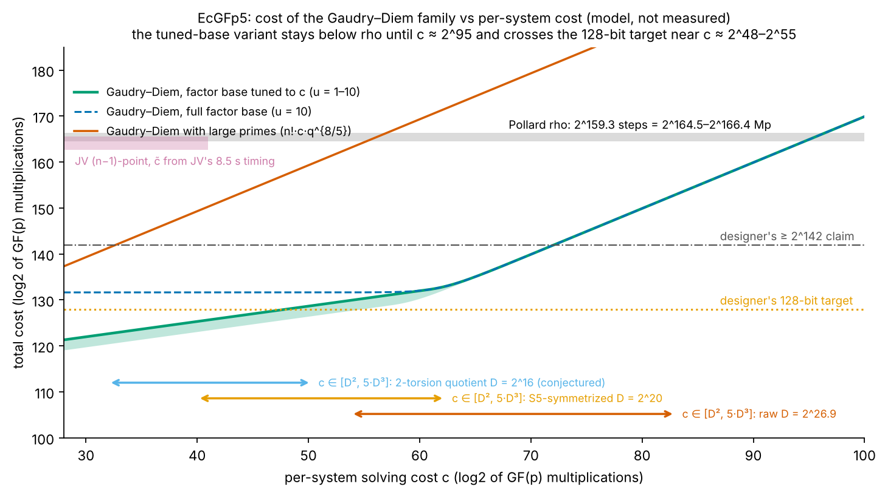

# EcGFp5 and EcMasFp5: desk evaluation of the four atlas leads

**Date.** 2026-10-31. **Question (owner).** "Evaluate the EcGFp5 leads": the four atlas rows
`LEAD-ICP-gfp5-symmetrized-gaudry`, `LEAD-ICP-gfp5-odd-char-cover`, `LEAD-ICP-gfp5-oa-sdhp-jv` and
`LEAD-ICP-gfp5-rho-reference-audit` (crypto-autoresearcher `knowledge/leads/ecdlp/ic-prime/`), under
goal `GOAL-GFPN-380702`.
**Status.** Desk evaluation. **Nothing here is measured, nothing is an improvement and nothing is a
security claim about a deployed curve.** Every cost below is a model built from cited constants. The
container's disk allowance was nearly spent, so nothing was built or run beyond small analysis scripts
and one standalone Rust check.

## 1. Answer in seven lines

1. **The design note's "≥ 2^142" is not a lower bound for the Gaudry–Diem family.** It multiplies the
   large-prime system count p^{2−2/5} = 2^102.4 by a per-system cost c, without the 5! = 120 inverse
   decomposition probability. Large primes are the *worst* rebalancing when each system is expensive.
2. **The cheapest member is the basic algorithm with a factor base tuned to c.** Two independent
   derivations (mine, and evaluator G1's) give a total that scales as **c^{1/3}**:
   about **2^{115.5 + log2(c)/3}** 64-bit word operations (G1). For the repository's own per-system
   bands (c between D² and 5·D³) that is **≈ 2^126–2^136** for D ≤ 2^20, i.e. at the designer's
   128-bit target, not 14 bits above it (§3).
3. **In raw time every plausible variant is 32–45 bits below rho** (rho ≈ 2^159.3 steps ≈ 2^169 word
   operations). It stays below rho until c ≈ 2^94–2^97, beyond any per-system band.
4. **Memory is the barrier, not time.** The tuned factor base has 2^57–2^63 columns; linear algebra
   and relation storage need about **2^64–2^71 bytes** against 2^35–2^45 for rho with distinguished
   points. Capped at a petabyte, the method is about 2^27 *above* rho (G1). So rho remains the better
   attack in any memory-aware cost model.
5. **Symmetrization matters less than the lead assumed.** Because the total scales as c^{1/3}, cutting
   the ideal degree from 2^20 to 2^16 buys only about 3–4 bits.
6. **The decisive unknown is still c(5, p)**, the cost of one complete five-variable solve, which the
   repository's C1 ladder never measured (it died at an 11 GiB cap; Joux–Vitse report the same memory
   wall). A frozen experiment with a 512 GiB envelope is specified in §5.
7. Verdicts: symmetrized Gaudry **REVISE**; Joux–Vitse (n−1) for the full discrete log **CLOSE**
   (within ±2.5 bits of rho at ≈ 2^71 bytes); odd-characteristic cover **CLOSE** (genus 65 and 97,
   ≥ 2^206); oracle-assisted SDH **REVISE** (2^63 queries, no exposed oracle found); rho reference
   stays closed.

## 2. What was already known (read, not re-derived)

* **Primary source.** Pornin, ePrint 2022/274, frozen in crypto-autoresearcher
  `inputs/PORNIN-2022-274-ECGFP5/paper_fulltext.md`, lines 113–152: "Gaudry's attack entails computing
  about p^{2−2/5} ≈ 2^{102.4} systems … D … close to 2^{k(k−1)} = 2^{20} … unlikely to go below
  O(D²) ≈ 2^{40} … a total theoretical complexity of at least 2^{142} … Joux and Vitse's variant has
  cost O(C p²) … again above the 128-bit level." The target is 128-bit security, not rho's ≈ 2^160.
* **Joux–Vitse**, ePrint 2010/157, frozen in `inputs/JOUX-VITSE-2010-157/paper_fulltext.md`: Gaudry–Diem
  relation search n!·c(n,q)·q/2 and linear algebra Õ(n q²) (lines 352–361); large primes give
  n!·c(n,q)·q^{2−2/n} (lines 362–367); the (n−1)-point variant costs (n−1)!·c̃(n,q)·q²/2 (lines 418–436);
  a 4-point decomposition over a 32-bit field takes 8.5 s on a 2.6 GHz Core 2 (lines 589–591); and
  "we have not been able to successfully run one complete relation search with [Gaudry–Diem's] method,
  as the requested memory exceeded the capacity of our personal computer" (lines 585–587).
* **The repository's C1 ladder** (`experiments/EXP-GFPN-05ff43/analysis.md`, decision DEC-20260923-d86ff2,
  inconclusive): no five-summand ideal degree was measured; both arms died at an 11 GiB address-space
  cap in the degree-33 F4 round at p′ = 4111. Its review (K7) found that the design note's degree-16,
  D ≈ 2^20 system is already the S5-symmetrized one (raw mixed volume 5!·16^5 ≈ 2^26.9), and re-anchored
  the bands to 2^134.4–2^162.6 (model only).
* **Open problem** `KN-OPEN-9b4a2b`: a genuine F_p-rational (Z/2)^4 ⋊ S5 quotient on the double-odd curve
  is conjectured to have D = 2^16; seen only in toy square analogues.

## 3. The cost landscape

My model is [cost_landscape.py](cost_landscape.py) (unit: one F_p multiplication, Mp; constants and
line references in its docstring; output [cost_landscape.md](cost_landscape.md)). Evaluator G1 derived
the same structure independently in 64-bit word operations ([cards/g1.md](cards/g1.md), scripts in
[cards/g1_scripts/](cards/g1_scripts/)). With a factor base of B abscissae out of the L = p/2 that carry
a point, a decomposition needs n!·(L/B)^n trials and about B relations are needed, so

  f(B) = c · 5! · L^5 / B^4  +  κ · B²,  optimum B* ∝ c^{1/6},  f(B*) ∝ c^{1/3} κ^{2/3}.

G1's table (κ ≈ 960 word operations per matrix entry, Wiedemann with normal equations; c in F_p
multiply-adds at 4 words each; rho = 2^169.0 words):

| log2 c (band) | design-note style p^{1.6}·c | full base | B* | tuned base | single large prime | memory, bytes |
|:--|--:|--:|--:|--:|--:|--:|
| 32 (D = 2^16, D²) | 2^136.4 | 2^135.9 | 2^57.8 | **2^126.2** | 2^124.8 | 2^65.9 |
| 40 (D = 2^20, D²) | 2^144.4 | 2^135.9 | 2^59.2 | **2^128.8** | 2^127.7 | 2^67.3 |
| 50 (D = 2^16, 5D³) | 2^154.4 | 2^135.9 | 2^60.8 | **2^132.2** | 2^131.4 | 2^69.0 |
| 62.3 (D = 2^20, 5D³) | 2^166.7 | 2^136.3 | 2^62.9 | **2^136.3** | 2^137.3 | 2^71.0 |
| 83 (D = 2^26.9, 5D³) | 2^187.4 | 2^154.9 | L | **2^154.8** | 2^158 | 2^71.1 |

My model, with a cheaper linear-algebra constant (20–200 word operations per entry, which assumes a
subquadratic Berlekamp–Massey), puts the same rows about 1.5–4 bits lower; the two agree on everything
that decides a verdict. The sensitivity is
T ∝ κ^{2/3} u^{1/3}: across the plausible unit range the 2^128 crossing moves between log2 c ≈ 34 and
≈ 55, and rho moves by about one bit. If the designer's "128-bit" means group operations
(≈ 2^137.6 words), the crossing moves to log2 c ≈ 65 (G1).

**F4 can dominate FGLM.** G1's dense Hilbert-function bound gives c_F4 ≈ 2^64.5 for the S5 system,
above its FGLM figure, and 2^51–2^54 for an assumed quotient shape. That puts the tuned total at about
2^132.5–2^133.6, above 128. The quotient's shape is assumed, not committed.

## 4. Verdicts

| lead | verdict | reason | next step |
|:--|:--|:--|:--|
| `LEAD-ICP-gfp5-symmetrized-gaudry` | **REVISE** | Its frame ("lower the design note's ≥ 2^142 floor") compares with the wrong member of the family; the right comparator is the tuned base, at or near 2^128. A D-drop from 2^20 to 2^16 is worth only 3–4 bits. | Measure c, not D, on the quotient (§5). |
| `LEAD-ICP-gfp5-oa-sdhp-jv`, (n−1) full-ECDLP half | **CLOSE** | (n−1)!·c̃·q²/2 = 2^131.6·c̃ with c̃ ≈ 2^33.5–2^34.4 cycles from two anchors lands within ±2.5 bits of rho, at ≈ 2^71 bytes; it loses to rho for any B ≤ 2^62.5. Obstruction: memory, not arithmetic. | none |
| `LEAD-ICP-gfp5-oa-sdhp-jv`, oracle-assisted SDH half | **REVISE** | About p/2 = 2^63 oracle queries and 2^68.3 bytes of stored answers, then about 24p = 2^68.6 four-point decomposition trials per target (JV §5; G2). A protocol-level condition, not an ECDLP weakness; no deployment found exposes a static-DH oracle (signatures only). | Record the classification; defer measuring the per-trial cost unless a persistent [d]X service appears. |
| `LEAD-ICP-gfp5-odd-char-cover` | **CLOSE** | Canonical (2,…,2) cover has F_2-rank m = 5 on both curves: genus 65 (EcGFp5) and 97 (EcMasFp5), non-hyperelliptic. The cheap genus-5 class needs full rational 2-torsion and 4 \| #E, impossible for orders 2n and n across both isogeny classes. Best constructed cover genus 33; index calculus there is ≥ 2^206 against rho 2^159.3. | Lift the source-freeze block by recording this computation; the Iijima–Momose–Chao text remains unread. |
| `LEAD-ICP-gfp5-rho-reference-audit` | stays **closed_known** | Reproduced: 2^159.33 steps with negation. Priced here at 37–130 Mp per step from Pornin's benchmark table (1,328.5-cycle addition, 10.18-cycle F_p multiplication), 2^164.5–2^166.4 Mp; G1 prices 800 words per step, 2^169.0 words. | Add the unit table to the lead's evidence. |

### 4.1 Covers and oracle-assisted SDH (evaluator G2)

Full card: [cards/g2.md](cards/g2.md); exact check: [cards/g2_rust/g2_ghs_check.rs](cards/g2_rust/g2_ghs_check.rs)
(standalone `rustc -O`, u128 arithmetic mod p) with its output beside it, 31 checks passing.

* **Field and curves checked first.** p = 2^64 − 2^32 + 1, p ≡ 1 mod 5, z^5 − 3 irreducible, the
  Frobenius acts as z^p = ω·z, b = 263z is a non-square, EcGFp5 has exactly one rational 2-torsion
  point, its 2-isogenous curve again has exactly one, EcMasFp5 has none, and neither j-invariant is in F_p.
* **Cover genus, computed.** For the x-coordinate Kummer cover descended from F_{p^5} to F_p, no product
  of the Frobenius conjugates of f is a square (all 31 subsets tested), so m = 5. Branch points: 12 for
  EcGFp5 (0, ∞ and ten conjugate roots), 16 for EcMasFp5, giving genus 2^{m−1}(t/2 − 2) + 1 = 65 and 97.
  I re-derived both genera by hand from the same formula. The toy cases reproduce the known weak class
  ((d, n) = (5, 4), genus 5). G2 also constructed covers of genus 33 by Möbius changes and derived a
  minimum of 25 for EcGFp5 (derived, not constructed, not source-verified).
* **Cost.** Index calculus on a genus-25 Jacobian is about 2^207, and about 2^180 under the most
  optimistic Enge–Gaudry estimate; genus 33 is about 2^247. All are far above rho.
* **Gorla–Massierer** (frozen text): their n = 5, genus-5 remark is about trace-zero varieties of
  curves defined over the subfield; neither curve is one, as the design note already said.
* **Oracle-assisted SDH.** Joux–Vitse's learning phase needs about p/2 = 2^63 queries (about 293 years at
  10^9 queries per second). Granger's slides give an asymptotic q^{5/6} ≈ 2^53.3 variant with unmeasured
  constants. Deployments found: Schnorr signatures (Lighter, POD2, goldilocks-crypto), a Miden ElGamal
  prototype, and an EcMasFp5 mention in a pil2-proofman PR; none exposes [d]X for attacker-chosen X.
* **Not read:** Iijima–Momose–Chao (ePrint 2015/805, 2013/487) and Diem's odd-characteristic GHS paper;
  ePrint returned 403 to both WebFetch and curl. The cover verdict rests on the computation and on
  secondary sources (Chao's ECC 2007 slides, Tian's arXiv summary).

## 5. The decisive experiment (specified, not run, not authorized here)

From G1, with my additions. It measures the one quantity every verdict above depends on.

* **What.** One complete m = 5 solve (F4 plus parametrisation) of the F_p-rational (Z/2)^4 ⋊ S5 quotient
  of `KN-OPEN-9b4a2b`, at three toy primes spanning at least 12 bits, after validating the quotient
  construction at n = m = 3 (predicted D = 16 against 64). Report D and c in F_p operations, with RSS.
* **Frozen criteria (G1).** PROMOTE if D ≤ 2^17 and c ≤ 2^40; CLOSE if c ≥ 2^44 or D ≥ 2^19;
  otherwise record not_measured with the RSS at death. Expected outcome: CLOSE, tuned total ≈ 2^132–2^134.
* **Envelope.** 512 GiB RAM, 32 threads, at most 72 h per cell, no address-space limit below 480 GiB.
  Do not attempt the S5 system at m = 5: G1's dense bound reaches 9.3 TiB at degree 76.
* **Repository rules that apply before any run.** Frozen protocol and task card (experiment-director,
  then executor-mechanical); a resume checkpoint (`scripts/checkpoint.sh init`); x86 runs go through
  `isolab-eks` on EKS Spot; any claim needs the validation gate. None of this was started.

## 6. Corrections found

| where | correction |
|:--|:--|
| Pornin §2 (the "≥ 2^142") | omits the 5! factor that Joux–Vitse carry (JV line 365); and the large-prime count is not the cheapest rebalancing when systems are expensive, so the figure is not a floor |
| atlas `LEAD-ICP-gfp5-symmetrized-gaudry` `discriminates` | "still far above rho's ~2^160 only if the band collapses" inverts the picture: in raw time every band is far *below* rho; the live comparison is with the 128-bit target, and memory |
| atlas `LEAD-ICP-gfp5-oa-sdhp-jv` | "the (n−1)-point variant … is expected to cost more than rho": it is within ±2.5 bits of rho in raw time (G1); it closes by memory |
| `research/gfp5_deployed_curves_20260920.md` cost bands | already re-anchored by the C1 review (K7); both those bands and the design note's use the large-prime count |
| crypto-autoresearcher `inputs/PORNIN-2022-274-ECGFP5/source_record.yaml` line 25 | says the modulus is z^5 − 2; the paper chooses z^5 − 3 (z^5 ± 2 is reducible because 2 is a fifth-power residue mod p, checked) |
| my previous chat answer | quoted the atlas's "unmeasured 2^121" symmetrized prediction as a live figure; the C1 review (K7) had already shown that band mis-anchored by 5! and re-anchored it to ≥ 2^134.4 (model). The tuned-base figures above supersede both |

## 7. What I verified and what I did not

**Verified by me:** the quotations from Pornin and Joux–Vitse (line numbers above); the benchmark
constants (Pornin's table: F_p multiplication 10.18 cycles, point addition 1,328.50 cycles); my own cost
model and the c^{1/3} scaling; agreement of my model with G1's structure; the repository records cited
in §2.

**Also verified by me:** G2's Rust check passes all 31 checks; the two canonical cover genera (65, 97)
recomputed by hand; the modulus z^5 − 3 against the paper text.

**Relayed from evaluators:** G1's word-operation constants, memory figures, F4 RAM extrapolation and
crossing points; G2's constructed genus-33 covers, the genus-25 minimum, the Jacobian index-calculus
costs, the oracle-assisted SDH figures and the deployment search.

**Not verified:** Gaudry 2009 full text (paywalled), the exponents of single and double large primes
beyond Joux–Vitse's quotation, any 64-bit F4 timing (none exists; the 32-bit c̃ is carried over), the
repository's §5a GAE band (absent from the frozen checkout), and anything about deployed protocol use
beyond G2's search.

## 8. Files

`README.md`, `report.pdf`, `figures/cost_landscape.{png,svg}`, `cost_landscape.{py,json,md}`,
`plot_cost_landscape.py`, `cards/` (shared brief, the two evaluator cards, G1's scripts, G2's Rust
check), `build.sh`.
