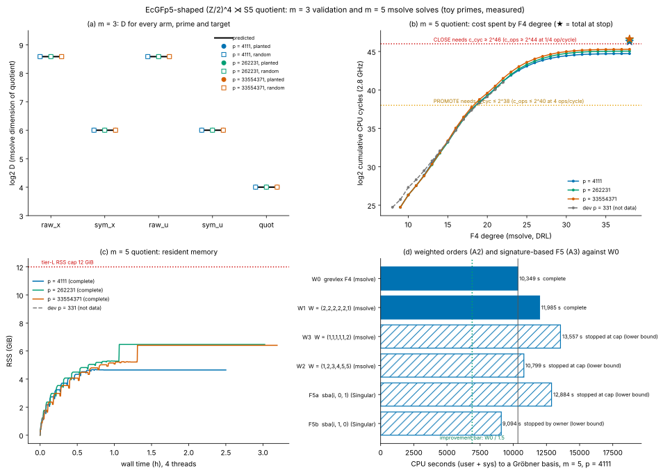

# EcGFp5 (Z/2)^4 ⋊ S5 quotient: one complete m = 5 solve, D and c

**Date.** 2026-11-01. **Question.** This is the decisive experiment of the EcGFp5 lead
evaluation (`research/ecgfp5_lead_evaluation_20261031/README.md` §5), as an answer to
crypto-autoresearcher open problem `KN-OPEN-9b4a2b`. It asks two things about the
F_p-rational (Z/2)^4 ⋊ S5 quotient of the five-summand point-decomposition system on
EcGFp5-shaped curves:

- what the ideal degree D is;
- what one complete solve costs, c, in F_p operations.

Evaluator G1's criteria were frozen before any run. **Protocol:**
[`PROTOCOL.md`](PROTOCOL.md), pre-registered in commit `7144c8a6`, with amendments A1–A5
(§10–§14).

**Status.** Measured at toy primes on one 4-vCPU host (tier L), with msolve 0.6.5 and
Singular 4.3.2. **This is not a measurement of EcGFp5 itself (64-bit p). It makes no
security claim about a deployed curve, and it does not improve the index-calculus
baseline.** It is a CLOSE verdict on one lead for one solver, and a null result for two
solver variants.

Every number below is labelled *measured* (from a committed run record), *derived* (a
calculation shown here) or *predicted* (stated in the protocol before the runs).

## 1. Answer

1. **D = 2^16 = 65,536 at all three primes** (*measured*, msolve "Dimension of
   quotient" and the degree of the parametrisation). This is exactly the affine Bézout
   bound 8^5 · 2 (*derived*, PROTOCOL.md §2). The quotient has no solutions at infinity
   and gives no D reduction below Bézout.
2. **The planted decomposition was recovered at every prime** (*measured*, `qsolve
   check`), so each cell is a complete, verified solve.
3. **One complete solve costs c_cyc = 2^46.30, 2^46.56 and 2^46.63 cycles** at p =
   4111, 262231 and 33554371 (*measured* CPU-s × 2.8 GHz). That puts c_ops in [2^44.3,
   2^48.6] across the unit band (*derived*, §5 of the protocol). **G1 verdict: CLOSE at all
   three primes**, since c_cyc ≥ 2^46. The margins over the CLOSE line are thin: 0.30,
   0.56 and 0.63 bits.
4. **The F4 work is p-independent.** Every cell ends on the same final basis matrix
   (5578 × 71114) and the same degree sequence (*measured*). CPU rises only 0.33 bits
   from 12-bit to 25-bit p. That points to slower field arithmetic, not more operations
   (*derived*).
5. **About two-thirds of c is msolve's rational parametrisation, not F4** (*measured*,
   §3). On F4 alone (c_cyc 2^44.7–2^45.3) every cell would be not_measured. The
   protocol fixed c as the whole solve before any run, so CLOSE stands, and the split is
   shown plainly here.
6. **Two solver variants were tried to lower c. Neither did** (*measured*, §4):
   - Weighted orders (amendment A2; FSV 2016) on msolve F4: none of W1, W3 or W2 reached the bar. W1 completed 1.16× slower than W0, with D = 2^21 (= 2^16·Πw_i, as predicted). W3 and W2 hit the 3,903 s wall cap.
   - Signature-based Gröbner bases (amendment A3; Singular `sba`): F5a hit its 12,996 s
     cap without returning, and F5b was stopped by the owner past the improvement bar.
7. **Two predictions were wrong** (*predicted* vs *measured*):
   - c_F4 came in 2^6–2^9 below the dense-proxy prediction of 2^51–2^54.
   - None of the tier-L cells stopped on the 12 GiB or 4 h caps.

## 2. m = 3 validation (both controls)

At every protocol prime and both targets, all five arms gave the predicted D: raw_x 384,
sym_x 64, raw_u 384, sym_u 64, quot 16 (*measured*, 30 solves, `analysis.md`).

- **Positive control:** the planted point was recovered on raw_u, sym_u and quot.
- **Identity control:** it passed at all three primes. Every rational raw solution maps to
  a free orbit of size 24 on the quotient.

At 65551 msolve 0.6.5 exits with SIGSEGV for every prime from 65537 to 253229, a solver
defect isolated on a two-variable toy system. That prime was replaced by 262231 before
any m = 5 run (amendment A1).

## 3. m = 5 baseline cells (msolve 0.6.5, grevlex F4 plus rational parametrisation)

| p | log2 p | D | planted recovered | F4 CPU-s | log2 c_cyc F4 | parametrisation CPU-s | whole-solve CPU-s | **log2 c_cyc** | log2 c_ops band | wall s | max RSS GiB | G1 |
|--:|--:|--:|---|--:|--:|--:|--:|--:|---|--:|--:|---|
| 4111 | 12.0 | 65,536 | yes | 10,349 | 44.72 | 20,655 | 31,004 | **46.30** | [44.30, 48.30] | 9,009 | 4.68 | CLOSE |
| 262231 | 18.0 | 65,536 | yes | 12,981 | 45.05 | 24,055 | 37,036 | **46.56** | [44.56, 48.56] | 10,888 | 6.47 | CLOSE |
| 33554371 | 25.0 | 65,536 | yes | 15,325 | 45.29 | 23,454 | 38,779 | **46.63** | [44.63, 48.63] | 11,493 | 6.41 | CLOSE |

**Sources and units:**
- *Measured* values come from `results/m5_p
_planted/quot.log` (msolve's `-v 2`
  timings) and `quot.run.json` (getrusage).
- CPU is user + sys over 4 threads.
- c_cyc = CPU-s × 2.8 GHz (*derived*). The band [c_cyc/4, 4·c_cyc] is the protocol's
  unit band (§5). G1's thresholds are PROMOTE at c_cyc ≤ 2^38 and CLOSE at c_cyc ≥ 2^46.

**What the curves show:**
- Figure (b) plots cumulative F4 cycles against degree. The curves for the three primes
  are parallel: the same rounds, with a per-operation cost that grows with p.
- F4 climbs to degree 38 with no degree fall. The Macaulay bound for a regular sequence of
  degrees (8,8,8,8,8,2) is 37 (*derived*).
- Figure (c) shows RSS. The parametrisation step holds 6.4–6.5 GiB at the two larger
  primes, against 4.7 GiB at 4111.

**Gap to rho** (*derived*, the lead evaluation's tuned-base model, not measured):
- G1's cost law is total ≈ 2^{115.5 + log2(c_ops)/3} 64-bit word operations.
- Over the measured band c_ops ∈ [2^44.3, 2^48.6] (c_ops is the c in that law), it gives
  2^130.3–2^131.7. That is 37–39 bits below rho's 2^169.0 word operations in raw time.
- The lead evaluation's memory barrier is unchanged: 2^64–2^71 bytes for the linear
  algebra, about 2^27 above rho at a petabyte cap.
- This is the distance remaining under that model, not a measured end-to-end comparison.
  Rho was not run here, and no matched rho reference exists for this per-system quantity.

## 4. Probe arms: can a different solver lower c?

All arms ran on the 4111 cell's own system (the sha256 of each arm's input is
recorded). Each is compared with W0, that cell's grevlex F4: 10,349 CPU-s and 3,075 s
elapsed. The frozen criterion (PROTOCOL.md §11, §12) needs a complete basis with CPU at
most W0/1.5 = 6,900 s. A stop at the wall cap means the arm spent more than 1.25 × W0:
that is recorded as no improvement.

| arm | ordering / call | stop | CPU s | W0/arm | max RSS GiB | D or vdim | highest degree | degree falls | verdict |
|---|---|---|--:|--:|--:|--:|--:|--:|---|
| W1 | W = (2,2,2,2,2,1) | complete | 11985.2 | 0.864 | 4.68 | 2097152 | 40 | 0 | no improvement |
| W3 | W = (1,1,1,1,1,2) | wall_cap | 13556.7 | 0.763 | 9.06 | None | 28 | 0 | no improvement (cap: > 1.25 x W0) |
| W2 | W = (1,2,3,4,5,5) | wall_cap | 10798.6 | 0.958 | 9.84 | None | 55 | 80 | no improvement (cap: > 1.25 x W0) |
| F5a | Singular sba(i, 0, 1) | wall_cap | 12883.6 | 0.803 | 6.07 | None | – | – | no improvement (cap: > 1.25 x W0) |
| F5b | Singular sba(i, 1, 0) | owner_stop | 9094.2 | 1.138 | 8.93 | None | – | – | no improvement (stopped by owner past the 1/1.5 bar) |

**Weighted orders (A2).**
- Source: Faugère–Safey El Din–Verron (arXiv 1412.7547) report ×9.3 for F4 on the
  2-torsion ⋊ S5-symmetrised Edwards system with W = (2,2,2,2,1). There, the standard
  grading had non-regular top components and many degree falls.
- Our quotient has **no degree fall** under standard grevlex (§3). That removes the
  mechanism the weighted gain relies on, and the protocol predicted no gain.
- Measured: W1 (2,2,2,2,2,1) completed, with D = 2,097,152 = 2^16·32. That is the predicted scaling by Πw_i, so the weighted substitution is correct. F4 used 11,985 CPU-s (0.864× W0), with no degree fall and peak degree 40. W3 (1,1,1,1,1,2) hit the wall cap after 13,497 user CPU-s at 9.06 GiB, with no degree fall. W2 (1,2,3,4,5,5) hit the wall cap after 10,645 user CPU-s at 9.84 GiB. It is the only arm with degree falls (80 by the cap, peak weighted degree 55): this grading makes the system less regular, not more. The outcome matches the protocol's prediction. On a system that is already regular under grevlex, weighting only inflates D and the matrices.

**Signature-based F5 (A3).**
- Singular 4.3.2's `sba` is a signature-based Buchberger, not a signature-based F4.
- F5a (`sba(i,0,1)`) used 12,840 user CPU-s and reached 6.07 GiB before the cap. It
  returned no basis.
- F5b (`sba(i,1,0)`) was stopped on the owner's instruction (amendment A5) after 9,032
  CPU-s and 9.37 GB, already past the improvement bar.
- Both outcomes match the protocol's prediction. A positive result would need a
  matrix-F5 or GVW-style F4 (for example FGb), which this host lacks.
- An earlier F5a attempt was killed by a container restart at 7,179 CPU-s (amendment
  A4). It is kept under `results/_lost_restart_20261101T0753Z/` and is not counted.

## 5. Figure

Figure: EcGFp5-shaped quotient solves. Run records are under `results/` (queue
`results/queue.log`, started 2026-11-01T07:57Z; 4111 cell 01:28Z). The panels:

- **(a)** m = 3 D for every arm, prime and target against the prediction (30 solves; the
  random-target markers hide the coincident planted ones).
- **(b)** m = 5 cumulative CPU cycles by F4 degree. ★ marks the whole-solve total. The
  dashed curve is the p = 331 development run, which is not data.
- **(c)** m = 5 resident memory against wall time.
- **(d)** Probe arms at p = 4111 against W0 (one run each; hatched bars are lower bounds
  from incomplete runs).

Source: [`plot.py`](plot.py) from [`analysis.json`](analysis.json), which is written by
[`analyze.py`](analyze.py) from the run records.

## 6. Host, isolation, runs

**Host.** Tier L only. This session's container: 4 vCPU Intel Xeon @ 2.80 GHz (AVX2,
AVX-512F), 15.7 GiB (*recorded*, `results/host-20261101T012844Z.json`).
- No core pinning and no A/A control. CPU-seconds are getrusage totals.
- Wall times are context only. No wall-time comparison is claimed except the frozen
  F4-CPU criterion of §4.

**Tiers E and X (EKS) were not reachable.**
- The `crypto-eks-highmem` run 41245660145 has been queued without a runner since
  2026-10-31T21:53Z.
- The isolab request route is limited to ecbench.
- The session's AWS identity is denied the EKS and CodeBuild listings.
- On the owner's decision ("Wait for EKS"), the 262231 and 33554371 cells ran locally,
  and no tier-E rerun was made.

**Runs.**

| run | arms | requested | completed | failures |
|---|---|---|---|---|
| m = 3 | 5 arms × 3 primes × 2 targets | 30 | 30 | the 65551 cells (SIGSEGV, A1) |
| m = 5 | 3 baseline cells | 3 | 3 | none |
| weighted | W1, W3, W2 | 3 | 1 | W3, W2 wall cap |
| sba | F5a, F5b | 2 | 0 | F5a cap, F5b owner stop |

**Execution.** Every run was launched from a frozen run card
([`cards/`](cards/), v1–v5), written by the experiment director and executed verbatim by
the mechanical-tier executor.

**Raw records not in Git.** Five files over the policy limit are in the artifact store
(`s3://setec-astronomy-artifacts/store`), not in Git:
- the three msolve parametrisation outputs `results/m5_p*_planted/quot.out` (2.3–3.8 MB);
- the two Singular logs `results/m5_p4111_sba/F5{a,b}/sing.log`.

Each is named, with its sha256 and size, by the `.artifacts.json` beside it, and was
verified remotely after upload. Hydrate them with `python3 tools/artifacts/artifacts.py
pull research/ecgfp5_quotient_solve_20261101`.

## 7. What this does not say

- **Not EcGFp5 itself.** Nothing here measures EcGFp5, a 64-bit F4, or a solver other than
  msolve 0.6.5 and Singular 4.3.2's `sba`.
- **c is not a lower bound for every solver.** CLOSE is G1's verdict for this solver
  stack on this system. A different strategy (FGb's F5, a GVW-style F4, a tuned
  parametrisation, the FGHR symmetric-variable techniques beyond this quotient) could
  lower c.
- **The CLOSE margin is under one bit.** If the parametrisation is excluded, the cells
  are not_measured.
- **Resolution item 3 of `KN-OPEN-9b4a2b` is not met.** That item compares D with the S5
  arm on the same m = 5 targets, and no such arm ran.
- **No security level follows.** No security level for EcGFp5 follows from this
  experiment. Any statement that it falls below 128 or 142 bits routes to
  review-breakthrough.

## 8. Next

- **Lower the parametrisation share.** Two-thirds of c is the parametrisation step. A
  cheaper finish for this shape-position system (FGLM or sparse-FGLM on the 65,536-dim
  quotient; msolve `-P 0` with an eliminant only) would bring c_cyc to about 2^45, the
  not_measured zone. That is the next measurement that could move the verdict.
- **Tier-X cell at a 64-bit prime.** Once an EKS runner exists, run one cell at a 64-bit
  prime to confirm that the operation count transfers.

## Files

- `PROTOCOL.md`: the frozen protocol and amendments A1–A5.
- Experiment code and scripts:
  - `src/qsolve.rs`: generator, checker, orbit control, runner and weighting.
  - `build.sh`, `run_cells.sh`, `run_probes.sh`, `run_weighted.sh`, `run_queue.sh`,
    `ms2sing.sh`.
- `cards/`: the run cards.
- `results/`: the run records.
- `dev/`: development runs, labelled as not data.
- `analyze.py`, `plot.py`: tabulation and layout of recorded values only.
- `analysis.md`, `analysis.json`, `figures/`.
- `build_report.sh` builds `report.pdf`.
