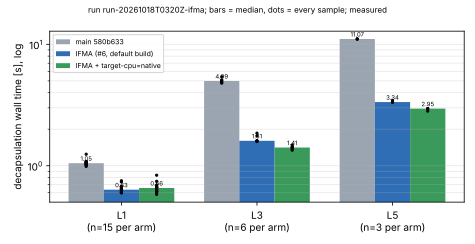
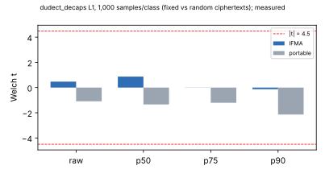

# Eigen-Séta: AVX-512 IFMA field multiplication: results report

This study backs aburan28/eigenx#6. F_p multiplication took about 84% of
decapsulation time on main 580b633 (perf). The PR adds a radix-2^52
Montgomery multiplier using AVX-512 IFMA, chosen at run time.

- **Isolation.** The multiplier lives in its own `eigen-fp-ifma` crate. That
  crate holds the only `unsafe` code in eigenx; `eigen_seta` keeps
  `#![forbid(unsafe_code)]` (the owner's choice).
- **Correctness.** Results are byte-identical to the portable multiplier on
  all five parameter sets.
- **Security.** No parameter, formula or output changes, so the security
  estimate is unchanged by construction.

PDF: [`report.pdf`](report.pdf). Run report:
[`reports/run-20261018T0320Z-ifma/`](reports/run-20261018T0320Z-ifma/README.md).

## Decapsulation wall time (measured)

- **Run:** `run-20261018T0320Z-ifma`, card `CARD-eigen_seta_ifma-20261018-1`,
  compiled by experiment-director and run by executor-mechanical. The
  preregistration is `DISPATCH-1.txt`.
- **Host:** shared 4-vCPU Xeon @ 2.10 GHz with AVX-512 IFMA and VBMI (KVM).
  One job. Arms ran sequentially, interleaved per set.

| set | main 580b633 | IFMA, default build | IFMA + `-C target-cpu=native` |
|---|---|---|---|
| L1 (n = 15 per arm) | 1.050 s | **0.635 s (1.65×)** [0.598–0.752] | 0.656 s (1.60×) |
| L3 (n = 6) | 4.989 s | **1.605 s (3.11×)** [1.582–1.855] | 1.413 s (3.53×) |
| L5 (n = 3) | 11.07 s | **3.345 s (3.31×)** [3.325–3.455] | 2.954 s (3.75×) |

Medians, with the decaps range in brackets. Ratios are main ÷ arm (derived).

**Encapsulation** medians, main → IFMA:

| set | main | IFMA |
|---|---|---|
| L1 | 0.165 s | 0.109 s |
| L3 | 1.024 s | 0.310 s |
| L5 | 2.498 s | 0.880 s |

Keygen is inconclusive at 1–3 keys per set (attempt count dominates).

Against the white-paper baseline (eigenx d89d790, decaps L1 1.20 / L3 5.83 /
L5 12.8 s, a different run on the same host), L1 is now 1.9× faster and L5
3.8× faster (derived).

L1 gains least. Its portable multiplier already had a hand-unrolled 21-limb
kernel, while L3 and L5 used the generic product scan.

## F_p multiplication (measured, single run)

`examples/bench_fp_ifma`: a dependent chain, so it measures latency.

| set | portable | IFMA |
|---|---|---|
| L1 | 487 ns | 384 ns |
| L3 | 1649 ns | 548 ns |
| L5 | 2781 ns | 716 ns |
| Q3 | 5587 ns | 1123 ns |
| Q5 | 9929 ns | 1736 ns |

## Constant time (measured; eigenx SIDE_CHANNELS.md §5.1)

**dudect on decapsulation.** L1, 1,000 samples per class, fixed vs fresh
ciphertexts (half of them FO-rejected), one key. Records:
`records/dudect-20261018T0300Z/`.

| path | t(raw) | t(≤p50) | t(≤p75) | t(≤p90) | median secret phase |
|---|---|---|---|---|---|
| IFMA | +0.47 | +0.87 | −0.01 | −0.13 | 580 ms |
| portable | −1.09 | −1.34 | −1.21 | −2.14 | 952 ms |

**Compiled-code audit.** Every conditional branch of the IFMA kernels
compares a loop counter or a slice length, never operand data.

**Not used as evidence.** A field-level fixed-vs-random dudect flags both
paths, including the portable one, which is proven constant-time by
instruction counts. On this VM it does not discriminate. IFMA's |t| there was
about 1.5–2× the portable one, and that is recorded.

**Not possible here.** Valgrind 3.22 cannot run AVX-512, so callgrind
instruction counts do not cover this path.

## Distance to practicality

L1 decapsulation is 0.635 s on this host (main at d89d790: 1.20 s). A
practical PKE needs tens of milliseconds. Remaining levers that change
nothing about security:

- the work around the theta chain: exact counts (aburan28/eigenx#7) show the
  theta step itself at formula cost (188.9 F_p² multiplications), with
  `sign_pattern` (16.5%), re-encryption (9.8%), splitting and elliptic
  doublings (15%) around it;
- F_p add/sub, about 16% after this PR;
- the public canonical 3^F3 basis of E_C, about 9%;
- multi-core chain evaluation.

## Files

- `records/run-20261018T0320Z-ifma/`: TSVs, host, hashes, exit statuses.
- `records/dudect-20261018T0300Z/`: the dudect output.
- `figures/plot.py`, `CARD-1.md`, `DISPATCH-1.txt`.
