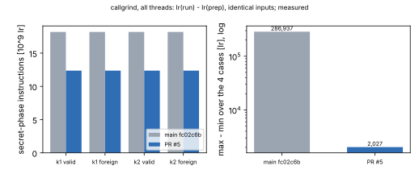

# Eigen-Séta speed-ups without a security change: results report

This study backs aburan28/eigenx#5, merged as `580b633`. That PR made speed
items 1–4 (decapsulation) and 6 (key generation); item 5 was not taken. The
owner's bar was "minor security reduction at most". Every merged change is
output-identical or distribution-identical, and constant time was
re-measured. Item 7 (half-length chains on a smaller prime) was studied and
not taken; see [`ITEM7_HALF_CHAINS.md`](ITEM7_HALF_CHAINS.md).

PDF: [`report.pdf`](report.pdf). Run report:
[`reports/run-20261017T2350Z-speedups/`](reports/run-20261017T2350Z-speedups/README.md).

## Decapsulation wall time (measured)

Run `run-20261017T2350Z-speedups`, card `CARD-eigen_seta_speedups-20261017-4`
(experiment-director compiled it, executor-mechanical ran it). Host: shared
4-vCPU Xeon @ 2.10 GHz (KVM), one job. The arms ran sequentially, interleaved
per set.

| set | main fc02c6b | PR #5 | PR #5 + `-C target-cpu=native` |
|---|---|---|---|
| L1 (n = 15 per arm) | 1.231 s | 1.070 s (1.15×) | 0.953 s (1.29×) |
| L3 (n = 6) | 5.925 s | 5.024 s (1.18×) | 3.459 s (1.71×) |
| L5 (n = 3) | 13.01 s | 11.58 s (1.12×) | 7.567 s (1.72×) |

- Medians; ratios are main ÷ arm (derived). Ranges and every sample are in
  the figure and the TSVs.
- The `native` arm builds the same source for this CPU (BMI2/ADX). It gains
  most at L3 and L5, whose 32- and 42-limb products use the generic path.
- Encapsulation medians, L1 / L3 / L5:
  - main: 0.212 / 0.898 / 2.160 s
  - PR #5: 0.193 / 0.922 / 2.551 s
  - native: 0.166 / 0.659 / 1.334 s

The 32% cut in decapsulation instructions (next section) shows up as a
12–18% cut in wall time. The work removed, four sign-pattern threads, ran in
parallel on the 4 cores, so total CPU fell more than elapsed time.

**Key generation is inconclusive.** The run has 3, 2 and 1 keys per set
(L1, L3, L5), and the random number of attempts per key dominates:

- L1 median: main 5.07 s, PR #5 7.23 s; the ranges overlap (3.8–13.3 vs
  5.3–16.1 s).
- L3: 79.0 vs 85.9 s. L5: 50.8 vs 71.6 s, one key each.

The per-attempt cost of the changed step was measured directly on the same
host (L1, 20 draws each, scratch build, not a committed record):

| basis | fresh draw | rerandomized |
|---|---|---|
| E_D 2^1078 | 226 ms | 121 ms |
| E_D 3^162 | 147 ms | 30 ms |

A keygen speed claim needs a run with many keys, which has not been done.

## Constant time and equivalence (measured)

Records: [`records/ct-20261018T0005Z-callgrind/`](records/ct-20261018T0005Z-callgrind/README.md).

Two L1 keys, each with a valid and a foreign (FO-rejected) ciphertext, were
written once by the main build; both builds read the same files. Under
callgrind, `secret` = total Ir of decapsulation − total Ir of the
prepare-only run, which counts every thread.

| build | secret-phase Ir | max − min over the 4 cases |
|---|---|---|
| main fc02c6b | 18.18·10⁹ | 286,937 |
| PR #5 | 12.36·10⁹ (−32.0%) | 2,027 |

- **Equivalence.** All four shared secrets are byte-identical across the two
  builds, including both implicit-rejection keys.
- **Cost model.** The eigenx `security_estimate` output is byte-identical
  between the builds.
- **The old probe was incomplete.** The repo's `ct_probe` used
  `--toggle-collect`, which counts only the thread that enters
  `probe_core`. A per-thread split does not work either, because valgrind
  reuses thread ids. The `run − prep` method above replaces both.

## Not taken

- **Hand-written 21-limb asm (item 5).** It needs `unsafe`, which the eigenx
  crate forbids, and it measured no faster than the portable code built with
  `target-cpu=native`, about 465 ns vs about 550 ns per F_p mul under load.
- **Half-length chains (item 7).** The design study (8 agents on Sonnet 5.5,
  adversarially verified) found feasibility unproven, a speed-up between 1×
  and 2.6×, and an unanalysed loss of torsion margin: from about 540 to about
  6 bits over log2(d·f).

## Distance to practicality

L1 decapsulation is now 0.95–1.07 s depending on the build. A practical PKE
needs tens of milliseconds at most. Next levers, none of which changes
security:

1. **The theta chain step.** (Later measured exactly, aburan28/eigenx#7: the
   theta step is already at formula cost, 188.9 F_p² multiplications; the
   618–670 below was wall time including setup and additions.) The attacker-side step measured 618–670 F_p²
   multiplications, against about 256 in the cost model.
2. **Shipping native builds.** Measured here at 1.29–1.72× over the default
   build.
3. **An AVX-512 IFMA field multiplier** in safe Rust with static target
   features.
4. **Karatsuba and lazy reduction** in the field multiply.

## Files

- `records/run-20261017T2350Z-speedups/`: TSVs, host, binary hashes, exit
  statuses.
- `records/ct-20261018T0005Z-callgrind/`: the constant-time records.
- `CARD-4.md` (relayed). `CARD.md`, `CARD-2.md` and `CARD-3.md` were
  superseded and never relayed. `DISPATCH-1.txt` holds the preregistration.
- `figures/plot.py` draws the figures from the records.
- `item7_workflow.json`: the raw output of the item 7 workflow.
