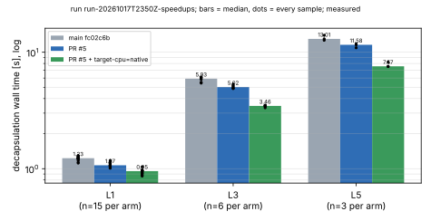

# Run report: run-20261017T2350Z-speedups

- **Command card.** `CARD-eigen_seta_speedups-20261017-4`
  (sha256 4d24…c3cb), compiled by experiment-director and run by
  executor-mechanical. The preregistration is `DISPATCH-1.txt`.
- **Commits.** eigenx `main` fc02c6b (arm `base`). eigenx 1e8b361 has the
  same library as 1eeb2d3 plus an example, for arms `new` and `native`
  (`native` adds `RUSTFLAGS='-C target-cpu=native'`). The binary sha256s
  matched the card.
- **Host.** Intel Xeon @ 2.10 GHz, 4 vCPU KVM, shared VM, rustc 1.97.0.
  - Load average at start: 3.00 / 5.00 / 5.82. A callgrind study had ended
    minutes before, and read-only LLM agents were running.
  - Load average at end: 1.32 / 1.46 / 2.73.
  - Runs were not pinned. Isolation level: L0.
- **Command.** `bench_kem <SET> <keys> <trials> 1` for L1 (3 keys × 5
  trials), L3 (2 × 3) and L5 (1 × 3). The arms ran base, new, native within
  each set, all sequential.
- **Runs.** 9 requested, 9 completed. Every exit status was 0 and every
  encaps/decaps pair agreed (`ok=true`).

## Measured: decapsulation wall time, median [min–max]

| set | base | new | native |
|---|---|---|---|
| L1 (n=15) | 1.231 [1.117–1.296] s | 1.070 [1.010–1.176] s | 0.953 [0.865–1.036] s |
| L3 (n=6) | 5.925 [5.428–6.137] s | 5.024 [4.879–5.330] s | 3.459 [3.334–3.504] s |
| L5 (n=3) | 13.01 [12.66–13.98] s | 11.58 [10.91–11.80] s | 7.567 [7.524–8.232] s |

## Measured: other records

**Keygen wall time, median, with the number of keys:**

| set | base | new | native |
|---|---|---|---|
| L1 (3 keys) | 5.07 s | 7.23 s | 3.39 s |
| L3 (2 keys) | 79.0 s | 85.9 s | 51.6 s |
| L5 (1 key) | 50.8 s | 71.6 s | 40.8 s |

**F_p multiplication**, base / new / native:

| set | base | new | native |
|---|---|---|---|
| L1 | 537 ns | 568 ns | 467 ns |
| L3 | 1751 ns | 1728 ns | 1120 ns |
| L5 | 2944 ns | 2957 ns | 1869 ns |

**Attacker chain step** (`pk_test`), L1: 971–1022 µs base, 928–1090 µs new,
832–926 µs native.

Raw records: `../../records/run-20261017T2350Z-speedups/`.
