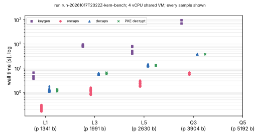
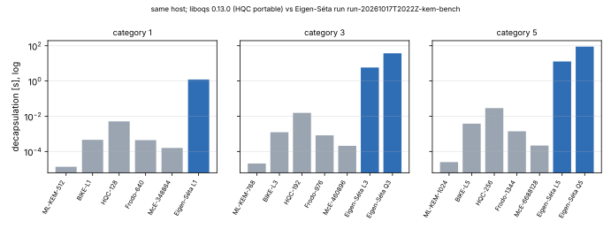

# Eigen-Séta performance and security white paper: study report

The white paper is `crypto:papers/eigen-seta-whitepaper/whitepaper.pdf`.
This directory holds its evidence. PDF of this report:
[`report.pdf`](report.pdf).

**Status.** The timings are measurements on a shared 4-vCPU cloud VM at
isolation L0. The security levels are derived from the eigenx cost model,
not measured. The one cost-model input that can be measured (the
attacker's chain step) is measured.

## Question

How long does every operation of Eigen-Séta v2 take at every parameter
set, measured on one host? How secure is each set, and how far is it from
the other post-quantum KEMs?

## What was run

| Run | What | Record |
|---|---|---|
| `run-20261017T2022Z-kem-bench` | eigenx `bench_kem` (commit `d89d790`): keygen, encaps, decaps, 1 KiB PKE, sizes, field arithmetic, attacker chain step; L1–Q5 all cores, L1–L5 one core | [`records/run-20261017T2022Z-kem-bench/`](records/run-20261017T2022Z-kem-bench/), [run report](reports/run-20261017T2022Z-kem-bench/) |
| liboqs comparison | ML-KEM, BIKE, HQC (portable), FrodoKEM, Classic McEliece at categories 1/3/5, same host, one pinned core, two repetitions | [`records/pqkem_same_host/`](records/pqkem_same_host/), harness [`tools/pqkem_bench/`](tools/pqkem_bench/) |
| RustCrypto ML-KEM | portable crate, taken while Q5 keygen loaded the host; kept as a record, not used in the tables | [`records/mlkem_same_host/`](records/mlkem_same_host/) |
| cost model | `security_estimate` at eigenx main | [`records/security_estimate.txt`](records/security_estimate.txt) |

## Findings (measured unless marked)

* **Speed (all cores, medians).**
  * L1: keygen 4.6 s, encaps 0.20 s, decaps 1.20 s.
  * L3: keygen 84 s, encaps 1.1 s, decaps 5.8 s.
  * L5: keygen 51 s, encaps 2.3 s, decaps 12.8 s.
  * Q3: keygen 14 min (4 workers), encaps 5.9 s, decaps 37 s.
  * Q5: keygen 33 min (4 workers, one key), encaps 13.7 s, decaps 89 s.
  * On one core, decaps is 1.6–1.7 times slower.
* **Sizes (exact).** pk = ct = 1344 / 1992 / 2632 / 3904 / 5192 bytes;
  sk = 1855–7050 bytes; shared secret 32 bytes.
* **Chain-step cost (corrected 2026-10-18).** 618–670 F_p²
  multiplication-equivalents per (2,2)-step by wall time. That figure
  includes the setup before the chain and all additions, so it is not a
  step cost. Exact counts (aburan28/eigenx#7) give 566.6 F_p products, i.e.
  188.9 F_p² multiplications (2^7.56), per theta step. The model's 256 was
  therefore *not* conservative: it overcharged the attacker by 0.5–1.0 bit
  in the gate columns, and eigenx#7 lowers it to 2^7.5.
* **Against ML-KEM on the same host,** Eigen-Séta decapsulates about 89,000
  times slower at L1, rising to about 3.5 million times at Q5.
* **Against BIKE, FrodoKEM and Classic McEliece,** it decapsulates
  2,600–7,600 times slower at level 1. It is about 230 times slower than
  even the portable HQC.
* **Sizes compared.** Eigen-Séta's level-1 key and ciphertext (1.3 kB) are
  close to ML-KEM and BIKE, smaller than HQC and FrodoKEM, and 190 times
  smaller than a Classic McEliece public key.
* **Security (derived).** L1, L3 and L5 meet categories 1, 3 and 5 only in
  the gate count under MAXDEPTH. At least 2^λ quantum queries holds only for
  L5 (at λ = 128), Q3 and Q5. The largest risk is the hidden orientation:
  if it became effective, the scheme would be broken quantumly at every set.

## Limits

* One host, shared, unpinned for the all-core rows. Few keys for the Q
  sets: Q5 has one key, and its key generation overlapped light work on the
  host.
* HQC in liboqs 0.13 is the portable implementation, so its rows
  understate an optimised HQC.
* No external implementation of Eigen-Séta exists, so its speed cannot be
  compared with another implementation of the same computation.
