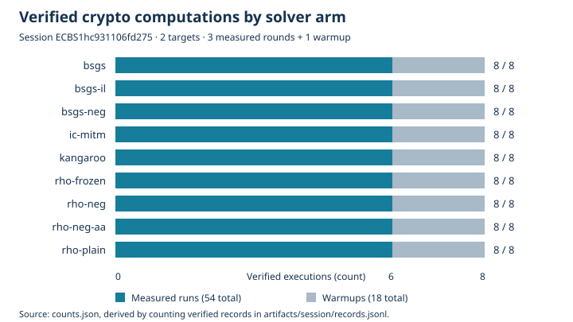

# Real crypto execution on EKS — 2026-10-19

**Verified complete:** the harness launched actual native elliptic-curve discrete-log computations in EKS, and their results were saved to S3, downloaded, hash-checked and replayed on another host.

| Requirement | Observation |
|---|---|
| Submit through the harness | Codex `isolab_k8s_run`, Job `ecbench-real-20261019-1922`, UID `57b5a5ec-d11e-40f0-8742-67cedfdf87b0` |
| Actual crypto work | 72/72 executions verified; 54 measured runs plus 18 warmups |
| Pod audit | 54/54 deterministic measured replays reproduced, 0 problems |
| Durable S3 output | 17 objects downloaded; all 16 payload SHA-256 hashes matched the pod's manifest |
| Second verification | Downloaded session audited outside the worker: 72 verified records, 54/54 replays reproduced, 0 problems |

## What ran

The unchanged public synthetic fixture in [protocol.md](protocol.md) uses the prime-field curve `icv1-fp20-t727-cd198a38`, field modulus 563153, prime subgroup order 562427, curve seed 59297 and target seed 20261002. All nine arms recovered the planted scalars **330146** and **138031** for the two targets; the audit independently checked each equation `[k]G = Q`. The frozen plan records the curve coefficients, generator, targets, seeds and method parameters.

Curve identity: `ICV1:fp-563153:727:562427:476305:unk:unk:r:cd198a38cd5f`; registered identity `EC1P20Cfphd19e740ea95d`.

The nine arms are Pollard rho with negation, plain rho, frozen rho reference, textbook BSGS, interleaved BSGS, negation BSGS, van Oorschot–Wiener kangaroo, the index-calculus MITM pipeline, and a repeated rho-negation control. Each arm executed twice for warmup and six times for the measured rounds. These are fixture correctness results, not recovery of a real-world secret.



Graph counts are derived with jq by grouping records by arm and counting verified, measured and warmup records; [counts.json](counts.json) is the source. Counts are complete observations, not statistical estimates; no uncertainty interval applies. All timings and counters remain in the immutable raw records, but no method ranking or performance result is reported.

## Execution and persistence

The Job ran in `isolab`, account `104186811093`, region `us-east-2`, on Spot node `ip-10-84-69-3.us-east-2.compute.internal` (`c8in.xlarge`, Intel Xeon 6975P-C). The pod requested 2 vCPUs and 4 GiB with Guaranteed QoS and used CPUs 1 and 3. The native child ran on CPU 3. The image and source revision are fixed in [protocol.md](protocol.md); [request.json](request.json) preserves the exact MCP call.

The full output prefix is:

```text
s3://isolab-results-104186811093-us-east-2/runs/ecbench-real-20261019-1922/5319a3b0-ba85-44cc-be19-02d123364899/
```

It contains the sealed session (spec, plan, host capsule, records and session metadata), audit, logs, input/build identity, Job exit record and [SHA256SUMS](artifacts/SHA256SUMS). [cloud-receipt.json](cloud-receipt.json) records the completed Kubernetes Job and S3 object listing. The empty `run-summary.json` is retained exactly as uploaded; ecbench's authoritative summary is `session/session.json`.

Pod audit SHA-256: `f25f14f73a05dabfe35027cbbc8a88e870ef5e412d2ccf92440e81cfa5e2d549`.

Downloaded manifest SHA-256: `44379cb05d973aab55e3f2edeccb1e9d4bc079cf76226045314432b5cf68517c`.

Second audit SHA-256: `386d52abd0a8a36f32f787051256d5c88e5e7629bbfba595e07085b14a90ea82`. The [host replay receipt](host-replay.json) came from the frozen native binary on the harness host, environment `ECBENV2ha8c679da3835`, distinct from the pod's `ECBENV2he17ba5a30679`. This is an independent execution and download check using the same implementation, not a different solver implementation.

## Limits

All 72 records earned **L0** under ecbench's grading. One user thread could not be evicted, the start was not quiet, and VM frequency/bare-metal conditions were not established. The spec's L2 threshold for wall-time claims was not met. The mathematical answers, deterministic replay and artifact hashes passed; this run does not establish strict host isolation or comparative speed.

No algorithms, curve registrations, ledger claims or canonical performance graphs changed. The scoreboard, progress timeline and curve diagrams were left unchanged because this is a harness correctness/persistence check of an existing fixture, not a new performance or mathematical result.

[PDF report](reports/run-20261019T1922Z/report.pdf) · [pod audit](artifacts/audit.json) · [host audit](host-replay.json) · [raw records](artifacts/session/records.jsonl).

## Repository checks

The requested EKS run, both full session audits, all recovered-answer checks,
artifact hashes and shell validation passed. The broader pre-push library
suite is **not green**: two runs each passed 4,404 tests with 118 existing
ignored tests and failed one unchanged randomized test. The first failed
`pqc::sqisign::tests::the_toy_graph_sets_the_false_accept_rate` (observed
0.00675 at the lower acceptance boundary); the second failed
`pqc::hawk::tests::naive_forgery_fails`. Each test passed its immediate isolated
rerun. No library code or tests were changed, skipped or disabled, and no
further full-suite reruns were used to obtain a green result. This is a
repository validation limitation, not a failure of the EKS computation.
`library-validation.json` records the outcomes and S3 log hashes. The PR
remains unmerged pending its applicable validation gates.
