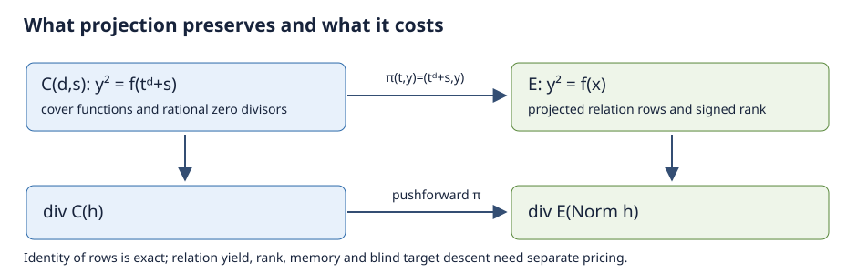
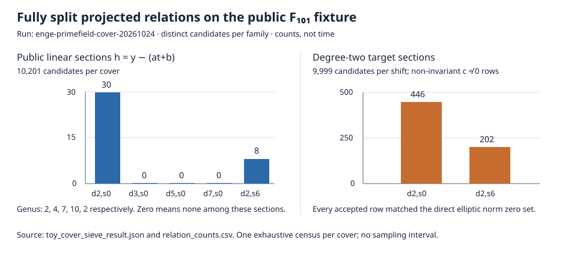

# Projected relations from prime-field hyperelliptic covers

Date: 2026-10-24. Scope: a mathematical reduction and one exhaustive,
small-field relation-source test. This is not a test of Enge's full Jacobian
algorithm and does not establish a large-field complexity bound.



## Algebraic finding

Let `E/F_p: y^2=f(x)=x^3+Ax+B` be smooth, with `p>3`. Choose `d` coprime to
`p` and a shift `s` with `f(s) != 0`. Then

```text
C_{d,s}: y^2 = f(t^d+s),       pi(t,y) = (t^d+s,y).
```

The polynomial on the right is squarefree: a repeated root away from `t=0`
would give a repeated root of `f`, and `t=0` is excluded by `f(s) != 0`.
For odd `d` the genus is `(3d-1)/2`; for even `d` it is `(3d-2)/2`.
The degree-`d` map induces `pi_* pi^*=[d]` on `E=Jac(E)`. Thus pullback
preserves a prime-order subgroup of order `ell` when `ell` does not divide
`d`. The degree-two case is the split-cover mechanism in the project's
PO-transfer-003 work.

Enge's proven expected-time bound applies when `g >= theta*log(p)` for a
fixed positive `theta` and has the form
`exp(O(sqrt((g log p) log(g log p))))`. Choosing `d=Theta(log p)` puts this
family in that regime, but the expression in the bound then has exponent
`Theta(log p*sqrt(log log p))`, larger than rho's `(1/2)log p` exponent.
This compares published *guarantees*, not lower bounds on specialized
algorithms. It motivates the quotient-aware relation question tested below.

For every nonzero rational function `h` on `C`, the divisor norm identity is

```text
pi_*(div_C h) = div_E Norm_{F_p(C)/F_p(E)}(h).
```

This is an equality of projected *relations*, not an equality of algorithms or
running times. A cover may make a useful norm easier to generate or factor,
but projection alone creates no relation unavailable in the elliptic function
field. For `h=y-(a*t+b)`, the norm is explicit:

```text
Norm(h) = (y-b)^d - a^d*(x-s).
```

When `a != 0`, a rational zero `(x,y)` of this norm has the unique rational
cover coordinate `t=(y-b)/a`. The rational zero sets on the two sides agree.
For the target-coupled degree-two section

```text
h = y-y_Q-(t^2+s-x_Q)*(c*t+b),
```

putting `A_E=y-y_Q-b*(x-x_Q)` gives the equally explicit elliptic norm

```text
Norm(h) = A_E^2 - c^2*(x-s)*(x-x_Q)^2.
```

For `c != 0`, its rational zeros away from `Q` also have a unique rational
cover coordinate. The zero at `Q` has multiplicity at least two, and exactly
two when both cover zeros above `Q` are simple. The fully split degree-two
target relations below therefore have a direct elliptic representation with
the same parameter pairs and projected rows.

The degree-two product identity is recorded as evaluated certificate
`IDC1h4255f156b69df1c2` (`identity.certificate/v1`) in
[`target_norm_identity.certificate.json`](target_norm_identity.certificate.json).
The issuer checks 32 statement-derived and 32 extra checker-seed points over
`F_(2^61-1)`; it is an evaluated certificate, not a formal proof. The Lean
file [`lean/NormIdentity.lean`](lean/NormIdentity.lean) contains proof
source for the polynomial factorization and its substitution under
`t²=x-s`. The build status is recorded below. Neither artifact formalizes
construction of the curve map or divisor norm; those geometric facts retain
the written proof and remain a formalization gap.

There is a factor-base constraint. For nonzero `x-s`, the map
`t -> t^d+s` has either zero or `gcd(d,p-1)` rational preimages. Repeated
cover points therefore become duplicate elliptic columns. If
`gcd(d,p-1)=1`, the rational-point images cover all of `E(F_p)`, but the
other algebraic points in a degree-`d` pullback fiber still matter for a
degree-one factor base.

## Reproducible toy test

The public fixture is `E/F_101: y^2=x^3+x+46`, with verified group order
`109`, generator `G=(2,37)`, and target `Q=(64,19)`. The collector takes
`G,Q` as public points and never reads the target scalar. The scalar is
computed from relations and checked afterward by elliptic multiplication.

For each unshifted `d`, the script exhausts all `101^2` functions
`y-(a*t+b)`. It retains a relation only when all `3d` finite zeros are
distinct and rational. It projects each point, merges duplicate images,
identifies `P` with `-P` using signed columns, and computes rank modulo `109`.

| Cover `(d,s)` | Genus | Distinct projected affine points | Fully split public sections | Signed rank / columns, including `G,Q` |
| --- | ---: | ---: | ---: | ---: |
| `(2,0)` | 2 | 56 | 30 | 9 / 25 |
| `(3,0)` | 4 | 108 | 0 | 0 / 2 |
| `(5,0)` | 7 | 20 | 0 | 0 / 2 |
| `(7,0)` | 10 | 108 | 0 | 0 / 2 |
| `(2,6)` | 2 | 44 | 8 | 2 / 11 |

The unshifted degree-two image omits `G`, so those rows cannot determine
`log_G(Q)`. Shift `s=6` makes both public points lie in the rational image.
That shift was selected using the public `G,Q`; its selection cost is not
measured and would be target-dependent in a full one-target assessment.
The higher-genus zero counts apply **only** to these linear sections and a
degree-one, fully split factor base. They say nothing about higher-degree
factor bases, randomized Jacobian divisors, or Enge's algorithm.



For target descent, the script exhausts `h=y-y_Q-(t^d+s-x_Q)*(c*t+b)` when
the target fiber is fully rational; it excludes `c=+/-1`, whose leading degree
cancels and needs a separate infinity analysis. In `(d,s)=(2,6)`, streaming
only the non-invariant (`c != 0`) target rows recovers `37` after **1,070**
candidate sections, **108,070** cover point tests, and **22** accepted rows.
The signed matrix has rank `21` on `22` columns; adding `log(G)=1` determines
all columns and `log_G(Q)=37`. A separate elliptic multiplication check confirms
`37G=Q`. Adding all `10,201` public-section scans reaches recovery after
1,032 target candidates, so the target-only path is cheaper in this toy.

For `(2,6)`, all **202** fully split non-invariant target rows found by the
complete `9,999`-candidate census matched the rational zero sets of the
explicit elliptic norm. The direct norm accepted the same 202 parameter pairs.
For `(2,0)`, the corresponding count was 446 on both sides. Thus this
positive toy recovery is reproducible directly on `E`; the cover did not
expose a new projected relation family.

A deterministic one-target rho control recovered the same scalar in **72**
elliptic group operations through collision. The 108,070 cover point tests,
22 rank solves, and verification use different units from rho's group
operations, so these counts are not a calibrated speed ratio. No below-rho
claim is supported by this bounded test; the direct norm equivalence is the
stronger result for this relation family. The first-recovery count omits the
script's one-time point enumeration and the remainder of the full census.

For the unshifted higher-genus targets, `t^d-64` has only `1`, `0`, and
`1` rational roots for `d=3,5,7`, respectively, below the `d` roots
required for a fully rational target fiber. This blocks the tested
rational-point target descent. A higher-degree factor base or a different
target descent is required to test those covers.

## What remains open

The useful question is whether a *specific* higher-genus function family can
produce norms whose factorization, projected rank, and target descent are
cheaper than the same norm family handled directly on `E`, after every phase
is priced. The present test rules out a relation-count novelty claim for
linear cover sections and the tested degree-two target sections. It does not
rule out an advantage from higher-degree primes, special norm factorization,
or a different cover family.

A next experiment should freeze a degree bound `B>1`, implement the trace of
each degree-`<=B` cover prime under `pi_*`, and compare each accepted relation
with its direct elliptic norm using identical parameters. It needs (i) a
verified arbitrary-divisor norm/pushforward, (ii) independent relation replay,
(iii) rank after merging projected images, (iv) target-only recovery, and
(v) a single-target, same-host cost record including setup, failed attempts,
factorization, matrix work, memory, and verification. The current `crypto`
cover infrastructure documents that arbitrary-class pushforward is not yet
available for the odd-prime even-sextic family, so that implementation is a
concrete prerequisite rather than a presumed capability.

## Proof map

| Statement | Lean declaration | Exact status |
| --- | --- | --- |
| Degree-two product factorization | `EngePrimefieldCover.target_section_factorization` | Lean source written; build status below |
| Substitution of `t²=x-s` | `EngePrimefieldCover.target_section_norm_after_cover_equation` | Lean source written; build status below |
| `π_*(div h)=div Norm h` and `π_*π^*=[d]` | None | Written geometric arguments; formalization remains open |

The Lean project pins Lean `v4.34.1` and mathlib revision
`d13f23b723b8a846827a245b89c10fc7d3f11612`. The first `lake build`
attempt stalled while checking out mathlib on this shared host and was
interrupted; it did not produce checked proof artifacts. A second attempt
hit a stale Git index lock. After clearing that lock, a third checkout
again stalled and was interrupted. The source is therefore **unverified
by Lean** until a clean `lake build` and axiom audit complete.

## Artifacts and replay

- `src/main.rs`: native Rust exhaustive toy collector, projection, rank
  solve, direct norm zero-set checks, and deterministic one-target rho control.
- [`toy_cover_sieve_result.json`](toy_cover_sieve_result.json): complete
  machine-readable counts, including root-count histograms and both shifted
  and unshifted degree-two results.
- [Native run record](reports/run-20261024T2315Z/REPORT.md): exact command,
  raw output, host, accounting limits, graph, and run PDF.
- [Results PDF](REPORT.pdf), [TeX source](REPORT.tex), [relation-count graph](relation_counts.svg),
  [diagram](cover_projection.svg), and [graph data](relation_counts.csv).
- [Norm product certificate](target_norm_identity.certificate.json) and its
  [native issuer/replayer](src/bin/issue_cover_identity.rs).
- [Validation record](validation/VALIDATION.md), including the root-suite
  failures from a shared sparse checkout and focused replays.

```sh
cargo test --release --offline --manifest-path research/enge_primefield_cover_20261024/Cargo.toml
cargo run --release --offline --manifest-path research/enge_primefield_cover_20261024/Cargo.toml \
  --bin enge-primefield-cover-toy > /tmp/enge-primefield-cover-replay.json
CARGO_TARGET_DIR=target cargo run --release --offline \
  --manifest-path research/enge_primefield_cover_20261024/Cargo.toml \
  --features certificate --bin issue_cover_identity -- \
  --check research/enge_primefield_cover_20261024/target_norm_identity.certificate.json
```

The command is run from the repository root. `jq -S` comparison of the
native result with an earlier out-of-repository Python diagnostic matched
every JSON field; the committed result is from the native replay. This was one
deterministic exhaustive census per cover, with no sampling interval.
No elapsed-time, memory, setup, shift-selection, or matched total-work
measurement was made. The canonical IC progress and leaderboard graphics
were checked for applicability and left unchanged: these toy counts provide
no calibrated IC/rho ratio or new pipeline result.

| Requested question | Current status | Evidence or gap |
| --- | --- | --- |
| Projected relation family on `C_d` | Verified for the five toy covers and the stated sections | Native census JSON and direct norm zero-set assertions |
| Reusable rank | Partially tested | Signed ranks of public and target rows; no scalable factor base |
| Blind-target descent | Verified on the `F_101` degree-two shifted fixture | 22 accepted target rows, rank 21/22, `37G=Q` check |
| Less than `sqrt(ell)` total work | Not established | No same-unit total-work or memory record; observed counts are far above the rho control in unlike units |
| Enge high-genus projected advantage | Not tested generally | Higher-degree primes, arbitrary-divisor norm and Jacobian relation collection absent |

Source context: [Enge's original preprint](https://enge.math.u-bordeaux.fr/publications/log.ps.gz)
and [Gaudry–Hess–Smart's Weil descent paper](https://www.kantmath.de/publications/papers/weil_descent.pdf);
the local PO-transfer-003 note; and the `crypto` ecdlp-surfaces
higher-genus workflow.
