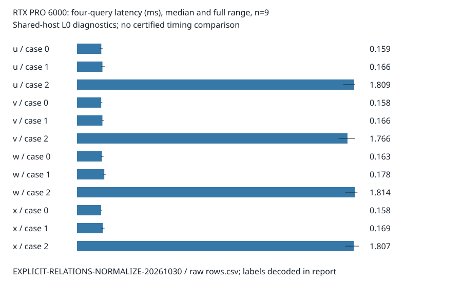

# RTX PRO 6000 normalization comparison

This report records observations from one software diagnostic panel. It does
not promote a research hypothesis, certify a timing speedup, or establish
an ECDLP advantage. The implementation changes only block normalization.

The [two-page PDF report](reports/run-20261030T0021Z/report.pdf) includes the
quantitative chart; its editable Typst source is alongside it. Both pages
were rendered and visually inspected before publication.

Source: `47ff700720f3563ed67eb1bb9e507db8c252c1c7`. Protocol:
`3e379eac61e5b75a077ad8bba29dd68e6f5319c1356ecdf4b337b1f35bab3fd6`.
RunPod pod `1lq0cd2l0en5ju`, RTX PRO6000 Blackwell Server Edition, 97,887MiB,
driver 595.91.07, CUDA 13.2.51, Rust 1.88.0. Exact device and launch identities
are in [the receipt](results/receipt.json) and [GPU record](results/gpu.csv).
The command was `bash research/explicit_relations_perf_20261030/run.sh` on
the pinned source. The controller recovered the artifacts and confirmed
pod deletion; no continuing GPU workload remains.

## Exact work and correctness

The previous dual scan performs 4608 source-level field multiplications per
256-lane block in inversion preparation; the product tree performs 765.
This is a derived 83.3984375% reduction for that operation category only.
Both retain one inversion per block and the same affine conversions,
tuple arithmetic, sorting, lookup and witness checks. These counts are not
machine instructions, total field operations or GAE. CUB's count is unknown.

All three implementations passed projective normalization checks over
three fields, including p=2^61-1, with random nonzero scales, infinity lanes
and partial blocks. Existing host/CUDA service and complete bounded driver
tests passed; all 10 Rust tests and Clippy passed. Memcheck reported 0 errors,
racecheck 0 hazards/errors/warnings, and synccheck 0 errors. Every benchmark
cell checked two positive and two exhaustive negative targets against the
independent host backend. All cross-arm witness and normalization digests
matched. The result contains 120 completed rows: 12 warmups and 108 measured,
with no missing, failed, resumed or excluded rows.

## Measured diagnostics

The frozen analyzer received neutral labels: u=old scan, v=product tree,
w=NVIDIA CUB BlockScan, x=repeat of the exact u binary. Each table entry below
is a recorded median over 9 fresh-process repetitions. Full min/max ranges
for every metric and arm are in [summary.csv](results/summary.csv). The
source fixture seeds were 111/222/333 and all arms used the same inputs,
compiler options, launch geometry, row cap and 4096-row query chunks.

| Normalization lanes | Old scan, ms | Product tree, ms | CUB, ms | A/A old scan, ms |
| --- | ---: | ---: | ---: | ---: |
| 257 | 0.009620 | 0.009036 | 0.009576 | 0.009580 |
| 65,537 | 0.011332 | 0.010652 | 0.011168 | 0.011496 |
| 262,145 | 0.021668 | 0.018152 | 0.024024 | 0.021508 |

For the largest relation fixture (four 256-point bases, 65,536 rows per
side), the four-query median was 1.809353ms old scan, 1.765703ms tree,
1.814083ms CUB and 1.807224ms A/A. The old and tree query ranges overlap:
1.738424–1.815144ms and 1.707625–1.815973ms. Cold-pipeline medians were
143.981243ms old scan and 145.227285ms tree; the tree did not have a lower
cold median in this cell. No end-to-end gain is established.



The graph shows measured medians and full observed ranges, n=9 per cell;
case 0/1/2 use 16/64/256 points per base. All timings are L0 shared-host
diagnostics with `wall_valid=false`. The A/A cold range for case 0 includes
a 272.657302ms observation, retained without exclusion. GPU events time the
normalization kernel after warmup; other columns use synchronized host
intervals. Setup and cold costs are retained, not discarded to inflate a
query-only result. See [the protocol](PROTOCOL.md) for exact boundaries.

## Evidence and limits

[export-v2.json](results/export-v2.json) is the current checked unified
export: the canonical checker passed with file verification. It corrects
only an unobserved unmasking timestamp in the preserved first export; no
measurements, analyses or hashes changed. The analyzer was label-neutral,
not a human-blinded inference. The planning time at protocol freeze was an
unmeasured conservative allowance; round0 retains actual preflight costs.

Raw archive and controller artifacts:
`s3://setec-astronomy-artifacts/validation/ecbench-explicit-x/runpod-1lq0cd2l0en5ju/`.
Archive SHA-256: `d83cdcc92e49929fce81413ea1b2d9ebc807ff26093d2963c9735de6f1ff268b`.
Downloading the uploaded archive reproduced that hash. Local receipt:
`/home/ec2-user/ecbench-perf-20261030/`. No API credential is in the archive.

The primary change reduces normalization work. The panel also shows that
normalization timings alone do not describe query or cold-pipeline cost.
The service already supports persistent context/table reuse. Further work
can examine chunk synchronization and repeated right-side sums while
preserving user-supplied memory caps and deterministic first-witness order.
Those optimizations were not implemented or measured by this panel.
Root crypto/ecbench integration tests, wider-field complete reduction,
and the separate GPU tensor backend remain outside this run.

## Post-run coverage audit (2026-10-30)

PR review found that the frozen analyzer checked aggregate counts without
rejecting a duplicated execution or missing warmups. The measurements and
frozen analyzer are preserved. The separate [strict coverage checker](check-coverage.rs)
now checks the exact arm × instance × round key set, all seeds, warmup flags,
finite nonnegative timings, verification labels and cross-arm digests before
accepting either the normalization panel or the subsequent query panel.
Both unchanged raw files pass: 120 unique executions, 12 warmups and 108
measured rows each. The checker also rejects six deliberate faults: duplicate
execution, missing warmups, wrong seed, wrong warmup flag, unexpected arm and
changed witness digest. [Audit output](coverage-audit.txt) is retained.
This is a post-run validation correction, not a new experiment or a change
to the frozen statistics. Reproduce with a standalone Rust compiler:

```sh
rustc --edition=2021 -D warnings research/explicit_relations_perf_20261030/check-coverage.rs -o /tmp/check-coverage
/tmp/check-coverage research/explicit_relations_perf_20261030/results/rows.csv research/explicit_relations_query_20261030/results/rows.csv
```
