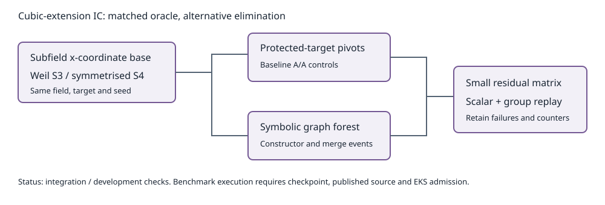

# Cubic-extension algebraic IC with symbolic graph elimination

This integration reuses the existing `gaudry_cubic` algebraic relation finders
and `pencil-symbolic-graph` forest. It changes the auxiliary-variable eliminator,
with a protected target logarithm and protected constant coordinate. [pcc:unverified]

[Implementation report (PDF)](report.pdf) · [Frozen protocol](protocol.json)

## Scope and status

| Requirement | State | Evidence / remaining step |
| --- | --- | --- |
| Native Rust integration with other IC code | Initial targeted tests pass; fingerprint-control rerun pending | `src/cryptanalysis/gaudry_cubic_graph.rs`; `run_gaudry_with_eliminator` |
| Extension-field algebraic relation finding | Existing native engines reused | Weil-restricted S3 pair test, symmetrised S4, and hybrid scan/S3 |
| Named baseline/candidate comparison | Driver implemented, run pending | `examples/gaudry_cubic_graph_compare.rs`, `protocol.json` |
| Preserve historical default behavior | Targeted regression passes locally | Legacy entry point and optional report-key regression |
| Numerical performance result | Not measured | S3 checkpoint/EKS submission access and admission required |
| Complete native-cost ranking | Not implemented | Legacy pivot/dense counters omit additions, inversions and native collection work |

## Two separate changes

The existing collector places the target in column `small`, but its historical
pivot eliminator uses `small` as the first auxiliary column. That permits it to
eliminate the target in partial relations. This integration preserves that entry
point for historical replay and adds an explicit comparison entry point that
protects `small + 1` columns for **both** backends. [pcc:unverified]

The comparison chain is therefore:

1. Historical pivot boundary → protected-target pivot boundary: a separately
   identified correctness/interface correction, distinct from the graph replacement.
2. Protected-target pivot → protected-target symbolic forest: the measured
   component replacement, on the same oracle and relation stream.

For a row `sum(c_i*x_i) = rhs`, the graph receives the homogeneous equation
`sum(c_i*x_i) - rhs*ONE = 0`. Its small variables include the ordinary base,
target logarithm, and `ONE`. No discrete logarithms of the base points are given
to the graph. Arbitrary coefficients, sign changes, loops and anchoring use the
existing forest implementation. [pcc:unverified]



## Sources checked

- **KB unavailable:** no research-kb MCP server is loaded; the repository wrapper
  returned `research-kb: no executable found`. No absence or novelty inference.
- `src/cryptanalysis/gaudry_cubic.rs`: existing subspace factor base, S3/S4
  solvers, cofactor projection, relation verification and pivot-chain baseline.
- `research/pencil_large_prime_20261029/README.md`, `src/lib.rs`, `src/meter.rs`:
  existing general-coefficient symbolic graph and constructor/event accounting.
- `research/notes/index-calculus/RESEARCH_RESIDUAL_WALKS.md`, sections 11.7/11.11:
  prior merge-depth and fill tradeoffs, kept distinct from this replacement.
- Gaudry–Theriault–Thome (2005), sections 2.3/3.1,
  [primary paper](https://cacr.uwaterloo.ca/techreports/2004/corr2004-29.pdf):
  full relations differ from arbitrary graph cycles; its higher-genus complexity
  theorem is not a complexity statement about this integration.

## Development checks

```sh
cargo test --release --lib --no-default-features gaudry_cubic::
cargo test --release --example gaudry_cubic_graph_compare --no-default-features
```

Tests cover symbolic projection against a full relation system after each prefix,
duplicate auxiliary coefficients, nonzero right-hand sides, invalid columns, and
actual cubic instances under all three native oracles. These are development
correctness checks, not admitted benchmark measurements. [pcc:unverified]

The local filtered release-library run reports **24 passing tests**, including
six adapter/integration tests, before the input-fingerprint control was added.
The touched example compiled in its Cargo test target before that control
(it defines no example-local tests). The final control rerun and full
default-feature library validation are pending. These are producer-run development checks, with no
independent signed verdict. [pcc:unverified]

Raw development output: [targeted library](validation/targeted-library-tests.log),
[example compilation](validation/example-build-tests.log), and
[checkpoint gate](validation/checkpoint-gate.log).

The checkpoint gate reports no configured AWS profile or upload token. This
shares the existing [launch-gate access obstruction](../../problems/arity-completion-launch-gates.md#2026-11-15-cubic-extension-symbolic-graph-comparison).
No benchmark launcher was invoked. [pcc:unverified]

Protected runs additionally fingerprint the entire factor base and the admitted
projected relation stream with BLAKE3. Both backends hash the same byte encoding;
the report carries the digest and input-byte count. This hashing remains in the
unpriced native-work scope; it is not a free relation oracle. [pcc:unverified]

## Frozen measurement commands

Only launch after publishing the exact source, checkpointing, and admitting the
prescribed EKS run. The driver refuses to overwrite raw data, retains failed
attempts, and reverses arm order between rounds.

```sh
cargo build --release --no-default-features --example gaudry_cubic_graph_compare
target/release/examples/gaudry_cubic_graph_compare \
  --primes 7,13,19,31 --seeds 3,7,11,23 --rounds 5 \
  --max-residuals 10000 --source-revision SOURCE_SHA --out cohort.jsonl
target/release/examples/gaudry_cubic_graph_compare \
  --primes 43 --seeds 101,103 --rounds 5 \
  --max-residuals 10000 --source-revision SOURCE_SHA --out holdout.jsonl
```

`legacy_model_cold_gae` is the existing multiplication-equivalent model plus
fresh base setup. It is explicitly a diagnostic, **not** a complete native-cost
ranking: missing scalar/collection operations are listed in every row. Graph
constructor primality and inversion multiplications are retained. Legacy wall
readings remain unadmitted until the EKS/L2/A/A conditions are met.

The external linear-algebra comparison is not run. The frozen WDSat regression
suite concerns a different encoding; this protocol freezes equivalent matched
cubic-extension inputs instead, without substituting a WDSat-stage gain for a
full IC measurement.

No scoreboard or leaderboard figure changes: this packet has no admitted
performance observations. Historical Python artifacts remain outside this
repository; this execution path is native Rust throughout.
