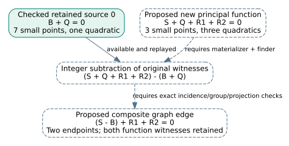

# A checked factor-base anchor exists for the next forced-divisor test

The sole local audit selected retained source0 and passed its original
normalized function/norm, seven actual small points, signed quadratic
support and Jacobian replay. The stored collection has90,877 sources:
215 full,8,013 with one quadratic and82,649 with two. This is availability
evidence for a changed relation finder, not new collection or yield.
PCC-20261124-9efc02 remains producer-unsigned and UNVERIFIED.
[pcc:unverified]

The checked anchor gives B+Q=0. A proposed new function with
S+Q+R1+R2=0 would yield S-B+R1+R2=0 by integer subtraction. It has two
graph endpoints but two original principal-function witnesses. It must
not be serialized as one degree-nine principal certificate. Original
norm/support/group identities and exact cofactor cancellation precede
projection; coefficient reduction modulo subgroup order comes afterward.
The dashed parts of the diagram are unimplemented hypotheses.

## Exact audit and custody

[PLAN.md](PLAN.md), [PROTOCOL.md](PROTOCOL.md), [audit.rs](audit.rs),
[source/worker/input hashes](source-worker-inputs.sha256),
[validation](validation). Eight native controls and strict Clippy pass.
Published source69dda878b3 precedes the sole saved-data call. Select the
first stored seven-small/one-quadratic source only; no replacement after
failure. No F4, new polynomial-system solve, rho or DLP computation.
[pcc:unverified]

[Public fixture](results/fixture.json) SHA256
`d09c03c2734e32b36c229f1fc52997c05e9dfc1b12ba7f8c57c330364d6c26e9`;
[summary](results/audit.json), [public raw archive](results/raw.tar.xz),
[PDF report](report.pdf). The110MB original Run51 input remains LOCAL at
its previously published hash; this archive contains only public outputs,
H fixture, native conditions, hashes and statuses. No target/kernel/answer
fields were exported. Executables remain separate pinned read-only LOCAL
objects under `/workspace/ic-local-runs/anchor-forced-divisor-audit-20261124-01`.

Native/launcher/posthash0, empty stderr, CPU0 AMD EPYC9V74,8GiB/120s,
uncontended receipt; PSI null. No wall comparison or full native total.
No new graph row or graph-rank gain. S3, signed/canonical admission and
whole-root compilation remain open. [pcc:unverified]

## Next discriminating work

Qualify three-small/three-quadratic exact support and a composite graph-edge
type preserving both original witnesses. Check malformed factors, signs,
repeated endpoints, nonunit denominators and integer cancellation. Then
register a finite positive-controlled cost/yield pilot using this anchor.
Anchor existence alone does not establish that finding suitable functions
is affordable or that the resulting graph edges close useful cycles.

Sources checked (KB): no loaded server; wrapper status and two distinct
queries have no executable. Fallback sources are prior anchored_descent.rs,
principal/quadratic-pair and signed deferred graph modules; primary
Joux–Vitse CoverDecomp §§3.2–3.3, including its structured equations and
factor-base-restricted double-large-prime sieving. No novelty claim.
