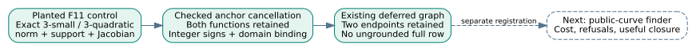

# Three-quadratic support and anchored graph edges are source-qualified

The opt-in Rust modules now admit three-small/three-quadratic principal
support and cancel a checked one-LP anchor while retaining both original
function witnesses. Composite incidence enters the existing signed deferred
graph. Twenty-six native controls pass, with strict worker/test Clippy.
PCC-20261124-c193f2 is producer-unsigned, UNVERIFIED. [pcc:unverified]

The source-qualified path checks exact norm/factorization, actual ordinates,
three Mumford divisors and original Jacobian replay. A domain object admits
the odd-prime field, squarefree degree7 curve and ordered/oriented factor
base; hashes bind their exact representation. Principal proofs have no
unchecked deserializer. Composite rows retain candidate and anchor proofs,
their signed coefficient and integer small/large incidence. Graph projection
re-expands and rechecks these proofs before exact cofactor cancellation and
only then reduces the small coefficients modulo the supplied subgroup order.
[pcc:unverified]

Controls construct a smooth F11 anchor with seven small points. The fixed
lexicographic search finds its first valid three-LP function after307 points
and59 quartic requests,58 bounded split refusals and0 support refusals.
These are control-generation counts on a deliberately structured small
fixture, not public-curve yield or performance evidence. The resulting
two-endpoint edge is deferred, with no ungrounded full row. Self-cancellation
is excluded from graph input; norm, sign, incidence, base-binding and singular
curve tampering are refused. Original constructor, support, quartic-split
and signed graph controls also pass. [pcc:unverified]

Implementation: [support materializer](../../../../src/cryptanalysis/jv_forced_divisor.rs),
[proof/graph adapter](../../../../src/cryptanalysis/jv_forced_graph.rs),
[source-only example](../../../../examples/jv_sieve_forced_graph.rs).
[PLAN.md](PLAN.md), [source/binary pins](source-worker-inputs.sha256),
[all build/control logs](validation), [PDF report](report.pdf).
The scoped optimized build uses pinned native Root41 dependencies, not a
fresh whole-root build. Two inherited certificate API/test-tuple Clippy
allowances are restricted to the unchanged included module. New code passes
strict checks; initial failed lint logs are retained. [pcc:unverified]

No saved public-curve finder call has run under this qualification. The
previous anchor/fiber/unit registrations remain consumed. Next freeze a
finite finder/cost/yield worker with exact source/input hashes, unchanged
root controls, all split refusals, graph events and complete attempted work.
Extra admissible edges must be distinguished from full projected relations
and independent graph rank. All setup must eventually be charged before a
one-target cold comparison. No full native/yield/speed/parity conclusion.

Sources: prior anchor audit; existing principal/quadratic/deferred graph
implementations and primary Joux–Vitse3.2–3.3. KB unavailable; no novelty
claim. S3, signed/canonical admission and whole-root compilation remain open.
