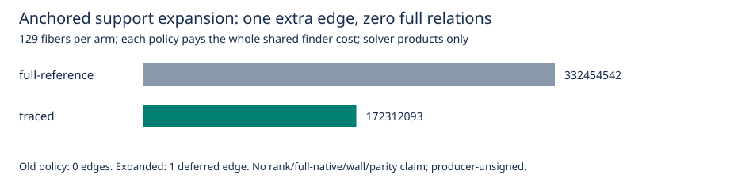
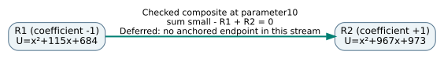

# Expanded support produces one checked edge and no full relation

All258 local calls complete, with identical full-reference/traced roots,
original functions, policy outcomes and cumulative graph states. On128
development values the old5/7-small policy admits no edge; expanded3/5/7
admits one three-LP-minus-anchor composite edge at c0.re10. It has two
endpoints and stays deferred. No full projected row or independent rank.
PCC-20261124-37cb55(raw) and PCC-20261124-a236c7(analysis) are unsigned,
UNVERIFIED. [pcc:unverified]

| Mode | Shared finder F4+linear products,129 fibers | Development only |
|---|---:|---:|
| Full reference | 332,454,542 | 329,874,416 |
| Traced staircase128 | 172,312,093 | 170,486,075 |

Each policy pays the whole shared finder count. The reference arm is
validation work; the traced algorithm includes learning on the known
control and128 subsequent replays. Every quotient dimension is70.
No full native total or wall ranking is available. [pcc:unverified]

Each arm finds124 norm functions,121 on development values. Eleven have
three small roots; ten bounded quartic requests refuse a degree-two-factor
pattern, one succeeds. That function has small abscissae850,926,992 and
three exact signed quadratic divisors. Subtracting the original source0
anchor removes its shared class and retains both original function proofs.
The seeded positive self-cancellation stays trivial and is excluded.
[pcc:unverified]

The new graph contains one edge/two vertices, zero anchors/activations/cycles/
full sources. Its state consists of newly produced composite edges; the
historical graph forest is supplied separately for a future lookup. Full
relation cost is unavailable. One extra edge verifies the finite support
mechanism, without establishing affordable useful closure. [pcc:unverified]

## Separate counter boundary

Per arm, legacy Fq setup is527,317, common post work65,372, old-policy
post20,156 and expanded-policy post86,709. Total dual-policy post172,237
equals those three disjoint post components. Legacy Fq inversion pricing
differs from the F4/linear unit. Quartic Fp arithmetic and native hash/map/
evaluation/container work are outside these summed counters; complete split
reports retain the attempts. Keep units separate; do not add them into a complete
native cost. Original supplied-anchor collection is outside this component
and must be charged before a cold one-target comparison. [pcc:unverified]

## Frozen method and replay

[WORKER_DESIGN.md](WORKER_DESIGN.md), [PROTOCOL.md](PROTOCOL.md),
[driver.rs](driver.rs), [exact pins](source-worker-inputs.sha256).
Twenty-nine native source controls and strict worker/test Clippy precede
the sole saved call. Sourceeaecc682ad, final registration9c7d9982e1;
worker SHA256b6eb4e44e27325b8ff32c27db6e689ff75838700d4f82ce12e6a2fe91cf03575.
Known369 then0..127, all129 full references then129 traced. Grevlex/
maxdegree24/Fast roots; shared10s budget per case includes both policies.
Quartic RNG is separate with all8-attempt reports retained. [pcc:unverified]

One local CPU0 AMD EPYC9V74, one Rayon thread,8GiB/360s. Native/launcher/
posthash0, empty stderr, uncontended receipt, PSI null. Native conditions
and legacy clocks are preserved without timing ranking. [pcc:unverified]

[Raw archive](results/raw.tar.xz),44,184bytes, SHA256
`e868a5d482fe90d2bf87ad8b593c9e1e3b096bc295832edbe3710dfb7d3555c9`,
contains the complete1,002,274-byte summary,444,770-byte events and public
input/status/hash/conditions tree. Pinned executables are separate read-only
LOCAL objects under `/workspace/ic-local-runs/anchored-policy-20261124-01`.
[Read-only Rust analyzer](analyze.rs) checks258 cases/516 events, replays
every original root/function, reconstructs each original/composite proof
and both graphs. Archive replay regenerates byte-equal
[derived JSON](results/analysis/derived.json), SVG and
[complete extra-edge proof](results/analysis/extra-edge.json); strict
analyzer Clippy passes. [PDF report](report.pdf). [pcc:unverified]

## Decision and next hypothesis

Close this finite finder registration. No unchanged larger panel. Next
register a public read-only lookup of the two endpoint classes against the
retained Run51 anchor forest. If matching witnesses exist, replay their
original principal functions before composing a full integer projection.
Availability in that forest is unknown; no new finder solve is needed for
this discriminating check. The present panel gives no parity result.

Sources: checked source0 anchor, original principal/quartic/deferred graph
modules and Joux–Vitse3.2–3.3. KB unavailable; no novelty claim. S3,
canonical/signed admission and whole-root compilation remain open.
Benchmark copies are diagnostic; no admitted IC/rho row.
