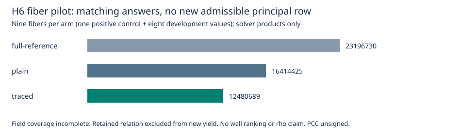

# H6 fiber pilot: exact outputs, lower traced solver count, no new graph rows

All 27 registered calls completed. Plain and traced solving reproduce each
full-reference root set, normalized function, support outcome and resolution
flag. The retained positive control recovers its known principal relation;
the eight development values produce no admissible principal rows.
Claims PCC-20261124-1ca497 (raw) and PCC-20261124-d607b4 (analysis) are
producer-unsigned and UNVERIFIED. [pcc:unverified]

| Arm | Solver F4 + linear/root products, all nine fibers | Development products |
|---|---:|---:|
| Full reference | 23,196,730 | 20,619,924 |
| Plain stopped F4 | 16,414,425 | 14,591,508 |
| Traced stopped F4 | 12,480,689 | 10,657,772 |

Traced/plain is 0.7603488395115882 in this partial solver unit, including
traced learning on the positive control. All eight subsequent traces replay.
Each quotient has dimension 70. These counts exclude constructor/admission,
support processing and uninstrumented native work. Legacy Fq product counters
are retained separately: admission 2,412, postprocessing 12,100 per arm;
constructor counters are in the derived JSON. Their inversion pricing is
different and they are not added to the solver count. No full native cost
or wall comparison is available. [pcc:unverified]

Each arm finds ten norm-valid functions: two at parameter 369 and eight
across development parameters 0..7. Development root counts are
2,1,0,0,1,3,1,0. Only the retained function has the required five/seven small
points and exact quadratic support followed by original Jacobian replay.
Zero new admissible rows makes cost per new row unavailable. A principal
row would still require graph projection and an independence check.
[pcc:unverified]

## Frozen method and replay

[PROTOCOL.md](PROTOCOL.md) fixes all values, call order, seeds, errors and
resource limits before execution. Source e36319dd74 and registration
a2c085beed were published before the sole call. Exact hashes are in
[source-worker-inputs.sha256](source-worker-inputs.sha256). The worker uses
one Rayon thread, CPU 0, AMD EPYC 9V74, 8 GiB virtual memory, a 360 s hard
watchdog and a shared 10 s cooperative budget per system. Native/launcher/
posthash statuses are zero, stderr is empty and the native receipt reports
uncontended; PSI is unavailable. This is a count study, not an A/A wall
benchmark. [pcc:unverified]

[results/raw.tar.xz](results/raw.tar.xz) contains the complete raw-data tree,
8,384 bytes, SHA256
`0a5babe9106710c143a66b087bd614866b173ed6fab252617035932ef5bf480d`.
Pinned executables remain separate read-only LOCAL objects under
`/workspace/ic-local-runs/forced-divisor-h6-fiber-20261124-01`.
[analyze.rs](analyze.rs) checks the complete order and cross-arm outputs;
archive replay reproduces [derived JSON](results/analysis/derived.json)
and the SVG byte-for-byte. Strict analyzer Clippy passes. Producer replay
is not an independent signed verdict. [pcc:unverified]

[PDF report](report.pdf), [source](report.typ), [qualification logs](validation).
S3 upload, canonical PCC-prefix reconciliation and whole-root compilation
remain open. Diagnostic index exclusion continues: no complete native total,
wall ranking, external-tool rank or admitted IC/rho row is generated.

## Decision and next hypothesis

This registration is consumed. Do not rerun or enlarge it unchanged.
The top coefficient equation has constant unit coefficient -2 on c0.im:
`2*t2.re*t2.im - 2*c0.im - Im(H6) = 0`. Eliminating c0.im gives six equations
in six variables after fixing c0.re, with degree at most four. The exact
projection/lift should preserve all solutions, but degree growth may make
F4 more expensive. Qualify this changed Rust source, then register a finite
count comparison against the existing frozen references without re-solving
the old baseline. Useful graph yield remains a separate unresolved question.

Sources checked: existing H6 quotient construction; prior unit-coordinate
elimination in this lane; Joux–Vitse CoverDecomp §§3.2–3.3 and small-degree
paper §2.4; Sparse FGLM §§3.1–3.3, recorded in the sibling successor review.
KB unavailable in this runtime; no novelty claim.
