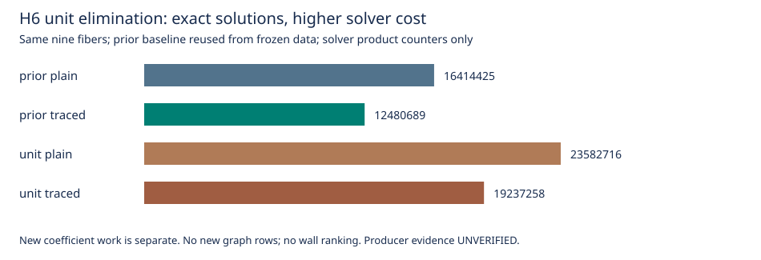

# Exact H6 unit elimination increases the recorded solver cost

The global substitution is implemented and preserves all outputs, but it
loses the registered count comparison. All18 calls complete and match the
frozen seven-variable full-reference roots, normalized functions, support
outcomes and resolution flags. No unchanged baseline was re-solved.
PCC-20261124-dababd(raw) and PCC-20261124-f74bc0(analysis) remain
producer-unsigned, UNVERIFIED. [pcc:unverified]

| Arm | Solver F4+linear products, nine fibers | Ratio to prior same mode |
|---|---:|---:|
| Prior seven-variable plain | 16,414,425 | 1 |
| New six-variable unit plain | 23,582,716 | 1.436706799 |
| Prior seven-variable traced | 12,480,689 | 1 |
| New six-variable unit traced | 19,237,258 | 1.541361859 |

New coefficient work adds1,076 products and1,045 additions per arm:
130 compilation products,936 specialization products and10 lift products.
These counters stay separate. Existing constructor costs1,280 legacy Fq
products per arm; common admission2,412, support processing12,100 per arm.
Native map/allocation/evaluation work is incomplete; legacy Fq inversion
pricing differs from the solver unit. No full native total or wall ranking.
[pcc:unverified]

Each arm has ten norm functions, eight on development parameters0..7.
Only the seeded positive relation has admissible support. All quotient
dimensions are70 and all reported solving degrees are5, matching the prior
formulation. Traced mode replays all eight development cases. The count
loss cannot be explained by variable count or solving degree alone; this
experiment does not isolate a complete causal cost model. [pcc:unverified]

## Method, controls and evidence

The opt-in [production module](../../../../src/cryptanalysis/jv_forced_divisor_unit.rs)
checks the exact highest equation `-2*b+2*r*s+c=0`, substitutes
`b=r*s+c/2`, fixes c0.re, and lifts every six-coordinate root. There is no
varying denominator in the odd-prime domain. Original norm/support and
Jacobian replay remain mandatory after lifting. The production default
does not change.

[PLAN.md](PLAN.md), [PROTOCOL.md](PROTOCOL.md), [driver.rs](driver.rs),
[source pins](source-worker-inputs.sha256) and [validation](validation)
retain11 passing controls, strict worker/test Clippy and the initial
corrected dead-code failure. Source788b8f005f and registrationfe68282737
were published before the sole call. Worker SHA256
`a14ac218f704079c2aa34f4ed8d57e8c81034b2261de5c99f972ca2207e08827`.
Qualification and registration claims:b82fc5,ceb374. [pcc:unverified]

Order: nine plain then nine traced cases, retained369 then0..7; same
maxdegree24/staircase128, Fast roots and per-case seed as prior study.
One native isolated local CPU0, AMD EPYC9V74, one Rayon thread,8GiB,
360s watchdog,10s shared cooperative budget per case. Native/launcher/
posthash0, empty stderr, uncontended receipt, PSI unavailable. [pcc:unverified]

[Raw archive](results/raw.tar.xz) has9,580 bytes, SHA256
`39b542c6c807f3cd78b2fe76c88f338de1075756765a37adbd3be4889df9754e`.
It includes the complete raw tree and frozen reference. Executables remain
separate read-only LOCAL objects under
`/workspace/ic-local-runs/forced-divisor-h6-unit-20261124-01`.
[Read-only Rust analyzer](analyze.rs) checks all18 calls/36 events,
reference flags and independent coordinate lifting. Archive replay produces
byte-equal [derived JSON](results/analysis/derived.json) and SVG; strict
analyzer Clippy passes. [PDF report](report.pdf). [pcc:unverified]

## Decision

Close this registration as consumed and retain seven-variable traced F4
as the incumbent on this panel. Do not increase bounds or repeat unchanged.
An exact coordinate change cannot improve support yield. Review a distinct
graph mechanism: force a quadratic divisor already represented by a checked
factor-base witness, then cancel it to admit three-small/two-other-quadratic
patterns as ordinary two-endpoint graph edges. First check whether the
retained data actually contains such anchors and whether original witnesses
can be composed. This is a hypothesis, not an admitted relation finder.
[pcc:unverified]

Sources checked: prior H6/fast-unit modules and the primary Joux–Vitse/
Sparse FGLM review. KB unavailable; no novelty claim. S3, signed admission,
canonical PCC-prefix reconciliation and current whole-root compilation
remain open. Browsing copies are diagnostic; no admitted benchmark or
IC/rho row is created.
