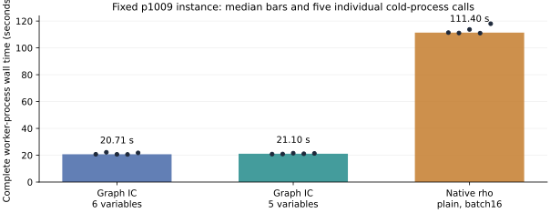

# Full scalar recovery: no demonstrated gain from unit elimination

Five measured cold processes per method give the following complete-process
wall times. All24planned recoveries (3warmup,6A/A control,15measured) complete
with valid endpoints and independent checks. All24isolation records are
uncontended, and each A/A max/min ratio is below1.10. Producer evidence;
PCC-20261117-6432aa remains unverified. [pcc:unverified]

| Method | Median seconds | Minimum seconds |
|---|---:|---:|
| Existing quadratic-remainder graph IC,6variables |20.71449|20.60457|
| Same complete pipeline,5variables |21.10177|20.84097|
| Registered native rho: plain,batch16 |111.40204|111.02453|

The candidate/baseline paired geometric wall ratio is **0.99832**, with
preregistered10000-draw paired-round bootstrap95% interval **0.96725–1.02717**.
It does not demonstrate an end-to-end improvement. The ratio of medians is
1.01870; these statistics differ because the paired analysis retains every
round, including the slower baseline in round1. No outlier was removed.
The previous27.7% incomplete component subtotal is not an end-to-end result.
[pcc:unverified]

[Two-page report](report.pdf) · [Native statistical summary](results/summary.json)
· [Frozen plan](PLAN.md) · [Exact input](public.json) ·
[Raw custody manifest](results/local-custody.json) · [Session](SESSION.md)

Canonical data record PCC-20261117-e9f39d pins this report and retains the
unchanged original data record6432aa and pre-data proposal feaf31 through the
exact [two-entry fork](results/original-ledger-fork.jsonl). Both original
subjects and their timestamps are preserved. Standing is unverified.
[pcc:unverified]

## What was timed

Each call runs the same compiled native worker in a new process on CPU0.
The maintained native isolation wrapper times the entire command: process and
thread-pool startup, public-input parsing/validation, cold transfer/model/base,
relation search and unsuccessful attempts, graph filtering, homogeneous
kernel, all descent attempts, affine recovery, elliptic scalar verification
and report serialization. No base, relation set, kernel or answer is supplied.
Counting instrumentation and legacy in-process calibration are included.
Challenge generation, compilation, wrapper preflight and the separately run
independent audit are harness work outside that process interval.

This is cold per-target attack state, not an OS page-cache flush. VM host
neighbors/frequency remain outside the local harness's control. The bootstrap
describes repeated process timing on this one fixed case, not variation across
curves, targets or rho walks. All comparison statistics come from Rust;
`render.py` only draws the supplied values.

The two IC variants have identical collection, normalized kernel, accepted
descent equations, residual stream and affine recovery. The copied stage41
qualifier independently replays original norms/sources/Cantor relations,
graph witnesses, rank/kernel/product prefixes, descent/affine witnesses,
unreduced target recovery and final elliptic endpoint. Within-method work
signatures agree exactly, and foreign-hook counts are zero. All non-descent
phase primitives match between the IC variants. The scoped native build has
6passing worker tests and55passing independent qualifier tests; scoped
Clippy passes. [pcc:unverified]

## Registered rho and scope

The paired geometric candidate/rho wall ratio is0.18701
(95% interval0.18372–0.18928); baseline/rho is0.18732
(0.18325–0.19370). These are local operational timings against the registered
native reference, not general cryptanalytic parity claims. The reference is
the best previously observed of the four registered plain/negation × batch1/16
configurations on this same instance; no global parameter optimum or fastest
external implementation is asserted. [pcc:unverified]

The case is the existing synthetic restricted weak Fp6 family, p1009,
generator seed389, worker seed401, L263807419614139553. Workers receive only
the public curve, G,Q,L; Spec.d=0. The owner-held known answer is separate.
This reuses stage41's fixed validation target and is not an unknown-log T1,
held-out family distribution or growing-size comparison. Complete primitive
prices remain null, independently of the complete process-wall measurement.

Dashboard exclusion: retain this fixed known-answer local timing diagnostic
outside fully priced IC leaderboards and general progress verdicts.
It establishes no new best verified curve or completed parity tier. The dated
benchmark note and this study index expose the result, including the absence
of a demonstrated new-finder gain. [pcc:unverified]

## Reproduction and custody

Frozen scientific source: `7802b7f864594d757f88991f7d70b77c38715ebe`.
Public input commit: `c1b9bd4e87535974d554ab7f9a383ebb79b4ad56`;
input SHA256 `48584910dd72ce9c30dba0063ba7f96cf7854c55d48fadf6e58f2dca7fba3852`.
The historical native library is fcda1e22cb0c5424ca3244f783e69be8b99792f4
with the three explicit files in `library-overlay/`. This is an identified
build boundary; no current-main global build is asserted. All seven copied
qualifier files retain their original bytes; `qualifier-source-pins.json`
binds them. Binary/compiler manifests are under `validation/`, with unchanged
post-run binary hashes under `results/`.

Build the frozen library with the overlay and
`cargo build --offline --release --lib --locked --message-format=json-render-diagnostics`,
saving its artifact JSON as `/tmp/nagao-e2e-library-build-2.jsonl`.
Then run `build-native.sh LIBRARY_ROOT TARGET_DIR NEW_NATIVE_DIR`.
Native `worker --generate` produces the owner fixture; native `prepare`
separates the exact-u64 public input. The sole finite measurement command is
recorded in `results/commands.txt`. Native `analyze RUN_DIR NEW_SUMMARY` reruns
the frozen statistics without another solve.

All109raw payload members, including every worker report, stdout/stderr,
isolation record, start/result log and owner fixture, remain untruncated in
`/workspace/nagao-e2e-runs/raw-payload.tar.gz` (19071290bytes), SHA256
`e1c5951e4091642e33996dd51c22de0cc310b00b14d9c529f2a2cdd9c1f71f4f`.
The manifest records every member's hash/size. No authenticated AWS identity
is available in this local runtime; no S3 upload is claimed. Compact source,
statistics and report are published; the full archive has LOCAL custody.
New paid compute cost is USD0. No scientific run was retried or repriced.
