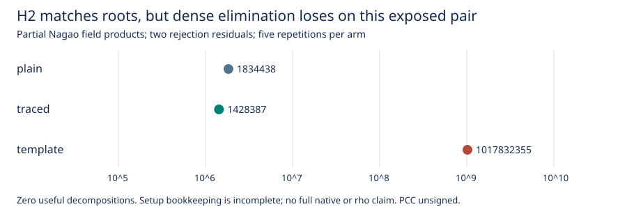

# H2 is exact, but loses the matched rejection-cost comparison

The Rust template/root adapter is integrated as an opt-in callback with
explicit plain/traced F4 fallback, preserved deadlines and attempted-work
audits. Its degree-7 construction is correct on the two exposed systems,
but it loses badly against the existing six-coordinate F4 paths at the
same root/Nagao materializer boundary. Keep the existing default.
Claims PCC-20261124-8ed801 and PCC-20261124-773135 are unsigned,
UNVERIFIED. [pcc:unverified]

| Arm | Partial Nagao field products per pair | Relative to traced |
|---|---:|---:|
| Plain F4 | 1,834,438 | 1.2843 |
| Traced F4 | 1,428,387 | 1 |
| Degree-7 H2 | 1,017,832,355 | 712.5746 |

Each count is identical across all five repetitions of its arm. The unit
is the sum of recorded Weil/F4/root/postprocessing products, including
fresh development F4 and measured compilation work in H2. Context/factor-base
setup and uninstrumented bookkeeping are excluded from this partial count;
they are inside the wall interval. Context counters overlap other fields
and are deliberately not added again. No full native total is available.
[pcc:unverified]

| Arm | Minimum local seconds | Median local seconds | Maximum local seconds |
|---|---:|---:|---:|
| Plain F4 | 0.007664002 | 0.007887210 | 0.009494961 |
| Traced F4 | 0.008276886 | 0.008449019 | 0.008870606 |
| Degree-7 H2 | 10.846889301 | 10.869866206 | 11.102456964 |

These are warm-process, cold-algorithm-cache component observations.
A/A max/min is1.0904338, inside the frozen1.10 limit. The plain/traced
median difference is inside that noise range; no wall ranking between
those two is supported. H2's median is1286.5 times the traced median on
this host. Native isolation reports uncontended, but unavailable PSI and
unsigned execution limit admission. External solver comparison was not
run; this is an internal comparison, with no fastest-tool claim.
[pcc:unverified]

## What was actually checked

All18 intervals ran: common traced warm-up, two traced A/A controls and
five fixed interleaved three-arm rounds. Every interval returns the same
one and two saved roots respectively, with resolved solver status and
identical factor-base/materializer fingerprints. There are54 root
occurrences across repetitions, but only three distinct saved roots on
two distinct exposed residuals. No fresh-population inference follows.
[pcc:unverified]

**Every arm returns zero decompositions on this pair.** Original-divisor
checks here are therefore vacuous; useful-relation output, success rate
and graph rank gain are unmeasured. The separate fixed p101/seed409
qualification exercises a positive materialized relation and both fallback
paths; that control is not a positive scientific sample in this panel.
[pcc:unverified]

H2 obtains its unrestricted development basis afresh on residual0, compiles
the template, then uses the development basis to materialize residual0.
It applies the template on residual1 with all original-generator membership,
input containment and S-pair checks. The latter accepts without fallback:
1,004,673,424 elimination products plus12,005,619 checker products.
The checker alone exceeds the entire traced pair's recorded product count.
Making dense elimination free would still leave the current exact-checking
design uncompetitive in this partial unit. This is a limitation of this
construction/checking path, not an impossibility theorem for templates.
[pcc:unverified]

Traced F4 learns on residual0 and replays successfully on residual1.
Its F4 subtotal is1,020,198 versus1,426,249 for plain F4; both root-stage
subtotals are398,639. Trace reuse removes work in this exposed pair,
while timing does not establish a plain/traced win. [pcc:unverified]

## Reproduction and custody

- Published source before execution: `99e80565ce7c3e72637bba7f2b73c8b1fb35278a`.
- [PROTOCOL.md](PROTOCOL.md), [worker.rs](worker.rs), [launch.sh](launch.sh),
  [source/binary pins](study-source-and-binary.sha256).
- Public-only [fixture](fixture/public.json); separate [validator roots](fixture/expected.json).
  Neither expected roots nor a saved basis enter the solver function.
- [Complete raw-data archive](results/raw.tar.xz), SHA256
  `3792993f536152116c19215ccea4c17e55770c0491f0f190a352b21a65b2a8eb`.
  Includes every event, full summary, native receipt, statuses, hashes,
  inputs and launcher. Executables are separate LOCAL objects with the
  published hashes; they are not hidden inside the small raw archive.
- [Read-only Rust analyzer](analyze.rs), [derived observations](results/analysis/derived.json),
  [PDF report](report.pdf). Re-analysis of the archived raw bytes matches
  derived JSON and SVG byte-for-byte. This is producer replay, not an
  independently signed verdict. [pcc:unverified]

Local root `/workspace/ic-local-runs/template-cost-20261124-01` retains
read-only worker and isolation binaries. AMD EPYC9V74 x86_64, CPU0,
one Rayon thread,8GiB virtual memory,600s watchdog. Native/launcher/posthash
statuses0, empty stderr, native wall54.7655s and max RSS77,136KiB.
No paid compute. S3 checkpoint gate1 lacks profile/token; LOCAL/Git custody
does not pass that gate. Canonical PCC prefix reconciliation, whole-root
compilation and signed admission remain separate open work. [pcc:unverified]

## Decision

Close this dense H2 cost registration as consumed. No unchanged retry,
larger dense bound or production-default change is justified by these data.
Preserve the exact constructor as a checked research component. A successor
must reduce both algebraic work and certificate cost, and must eventually
measure positive useful relations and cold full-graph cost. Review sparse
Frobenius/field-equation filtering and the actual curve's rho reference
before selecting the next finite test. No new hypothesis or run is
registered by that review item.

Sources: qualification and worker-design documents in this directory;
prior H2/Larsson and Joux–Vitse primary packets; existing F4/root/materializer
implementations and trace integration. KB unavailable as recorded in the
source qualification. No novelty or universal negative claim.

[Lane PR #5094](https://github.com/isogeny-labs/crypto/pull/5094) remains
draft for the ongoing research objective and publication reconciliation.
