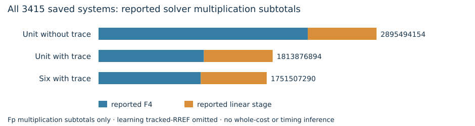

# Complete saved-cohort counter comparison

All3415 captured systems and3419 root multisets agree across the original unit and both traced paths. The analysis reads saved outputs only: zero new solver, relation-yield or timing calls. SHA256pins bind the three raw inputs and both full replay summaries. Unsigned PCC-20261123-400f7d. [pcc:unverified]

| Backend | Reported F4 Fp muls | Reported linear Fp muls | Sum of those counters |
|---|---:|---:|---:|
| Unit without trace | 2179269070 | 716225084 | 2895494154 |
| Unit with trace | 1097651810 | 716225084 | 1813876894 |
| Six with trace | 1065026764 | 686480526 | 1751507290 |

The full-cohort reported subtotal is lower for traced six than traced five. Reducing the coordinate count alone does not make this retained solver workload cheaper. This compares only the two emitted counters, not complete F4, descent or pipeline cost. The old and traced five linear-stage totals are identical; the six-variable basis has a different linear-stage count. [pcc:unverified]

The five path has3348replays,66mismatch flags and1recording; six3381/33/1. Every captured root set matches. These fixed controls do not prove a generic completeness guarantee for every future exceptional shape; the source acceptance/fallback audit remains open. [pcc:unverified]

Accounting finding: tracked RREF used to learn a trace lies outside the old field_ops counter. The retained rows lack that event trace, so summing them cannot reconstruct its cost. The separate Nov18descent-finder study gives its own bound; this analysis does not transfer it or reprice historical results. It agrees numerically with that study's six-trace F4/linear subtotals but is not its signed validation. [pcc:unverified]

Next comparison keeps both traced arities and charges trace learning, reduction/lifting, cold collection/graph/kernel work, random generation and verification. Runpod remains unfunded and checkpoint upload unavailable; no paid call started and no parity conclusion follows.

Sources: [proof-bound counters](../proof-bound-counter-summary.json), [analysis plan](../PLAN.md), [source review](../SOURCES.md), [native source](../../trace_cohort_summary.rs), [existing descent-finder study](../../leads-20261118/descent-finder/README.md), [prior full root controls](../../trace-integration-20261123/README.md).
