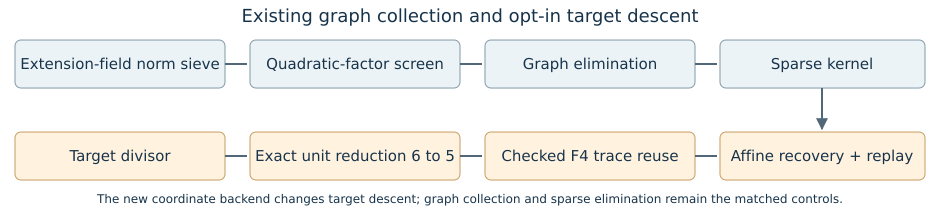
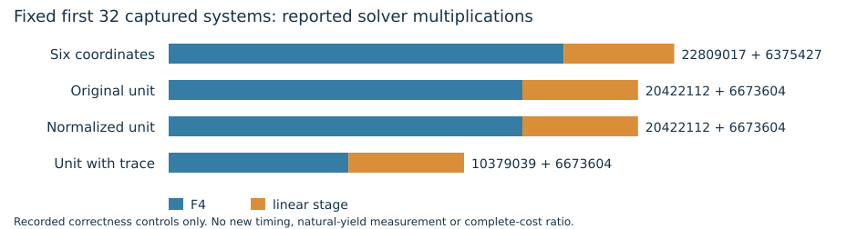

# Exact unit descent and checked trace reuse

Native Rust integration provides opt-in normalized-unit, traced-unit and traced-six backends. Original entry points keep their original behavior. Workers explicitly clear trace state and separate arities. Every trace mismatch takes the existing checked fallback; refusals are retained.

Both full recorded controls match all 3419 roots on the same 3415 saved Run51 systems: five-variable replay/fallback 3348/66, six-variable 3381/33. These are recorded correctness observations, not new natural-yield or timing trials. Unsigned PCC-20261123-ecef76. [pcc:unverified]

The four compact controls use the same first32 captured systems and34 roots, with one exact coordinate fingerprint. Counts come from the solver and exclude reduction, graph collection, other native control, hashing and serialization. No complete-cost, runtime or parity gain is inferred.

The earlier full-record Callgrind profiles include JSON/hash startup: original and normalized unit totals are 29290711138 and29289230219 simulated instructions. They are instruction attribution only. Original raw profiles and automated PDFs remain hash-bound LOCAL; long symbol tables in those PDFs overflow. The compact profiling schedule has not executed.

The full current-root library build fails on unchanged base syntax in binary_hyperelliptic_index_calculus.rs. Scoped binaries explicitly use the pinned Root41 library; scoped checks do not substitute for that gate. New Runpod measurement is blocked by the account balance and missing checkpoint upload route. No successor pod was created.

Sources: [five replay](../../validation/unit-trace-recorded-proof.json), [six replay](../../validation/six-trace-recorded-proof.json), [compact controls](../../coordinate-profile-20261123/), [native worker](../../../../examples/jv_sieve_fast_unit_deferred_compare.rs), [native per-arm checker](../../../../examples/jv_sieve_fast_unit_arm_check.rs), [Run51 observations](../../runpod-unit-deferred-20261117-51/report/REPORT.md). Joux–Vitse, §§3.1–3.3, [author PDF](https://www.lix.polytechnique.fr/~joux/notes/CoverDecomp.pdf); existing unit-elimination source e4af92fbc62ac21b6ae53d45d961de50ed60275f. KB unavailable; no novelty claim.
