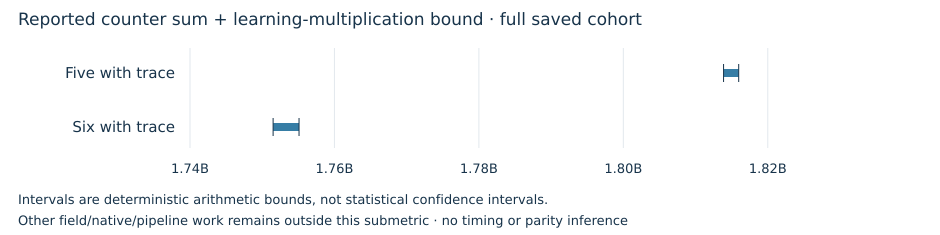

# Trace-learning bound and replay-contract audit

Eight fixed F4calls and six linear-stage controls on the first recorded system pass. Both arities reproduce the captured root under learning, self replay and ordinary reference. Three arithmetic-bound controls and strict scoped Clippy pass. This is recorded-input development mathematics, not a throughput trial. Unsigned PCC-20261123-ac5831. [pcc:unverified]

| Path | Recorded F4+linear sum | Missing learning multiplication upper | Included multiplication upper |
|---|---:|---:|---:|
| Five with trace | 1813876894 | 2097520 | 1815974414 |
| Six with trace | 1751507290 | 3589725 | 1755097015 |

The six-coordinate upper bound is below the five-coordinate recorded lower bound for this particular arithmetic subtotal. Each full saved stream has exactly one learning run, whose counter/matrix maxima match the new fixed control. Other operations and phases remain outside this comparison; no full-cost or runtime winner follows. [pcc:unverified]

For each learned matrix, let R be the pair-row upper count, C the full matrix column count, and k=min(R,C). Recorded rows/free columns form a subset. Bounds include R*C*k row multiplications, (R-1)*(C+1)*k additions including p-f, k inverse calls, 19*k Fermat multiplications at p1009, and (R-1)*k*ceil(R/64) contributor word ORs. Zero-sized matrices contribute zero. Sum each unit separately with checked u128. Inverse-call and Fermat-multiplication columns are alternative accounting, never charged twice. Allocation/copies/scans/bookkeeping remain missing.

All saved66five/33six mismatch cases meet the existing inconsistency-or-staircase<=64 predicate. Deliberately corrupted stored row indices return mismatch without that condition and are rejected by the audit predicate; they are not passed to the linear stage. This is synthetic API-contract evidence, not a naturally observed production failure. The stopping predicate is the existing rule, not a general Buchberger certificate or completeness theorem. [pcc:unverified]

No production source change is justified solely by this injected corruption. Dedicated worker traces remain internally generated and arity-separated, and all captured root sets match. Broader exceptional-input guarantees remain separate. New Runpod trials still require restored funds/checkpoint access and a new isolated cold protocol.

Sources: [original audit](../audit-original.json), [derived comparison](derived-comparison.json), [fixed plan](../PLAN.md), [native audit](../../trace_learning_audit.rs), [prior saved counters](../../trace-cohort-20261123/proof-bound-counter-summary.json). Source/immutable binary were published and hash-checked before the sole control. No elapsed values exported; library budget clocks remain internal.
