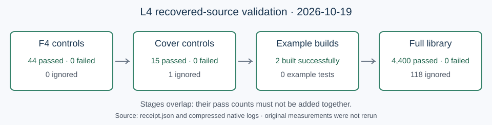

# L4 early-stop recovery and validation

The interrupted L4 implementation and 27 retained raw files are preserved with a fresh full release-library validation. This recovery launched validation only; it did not repeat the historical measurements.

The implementation adds opt-in Hilbert-based stopping with a guarded fallback, stopping/chunk diagnostics, and the `f4_stop_study` example. The recovered source is unchanged from the revision validated on the Linux worker. The original `aggregate.sh` is a no-op placeholder and is retained as historical evidence; the raw data and the separate saved-receipt audit do not constitute a completed performance comparison.

| Validation | Passed | Failed | Ignored |
|---|---:|---:|---:|
| F4 focused controls | 44 | 0 | 0 |
| Cover focused controls | 15 | 0 | 1 |
| Full release library | 4,400 | 0 | 118 |

Both `jv_cover` and `f4_stop_study` examples built successfully; both contain zero example tests. The focused tests overlap the full suite and their counts are not additive. Full library validation completed 2026-10-19 at 22:12:15 UTC, with 593.41 seconds reported by the test harness.

## Provenance and reproduction

- Base commit: `abee07ee7337d04a7e734333669ca1bacd6c763a` plus the recovered source changes committed with this report.
- `receipt.json` records all commands, source SHA-256 values, exit statuses, command limits and timestamps. The six source and manifest hashes were matched when copying into this checkout.
- Native validation ran on the shared EC2 worker, restricted to CPU cores 24-25, with `RAYON_NUM_THREADS=1`; the full suite used two test threads. This is correctness validation; no isolated performance claim is made.
- `f4-focused.log.gz`, `cover-focused.log.gz`, `examples.log.gz` and `full-library.log.gz` retain the complete outputs. `validation-driver.py` preserves the bounded host-side execution logic.
- `retained-input-manifest.json` hashes all 27 files in `../raw/`. Original measurement commands remain in `../run.sh`.
- Reproduce the full suite from the repository root with `cargo test --release --locked --offline --lib -j 2 -- --test-threads=2`. The exact focused and example commands are in the receipt.

The full saved-receipt analysis has 360 systems and 3,600 nonbaseline mode comparisons with recorded parity, but this is producer-record evidence. The p=251 cover receipts contain zero independent oracle checks. The native tests above do not retroactively provide independent replay for every saved measurement, and ignored tests remain unexecuted. No external-implementation ranking, total DLP cost improvement, or new leaderboard entry is established by this recovery.

The result diagram is a validation workflow because its test populations overlap; a quantitative performance chart would misrepresent this run. `REPORT.typ` is the editable source for the inspected `REPORT.pdf`. Canonical performance graphs and leaderboards remain unchanged: this package records recovered source and its test status, without promoting a performance result.
