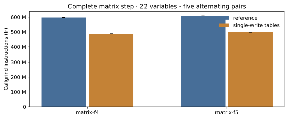
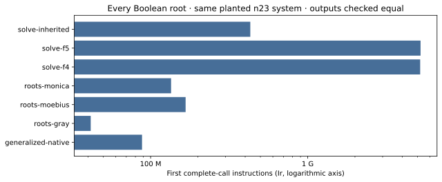
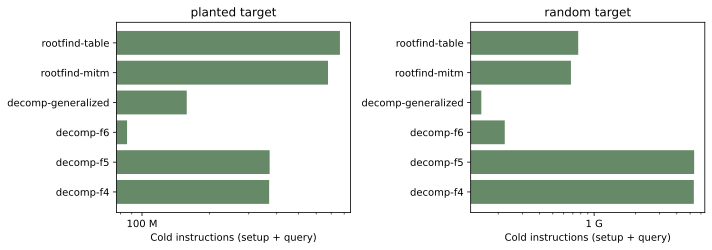

# Native generalized roots and Boolean F4/F5/F6 comparison

The opt-in single-write Gray-table builder reduces complete matrix-F4/F5
instruction work on the linked 22-variable fixture, with identical reduced
rows, rank and word-XOR accounting. These are Callgrind instruction results,
not admitted native runtime speedups. The production default is unchanged.

The missing bounded generalized-rootfinding execution path is now native Rust:
certified prime/binary/odd-extension fields; polynomial, affine-linearized and
partial rational-composition domains; complete enumeration, component MITM and
Boolean Gray dispatch; and a complete S3 separator retaining all original eight
coordinates. Ten independent tests pass, including poles, repeated and
inseparable roots, GF(2^83) extraction, a wide prime certificate, and literal
eight-coordinate separator enumeration. CLI fixtures return exactly two
Boolean roots and eight separator tuples. This completes these implementation
contracts; it does not establish the old hard-family 8x research target.

## Workload and measurement boundary

Baseline main: `1e2bf0715a2a927afc92e6730d6e65b59f15ab9e`.
The primary fixture is exactly `bool_gb/matrix_f4_deg4_m2_n23` and its F5
counterpart: K_1/GF(2^23), m=2, divisor index 0, seed 230, 22 Boolean unknowns,
degree 4. Its matrix has 8,449 columns, F4 5,842 rows, F5 5,566 rows, rank 5,289.
F5 prunes 276 rows. F4 performs 90,002,176 word XORs; F5 performs 83,289,643,
including 856 criterion XORs. Neither count changes under the candidate.

Same-binary controls use `KIC_GF2_WRITE_TABLE_ONCE=0/1`. Five A/A calls are
controls, and five alternating A/B pairs provide the primary comparison.
Screening calls are not pooled with confirmation. Seeds 231 and 232 are fresh
matrix holdouts; n17 and n19 are separate attempted scaling controls. The n17
pair completes; both n19 arms return None under the existing matrix limits in
both configurations, leaving four failed comparisons and no speed result.
Every successful matrix pair checks raw and canonical row-space output and
accounting. Root fixtures compare sorted complete sets against independent
Gray enumeration. Decomposition witnesses are re-added in the group and all
completed algorithms must agree on the verdict.

Host: Intel Xeon 6975P-C, x86-64, 32 logical CPUs, 132,915,908,608 bytes RAM,
Linux 6.18.54; rustc 1.99.1. Callgrind 3.19 uses merged worker threads and
explicit per-call regions. Its simulated ISA exposes AVX2, not the host's
native AVX-512. The local runtime preflight refused 32.30 unrelated CPU
seconds per second and CPU PSI avg10 78.26. Profiled elapsed times are never
used as native performance evidence. Clean-CI runtime qualification is a
separate run, analyzed by the native `runtime.rs` with A/A and the exact
3,125-resample paired bootstrap; it is not presumed successful here.

## Complete matrix instruction work



| engine | field degree | seed | reference Ir | candidate Ir | reduction | samples A/B |
|:--|--:|--:|--:|--:|--:|:--|
| matrix-f4 | 17 | 230 | 90,618,875 | 77,495,461 | 14.482% | 1/1 |
| matrix-f4 | 23 | 230 | 597,267,029 | 487,814,530 | 18.326% | 5/5 |
| matrix-f4 | 23 | 231 | 597,759,140 | 488,323,296 | 18.308% | 1/1 |
| matrix-f4 | 23 | 232 | 597,474,662 | 488,039,852 | 18.316% | 1/1 |
| matrix-f5 | 17 | 230 | 93,506,239 | 80,347,039 | 14.073% | 1/1 |
| matrix-f5 | 23 | 230 | 607,964,549 | 498,549,578 | 17.997% | 5/5 |
| matrix-f5 | 23 | 231 | 609,368,598 | 499,947,602 | 17.956% | 1/1 |
| matrix-f5 | 23 | 232 | 608,491,117 | 499,064,876 | 17.983% | 1/1 |

A/A controls, retained separately: matrix-f4: 597,256,829–600,117,876 Ir (0.477% spread; n=5); matrix-f5: 607,955,153–612,326,790 Ir (0.714% spread; n=5). Matrix error bars show the
recorded minimum/maximum of each arm's five confirmation samples.

The profile identified redundant zero initialization in the shared elimination
table. The candidate initializes only the zero entry and each subsequently
built entry, omitting unaddressable trailing entries of a partial final table.
The byte-level work changes; the mathematical rows and counted XORs do not.
The reused-storage test poisons buffers and independently checks every subset
XOR across partial groups, suffix widths and table sizes. The option remains
off until native runtime and regression evidence justify changing policy.

## Complete root sets



| solver, n23 planted fixture | first complete-call Ir | retained samples |
|:--|--:|--:|
| generalized-native | 88,159,189 | 5 |
| roots-gray | 41,546,652 | 1 |
| roots-moebius | 167,003,354 | 1 |
| roots-monica | 134,970,967 | 1 |
| solve-f4 | 5,202,510,761 | 1 |
| solve-f5 | 5,230,875,484 | 1 |
| solve-inherited | 431,085,932 | 1 |

The general API includes field/domain certification, input normalization,
backend dispatch and its complete result. Direct Gray search is cheaper;
the new solver dispatches to that existing backend for Boolean quadratics.
This is integration and completion, not a novel exhaustive-search algorithm.
Four root fixtures cover one planted and one random target at each n17/n23.
The generic Boolean F4-basis arm hit its 50-second profiling budget on n23's
planted fixture; its cost is unknown, and the failed run is retained. Its
other three completed root sets match. A profile timeout is not a no-root
answer. The n17 solver fixture here is a scaling control, not the old
eight-target `boolean-solver.pdf` workload.

## Same-target decomposition, including reusable setup



| method | target kind, n23 | cold Ir |
|:--|:--|--:|
| decomp-f4 | planted | 369,843,120 |
| decomp-f4 | random | 5,324,766,383 |
| decomp-f5 | planted | 371,711,269 |
| decomp-f5 | random | 5,354,145,741 |
| decomp-f6 | planted | 85,755,496 |
| decomp-f6 | random | 223,325,152 |
| decomp-f6-pairs | planted | 85,758,949 |
| decomp-f6-pairs | random | 223,328,344 |
| decomp-generalized | planted | 158,458,617 |
| decomp-generalized | random | 150,711,349 |
| rootfind-mitm | planted | 677,747,599 |
| rootfind-mitm | random | 677,746,987 |
| rootfind-table | planted | 766,095,496 |
| rootfind-table | random | 765,718,612 |

F6 uses exact factor-base geometry inside inherited F4; it has no standalone
matrix-step entry point. Its first verified decomposition is compared at
the decomposition boundary. The generalized arm includes encoding, complete
root solving and lifting. Rootfind-mitm is the actual `ic_framework/rootfind`
backend, using the exact same signed points. Rootfind-table is the existing
Koblitz pair table. Their setup is profiled separately and added once for the
primary cold comparison; online-only query figures are retained in JSON.
At m=2 the indexed F6 arm also ran and agreed; no m=3-only memoryless backend
is presented as an m=2 result. These are stage measurements, not full IC/rho.

## Validation, limits and replay

See [validation](VALIDATION.md), [protocol](PROTOCOL.md), [native summary](summary.json),
[native analyzer](analyze.rs), [runtime qualification](runtime.rs), and
[runner](run-profile.sh). The frozen first driver is in `records/driver-snapshot.rs`;
binary and source hashes, initial profiles, isolation refusal and failed runs
are preserved. The final generic driver and all field/solver sources are
versioned with the study. Raw run records are archive members:

```sh
cd research/f4_f5_boolean_perf_20261018
sha256sum -c runs.tar.xz.sha256
tar -xJf runs.tar.xz
```

Rebuild `analyze.rs` against the repository's serde_json/blake3 dependencies
and pass this study directory; it rechecks outputs and merged-thread profiles.
`summary.json` records relative archive-member paths and provenance hashes.
No Python algorithm, harness, verifier or comparison calculation is used;
this rendering script only lays out native recorded values.

Magma, msolve, FGb, Singular and PolyBoRi are unavailable on this host; their
matched external comparisons have not run. No fastest-implementation claim
is made. Arm64, GPU and native AVX-512 runtime are not measured by this study.
The original hard implicit-domain generalized-rootfinding qualification stays
open in [its problem record](../../problems/generalized-rootfinding-all-roots-8x.md).

| requested requirement | status |
|:--|:--|
| Improve F4/F5 for the linked matrix | Implemented opt-in and instruction-verified; native speed qualification separate |
| Compare F6 | Verified same-target decomposition instructions and witnesses |
| Compare generic and Semaev root solvers | Verified complete root sets and cold/query decomposition costs; one generic GB timeout retained |
| Find and finish missing native generalized solver | Bounded native solver and complete separator implemented; ten independent tests and CLI fixtures pass |
| Old hard-family all-roots 8x research qualification | Unresolved; no new claim or relaxed gate |
| Full library verification and clean runtime | See validation; no unsupported full-suite success is inferred |

The component panel and all leaderboard twins are regenerated from the native
summary. Tables A-C, the IC/rho progress timeline, curve facts and aggregate
historical performance series remain unchanged: this study supplies no new
whole-pipeline ratio, curve identity or exponent. Its own plots and PDFs are
copied to `benchmarks/20261018-f4-f5-boolean-perf/`.
