# Native F4/F5, F6 and root solvers

Native F4/F5, F6 and both root-solving families; bounded public Koblitz m2 Boolean fixtures. Final same-host table: run 20261019-024352-boolean-native-policy-ty-fb16d2. Five admitted samples per arm, four primary fixtures, fresh paired planted holdouts231/232. Complete roots and first-witness decomposition have separate boundaries. Every output is checked against complete scalar roots or the original group equation.

Final host: Intel(R) Xeon(R) Platinum 8488C; rustc 1.99.1 (58cf8f9c3 2026-10-13); reserved CPUs 3,7; c7i.2xlarge on-demand, one Rayon worker, exclusive reserved physical core, isolation receipts and A/A. VM neighbours/frequency remain outside the reservation. Failed and contended attempts are retained, excluded, and counted in each JSON summary.

n17: icv1-f2m17-tm101-00378d4e,16 Boolean variables,205 base points, group order 131,174. n23: icv1-f2m23-tm5197-1f85e9e1,22 Boolean variables,2071 base points, group order 8,393,806. Exact constructor output is fixture-identities.json. n19 is a 36-variable implementation-limit refusal, not an intermediate-size timing.

Planted target uses seed230; generator control is the registered generator. The old driver flag random=true does not generate a random target for its single-target invocation. TARGET_LABEL_CORRECTION.md explicitly corrects that earlier label without rewriting frozen inputs or raw records. These cases do not establish an average-case ranking.

Complete-root runs start from the prepared ANF or JSON representation for that API; system construction and JSON encoding are charged when rebuilt in the decomposition wrapper. Cold decomposition charges fresh target-dependent ANF construction, solving, lifting and verification; Semaev arms additionally charge fresh oracle/table preparation once. Common curve/base/context construction is outside every solver interval. Independent complete-root and final group-audit checks run after elapsed capture for all arms. Instrumented query timings include common driver metadata/wrapper overhead and are not bare-kernel latency. No whole-IC/rho ratio is supplied.

F6 is compared through the repository's first-witness decomposition APIs; no complete-original-root F6 API is benchmarked here. The original n23 planted system has two Boolean roots and the generator system has none. Exact complete-root output is a separate obligation from returning one group witness.

The original single-write matrix route qualifies a small native improvement on the primary fixture. Extra SIMD table construction is neutral at both measured sizes and remains experimental. Semaev batch construction preserves every key, first witness, insertion order and abstract group charge; the n23 cold improvement is about 3.6x. Each before/after ratio is from its own same-host experiment; ratios across hosts are never multiplied or pooled.

Iteration1 generalized JSON improvements borrow input, simplify exact evaluation and integrate the existing SIMD Gray kernel. Same-candidate ablations found SIMD slower at 16 variables and faster at 22; auto now keeps scalar below 22. Fresh confirmation measures that policy and the typed F2BoolPoly entry, which avoids JSON/BigUint conversion while retaining exact counts, output caps, budgets, original coordinates and root verification. This is engineering integration, not a new enumeration algorithm.

Single-write, SIMD tables, serial row clearing and batched Semaev setup remain opt-in; extra SIMD tables were neutral. The first serial guard regressed one four-worker control; the refined guard requires explicit RAYON_NUM_THREADS=1 and a current one-worker pool. Generalized auto uses scalar below22 variables and wide Gray when available at22 or more. Typed input avoids JSON; exact counts and original-root verification remain enforced. The18-arm costs precede serial-clear experiments and do not claim their complete-root speedup.

Fresh confirmation retains all outcomes: all 16 typed cells qualify faster than iteration1; n17 prepared JSON roots qualify faster on all four primary/holdout cases. n23 prepared JSON controls are neutral. One n23 planted JSON decomposition control regresses about 3.5% (before/after 0.9654); it is not hidden or described as regression-free. The typed route qualifies about 6x against that frozen wrapper on the same fixture.

Native comparison/admission, statistics and ratios are computed by the Rust analyzers. Five paired ratios use all 3125 bootstrap resamplings with percentile indices78/3046; qualification additionally requires effect greater than max(2%, twice median absolute A/A noise). Charts show recorded medians and min/max; full CI, individual rounds and rejected attempts remain in JSON/raw archive. Python only renders these prepared values.

Validation:13 standalone generalized-solver tests, strict Clippy, example build/tests, exact batched-map and binary/prime backend tests. Before the merge, 4,398 nonignored library tests were covered by passing executions: the8-thread suite had one unchanged time-budget failure, which passed serially; a separate serial full run passed4397 before the new map test. Post-merge latest-candidate serial run:4,397 passed,10 failed,118 ignored; nine failures were sandbox-denied network binds and one was an unchanged wall-threshold test. The network suite then passes38/38 with network access and the exact wall test passes serially. All 4,407 nonignored tests are covered by passing executions. The refined explicit-one-worker guard then passes a complete network-enabled serial library run:4,407 passed,0 failed,118 ignored, exit0. Its four worker/switch kernel configurations and SDK/Clippy/example checks pass. Earlier failing and interrupted invocations remain retained with their actual outcomes.

Limits: no external Magma/msolve/FGb/Singular/PolyBoRi runtime comparison, Arm64/GPU measurement or whole-IC/rho promotion. The generalized native field/domain and full eight-coordinate S3 separator are functionally implemented; these m2 timings do not qualify m5 separator performance or the old20-case/8x hard all-roots research gate. The open problem record remains authoritative.

Next measured bottlenecks: repeated F4/F5 matrix construction and recursive complete-root solving, plus the remaining native search kernel in typed generalized decomposition. The fresh typed wrapper is close to its prepared-input root cost; conversion/normalization was the dominant avoidable wrapper cost. Preserve output/accounting contracts and qualify any further layout or construction change with the same paired controls. Leaderboard component panels and browser are regenerated; tables A-C, curve facts and the IC/rho progress series are unchanged because the unit/boundary differs.

Evidence: initial-summary.json and PROTOCOL.md (run 014036 baseline); optimization-summary.json and OPTIMIZATION_PROTOCOL.md (run 013858 first candidate); final-summary.json and FINAL_PROTOCOL.md (run 014050 Semaev); policy-summary.json, policy-comparison-summary.json and POLICY_PROTOCOL.md (run 024352 confirmation). Source/binary hashes, protocols, commands, every retry, preparation failures and corrected/failed auxiliary Callgrind profiles are retained. Callgrind Ir is not native runtime. See RAW_EVIDENCE.md for archive extraction and immutable job locations.

The initial serial-clear matrix trial qualifies all eight one-worker cells faster but regresses the n17 F4 four-worker control (ratio0.8436). The unrestricted registry-query guard is not regression-free. serial-clear-summary.json preserves all outcomes. The refined source requires explicit one-worker configuration before querying Rayon; its fresh confirmation and direct legacy ablation have a separate protocol, summary and report. The eighteen-arm solver costs above precede both experiments with serial clearing off; they are not silently repriced.

The fresh explicit-one-worker confirmation qualifies all eight one-worker incremental cells faster; all four four-worker controls are neutral. Primary n23 incremental ratios are1.0802 F4 and1.0730 F5. Direct legacy to candidate ratios on this same host are1.1141 F4 and1.1209 F5, rather than products of earlier experiments. All12cells have five eligible pairs; eleven rejected attempts remain. Activation stays opt-in. These matrix-call gains do not establish a complete-root or decomposition improvement.

## n23 complete_roots, planted; five samples, ratio relative to F4

|Method|Cold ms|n|F4 / method|
|---|---|---|---|
|generalized-native|2.7533|5|131.150|
|generalized-typed|1.4494|5|248.149|
|generic-gb|669.8408|5|0.538|
|roots-gray|2.5987|5|138.912|
|roots-moebius|34.4747|5|10.448|
|roots-monica|11.9093|5|30.193|
|roots-wide|1.4275|5|252.955|
|solve-f4|360.1913|5|1.000|
|solve-f5|363.9447|5|0.991|
|solve-inherited|40.4737|5|8.896|

## n23 complete_roots, generator; five samples, ratio relative to F4

|Method|Cold ms|n|F4 / method|
|---|---|---|---|
|generalized-native|2.7096|5|135.873|
|generalized-typed|1.4774|5|249.159|
|generic-gb|449.6532|5|0.818|
|roots-gray|2.7031|5|136.175|
|roots-moebius|34.8805|5|10.553|
|roots-monica|12.0878|5|30.491|
|roots-wide|1.4900|5|247.049|
|solve-f4|368.1564|5|1.000|
|solve-f5|372.7797|5|0.988|
|solve-inherited|39.3968|5|9.342|

## n23 decomposition, planted; five samples, ratio relative to F4

|Method|Cold ms|n|F4 / method|
|---|---|---|---|
|decomp-f4|26.3691|5|1.000|
|decomp-f5|26.2727|5|1.004|
|decomp-f6|7.3539|5|3.610|
|decomp-f6-pairs|7.3983|5|3.552|
|decomp-generalized|9.2244|5|2.859|
|decomp-generalized-typed|1.4781|5|17.840|
|rootfind-mitm|46.3986|5|0.564|
|rootfind-table|131.0207|5|0.201|

## n23 decomposition, generator; five samples, ratio relative to F4

|Method|Cold ms|n|F4 / method|
|---|---|---|---|
|decomp-f4|370.4942|5|1.000|
|decomp-f5|375.1102|5|0.988|
|decomp-f6|18.6067|5|19.910|
|decomp-f6-pairs|18.3590|5|20.178|
|decomp-generalized|9.3417|5|39.691|
|decomp-generalized-typed|1.4931|5|248.331|
|rootfind-mitm|45.6419|5|8.117|
|rootfind-table|130.1315|5|2.853|

## Same-host paired changes; different rows are not pooled

|Change|Target|Before ms|After ms|Ratio|Decision|
|---|---|---|---|---|---|
|matrix-f4 single-write|planted|56.0625|53.9084|1.0400|faster|
|matrix-f5 single-write|planted|58.1545|55.9272|1.0363|faster|
|Semaev batched cold setup|planted|144.6895|40.1599|3.6050|faster|
|Semaev batched cold setup|generator|145.1419|40.4301|3.5899|faster|
|n17 generalized typed entry|planted|2.7787|0.2124|12.9877|faster|
|n17 generalized typed entry|generator|2.7740|0.2178|12.6796|faster|
|n23 generalized typed entry|planted|9.1164|1.5370|6.0022|faster|
|n23 generalized typed entry|generator|9.2590|1.5568|6.0379|faster|
|initial n17 F4 four-worker control|planted|8.3357|9.8786|0.8436|slower|
|matrix-f4 guarded serial clearing|planted|53.4171|49.6467|1.0802|faster|
|matrix-f4 legacy to guarded candidate|planted|54.9114|49.6467|1.1141|faster|
|matrix-f5 guarded serial clearing|planted|56.6003|52.8025|1.0730|faster|
|matrix-f5 legacy to guarded candidate|planted|59.2979|52.8025|1.1209|faster|

## Fresh cutoff and typed-entry confirmation, all holdouts

|Arm|n|Seed|Target|Old/JSON|Decision|Old/typed|Decision|
|---|---|---|---|---|---|---|---|
|generalized-native|17|230|planted|1.2909|faster|4.2625|faster|
|decomp-generalized|17|230|planted|1.0847|faster|12.9877|faster|
|generalized-native|17|230|generator|1.2461|faster|4.1444|faster|
|decomp-generalized|17|230|generator|1.0613|neutral|12.6796|faster|
|generalized-native|17|231|planted|1.2162|faster|4.2937|faster|
|decomp-generalized|17|231|planted|1.0607|faster|11.5310|faster|
|generalized-native|17|232|planted|1.2148|faster|4.1460|faster|
|decomp-generalized|17|232|planted|1.0568|neutral|11.9363|faster|
|generalized-native|23|230|planted|0.9744|neutral|1.8596|faster|
|decomp-generalized|23|230|planted|0.9654|slower|6.0022|faster|
|generalized-native|23|230|generator|1.0099|neutral|1.8610|faster|
|decomp-generalized|23|230|generator|1.0151|neutral|6.0379|faster|
|generalized-native|23|231|planted|1.0243|neutral|1.9342|faster|
|decomp-generalized|23|231|planted|0.9830|neutral|6.0849|faster|
|generalized-native|23|232|planted|0.9985|neutral|1.9497|faster|
|decomp-generalized|23|232|planted|1.0136|neutral|6.0081|faster|

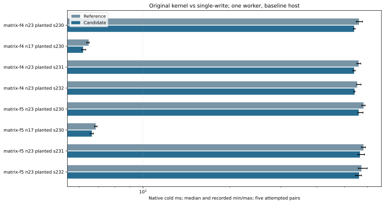
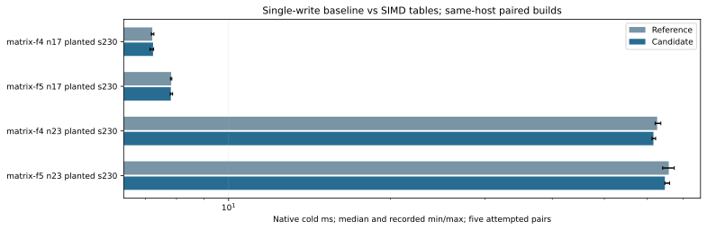
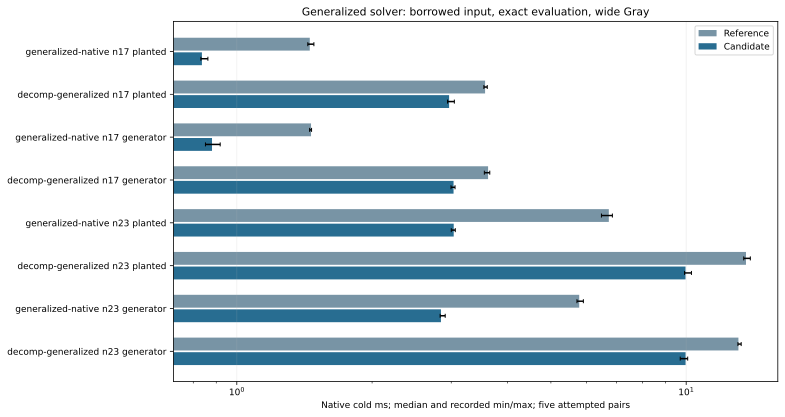
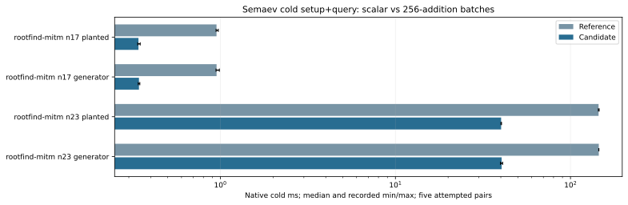
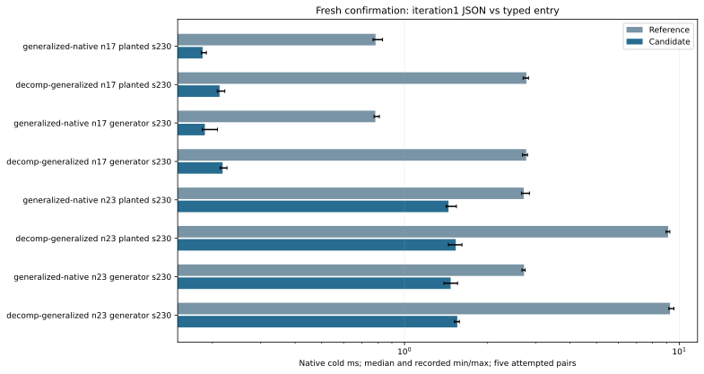
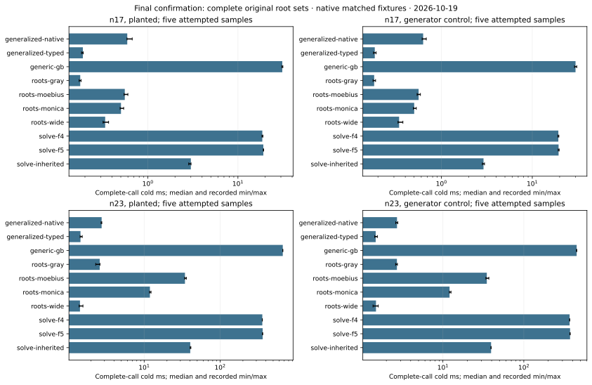
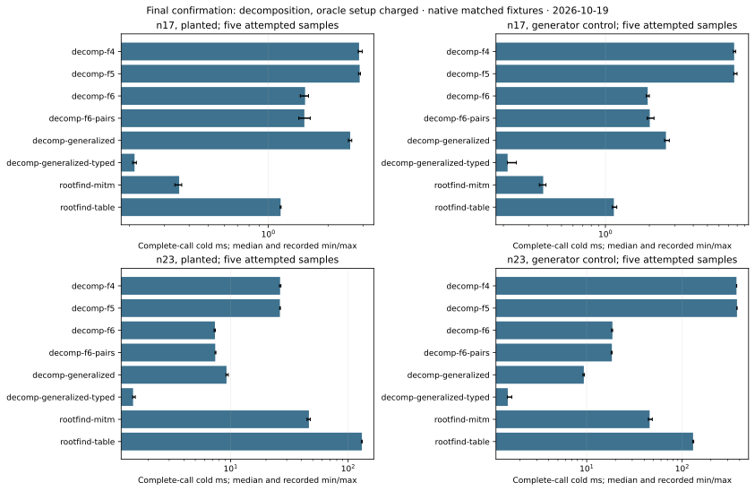

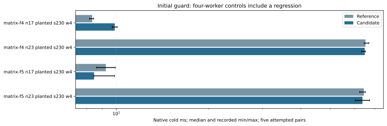
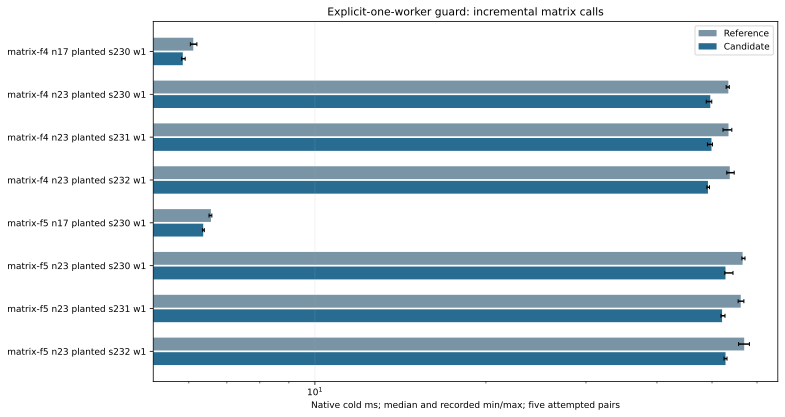
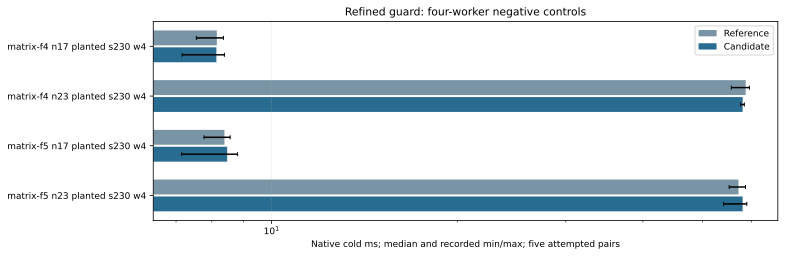
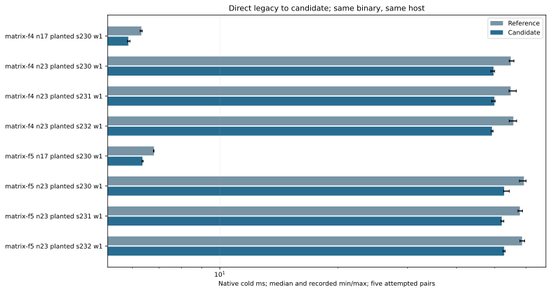
