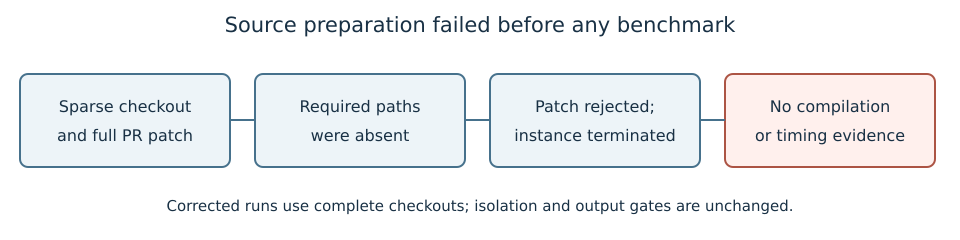

# Source-preparation failure

Run 20261019-012707-boolean-native-optimizat-abf14c. Source preparation only; c7i.2xlarge on-demand. The instance terminated automatically.

The working-tree patch included PR files outside the sparse checkout. git apply rejected the patch before compilation or timing. No native cost or speed ratio exists for this attempt.

Raw receipts: preparation-failures/optimization-job.json, optimization-status.json and optimization-job.log. Corrected runs use complete checkouts; no measurement gate was weakened.

