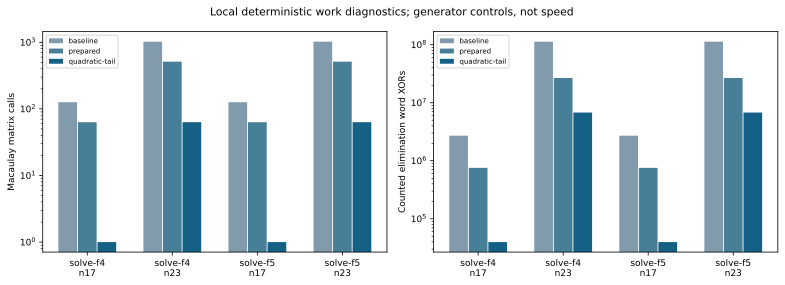
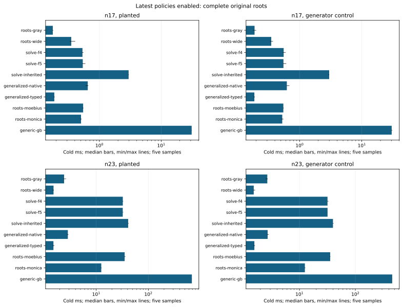
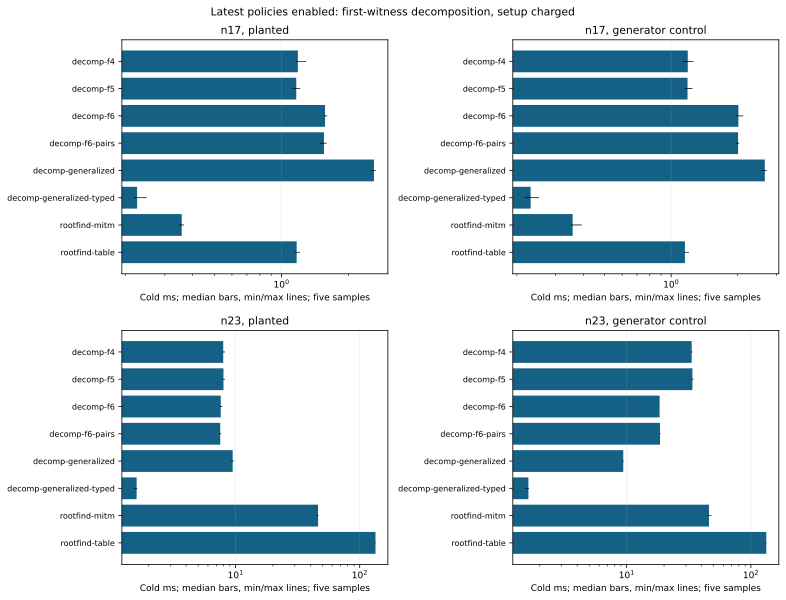
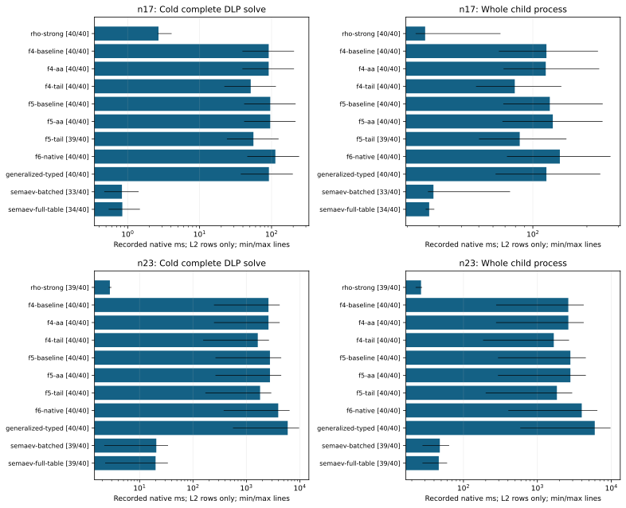

# F4/F5 construction, recursive roots and complete recovery

Continuation of the original Boolean matrix study: direct cached F4/F5 packing, bounded quadratic recursive tails, specialized column lookup, adaptive degree scheduling, serial one-worker full-table setup, a fresh eighteen-arm native comparison and full ecbench DLP recovery. Final source9bed104b0a and frozen baseline a78cc8906; earlier sources0acfc55b7f/71c4c99d85 remain separate intermediate evidence, including their full-pipeline regressions.

n23 planted solve-f5, complete roots: baseline 371.0485ms; final 32.2656ms; paired baseline/final 11.5008; CI95 [10.888096262128801, 11.72089850764556]; decision faster. Five same-host paired rounds; all other inputs and controls remain in the native run report.

n23 planted solve-f4, complete roots: baseline 365.4568ms; final 32.4994ms; paired baseline/final 11.2209; CI95 [11.161767619495334, 11.529210918687241]; decision faster. Five same-host paired rounds; all other inputs and controls remain in the native run report.

Matrix-F4/F5 here are degree-bounded algebraic solvers with splitting; the new tail is an explicit hybrid with the existing scalar Gray search. Complete roots and first-witness decomposition are separate tasks. Full ecbench recovery additionally includes every DLP phase and uses separately declared standard-subspace bases.

Validation:4,414 release library tests passed,0 failed,118 ignored;17 end-to-end integration tests passed, including48 exact policy/generalized recoveries/replays. Standalone SDK13 tests and strict Clippy pass. The legacy n17 session verifies528 records and reproduces440 measured runs with the corrected current binary. Both local adaptive screens verify16 records each (8 warmups) and reproduce all8 measured runs; the pre-version screen uses its frozen source. Strict root Clippy still fails on one unchanged PMAC lint; its separately retained scoped diagnostic passes with only that existing lint allowed, without waiving the strict failure. Merged-owner backlog integration with pinned Cairn9.1.0 passes13/15; two tests fail on an unchanged baseline quintic card with an unbound artifact placeholder. Cover assessment verification and refreshed-lockfile metadata checks pass.

Native comparisons and admission are prepared in Rust; Python only lays out recorded summaries. Five same-host paired rounds and A/A remain mandatory; Semaev setup is cold charged. The ecbench harness supplies its own sealed-session audit and comparison admission. No local unisolated wall, cross-host product, lower-bound ratio or stage-only result is promoted to a full-pipeline speedup.

The raw archive, exact commands and source/binary/host manifests preserve reproducibility. All new policies are explicit and opt-in, preserving old method defaults and frozen evidence. External fastest comparisons, Arm64/GPU, n19's36-variable matrix admission, and the old hard-family/8x research gates remain open.

Full ecbench n17 f4, candidate/baseline cold solve time: 0.5623; CI95 [0.5599368512706958, 0.5651490815056114]; admission admitted, outside A/A noise True. All requested L2 timing coverage: False; 0 of 40 matched pairs below L2. Process clocks, partial prices and every failure remain in its run report.

Full ecbench n17 f5, candidate/baseline cold solve time: 0.5822; CI95 [0.5795548493574879, 0.5839443622722156]; admission admitted, outside A/A noise True. All requested L2 timing coverage: False; 1 of 40 matched pairs below L2. Process clocks, partial prices and every failure remain in its run report.

Full ecbench n23 f4, candidate/baseline cold solve time: 0.6309; CI95 [0.6299009971212228, 0.6315614249975599]; admission admitted, outside A/A noise True. All requested L2 timing coverage: False; 0 of 40 matched pairs below L2. Process clocks, partial prices and every failure remain in its run report.

Full ecbench n23 f5, candidate/baseline cold solve time: 0.6532; CI95 [0.6526133456284446, 0.6539370178846236]; admission admitted, outside A/A noise True. All requested L2 timing coverage: False; 0 of 40 matched pairs below L2. Process clocks, partial prices and every failure remain in its run report.

