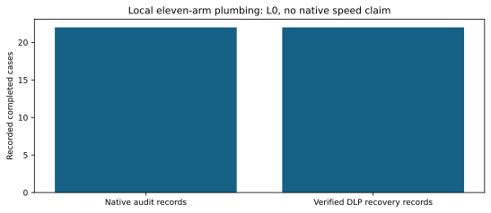

# Local complete-recovery correctness controls

Eleven arms, two public n11 targets; every one of the22 records verifies, and all22 audit replays reproduce. This is a plumbing/correctness session at L0, not a performance result.

The separate integration test recovers and replays32 DLP cases across Koblitz and generic binary curves. New Gray work appears as unpriced native counters; old method defaults remain unchanged.

Source0acfc55b7f; local CPU/compiler and binary hashes are adjacent. Raw sealed session: runs/local-smoke; audit: local-smoke.audit.json. Shared local elapsed time is not quoted.

