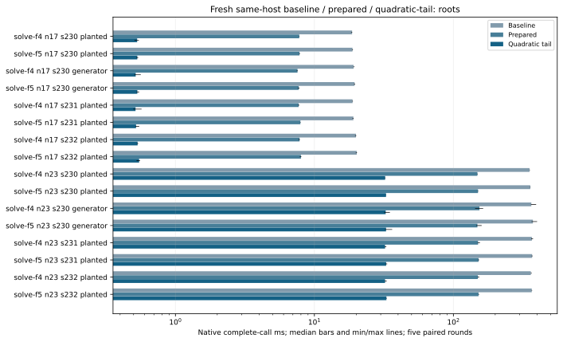
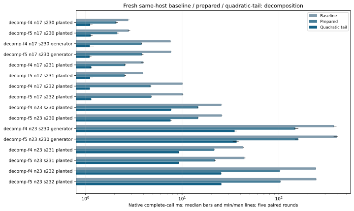
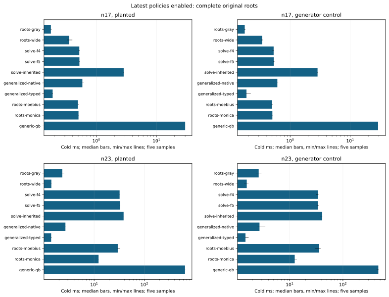
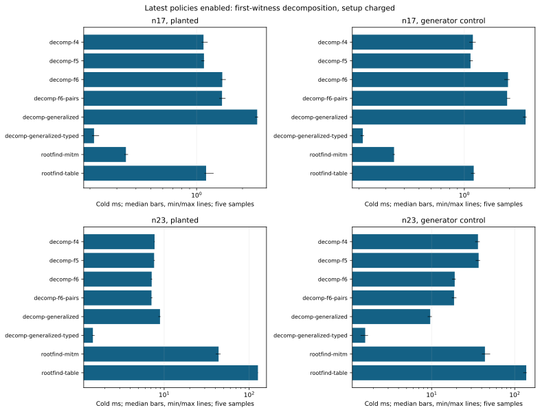

# Native F4/F5, F6 and root solvers

Run 20261019-165506-boolean-recursive-native-188e81, source 0acfc55b7f. Dedicated c7i.2xlarge, one worker and a reserved complete physical core; four-worker controls reserve two cores/SMT siblings. Exact source/compiler/CPU/ISA and binary manifests remain in the raw tree. Baseline: frozen a78 algorithm with all three previously qualified GF2 switches. Candidate: identity-bound prepared construction and bounded quadratic-tail policies.

Original n17/n23 fixtures have16/22 Boolean variables on icv1-f2m17-tm101-00378d4e / icv1-f2m23-tm5197-1f85e9e1. Planted seed230 and fixed generator control plus planted holdouts231/232; random=true means generator here. n19's36-variable admission gap remains separate. No fixture or baseline is replaced by the full-DLP standard subspaces.

All eighteen arms are rerun with this source's declared policies. Complete original roots and first-witness decomposition remain separate; common curve/base construction is outside component timings. Fresh target ANF, solving, lifting and internal verification are charged to decomposition; Semaev fresh table setup is charged once. Independent original-root/group audits run after elapsed capture.

Five paired rounds, first eligible of at most three attempts, exact original outputs, exact3125-resample CI and max(2%, twice A/A noise) gate. Rejected attempts retained: 42. All four multiworker controls neutral: True. Every slower/neutral/missing cell remains in native-summary.json.

Prepared is a combined active-layout/top-degree/linear-tail/direct-packing ablation. Quadratic-tail retains an algebraic root reduction, then exhaustively completes at most16 free quadratic variables using the existing Gray kernel; original coordinates, root order, caps and verification remain enforced. This is a hybrid engineering change, not a novel enumeration algorithm. Other split rules/custom node oracles keep recursion.

The matrix switches stay opt-in. Source/protocols: 0acfc55b7f, PROTOCOL.md and the frozen runner/protocols in the raw tree. Sources0acfc55b7f,71c4c99d85 and9bed104b0a are separate experiments. The final adaptive variants preserve cheap degree-two refutations below16 original variables; legacy policy names remain for replay. Full-table setup uses the same exact sorted tuples serially under an explicit one-worker resource contract. No cross-host pooling, external-fastest, Arm64/GPU, whole-IC/rho or hard-family8x conclusion follows from component calls.

## All paired recursive-solver outcomes

|Arm|n|Seed|Target|Before ms|Candidate ms|Ratio|Decision|
|---|---|---|---|---|---|---|---|
|solve-f4|17|230|P|18.6683|0.5305|35.2518|faster|
|solve-f5|17|230|P|18.7984|0.5316|35.2952|faster|
|decomp-f4|17|230|P|2.7783|1.1205|2.4795|faster|
|decomp-f5|17|230|P|2.8139|1.1352|2.4746|faster|
|solve-f4|17|230|G|19.1387|0.5177|37.1055|faster|
|solve-f5|17|230|G|19.4664|0.5320|36.5932|faster|
|decomp-f4|17|230|G|7.5975|1.1128|6.8504|faster|
|decomp-f5|17|230|G|7.6835|1.1053|6.9513|faster|
|solve-f4|17|231|P|18.8223|0.5164|36.6637|faster|
|solve-f5|17|231|P|19.0790|0.5209|36.5280|faster|
|decomp-f4|17|231|P|3.9782|1.1500|3.4860|faster|
|decomp-f5|17|231|P|3.9246|1.1189|3.4978|faster|
|solve-f4|17|232|P|19.9130|0.5343|37.2596|faster|
|solve-f5|17|232|P|20.1732|0.5480|36.7255|faster|
|decomp-f4|17|232|P|10.0959|1.1127|9.0538|faster|
|decomp-f5|17|232|P|10.1780|1.1489|8.8757|faster|
|solve-f4|23|230|P|353.2220|32.2922|10.9370|faster|
|solve-f5|23|230|P|357.6871|32.7721|10.9144|faster|
|decomp-f4|23|230|P|25.4665|7.6754|3.3198|faster|
|decomp-f5|23|230|P|25.7097|7.5960|3.3838|faster|
|solve-f4|23|230|G|363.7493|32.5795|11.3016|faster|
|solve-f5|23|230|G|373.4116|32.7732|11.3496|faster|
|decomp-f4|23|230|G|371.3619|34.8908|10.7285|faster|
|decomp-f5|23|230|G|396.3342|36.5644|10.9111|faster|
|solve-f4|23|231|P|367.1030|32.2413|11.3808|faster|
|solve-f5|23|231|P|368.6304|32.8270|11.2185|faster|
|decomp-f4|23|231|P|42.8434|9.2654|4.6716|faster|
|decomp-f5|23|231|P|43.9673|9.2237|4.8108|faster|
|solve-f4|23|232|P|360.9062|32.2386|11.2066|faster|
|solve-f5|23|232|P|366.3932|32.9762|11.1061|faster|
|decomp-f4|23|232|P|241.0781|25.3208|9.5504|faster|
|decomp-f5|23|232|P|243.2470|25.4276|9.5887|faster|

## Latest native complete-call ms (sample count)

|Boundary|Method|n17 planted|n17 generator|n23 planted|n23 generator|
|---|---|---|---|---|---|
|complete_roots|roots-gray|0.1757 (5)|0.1752 (5)|2.3277 (5)|2.6233 (5)|
|complete_roots|roots-wide|0.3535 (5)|0.3420 (5)|1.4074 (5)|1.5652 (5)|
|complete_roots|solve-f4|0.5217 (5)|0.5308 (5)|32.1783 (5)|34.0685 (5)|
|complete_roots|solve-f5|0.5240 (5)|0.5350 (5)|32.7056 (5)|33.8614 (5)|
|complete_roots|solve-inherited|2.8529 (5)|2.8616 (5)|38.6296 (5)|40.8531 (5)|
|complete_roots|generalized-native|0.5866 (5)|0.6117 (5)|2.6846 (5)|2.7184 (5)|
|complete_roots|generalized-typed|0.1881 (5)|0.1874 (5)|1.3946 (5)|1.4821 (5)|
|complete_roots|roots-moebius|0.4946 (5)|0.5007 (5)|29.5689 (5)|35.9190 (5)|
|complete_roots|roots-monica|0.5060 (5)|0.5054 (5)|12.2638 (5)|12.4504 (5)|
|complete_roots|generic-gb|30.0242 (5)|29.1847 (5)|645.4938 (5)|461.8308 (5)|
|decomposition|decomp-f4|1.1100 (5)|1.1397 (5)|7.7178 (5)|36.1335 (5)|
|decomposition|decomp-f5|1.1176 (5)|1.0993 (5)|7.6194 (5)|36.7864 (5)|
|decomposition|decomp-f6|1.4737 (5)|1.9511 (5)|7.1367 (5)|18.9605 (5)|
|decomposition|decomp-f6-pairs|1.4674 (5)|1.9250 (5)|7.0985 (5)|18.6299 (5)|
|decomposition|decomp-generalized|2.4957 (5)|2.5524 (5)|8.9416 (5)|9.6225 (5)|
|decomposition|decomp-generalized-typed|0.2126 (5)|0.2116 (5)|1.4523 (5)|1.5887 (5)|
|decomposition|rootfind-mitm|0.3440 (5)|0.3413 (5)|43.6873 (5)|43.8226 (5)|
|decomposition|rootfind-table|1.1543 (5)|1.1549 (5)|126.7873 (5)|137.6003 (5)|

## Four-worker matrix controls

|Arm|n|Before ms|After ms|Ratio|Decision|
|---|---|---|---|---|---|
|matrix-f4|17|8.3096|8.1812|1.0157|neutral|
|matrix-f5|17|8.1900|8.1191|1.0087|neutral|
|matrix-f4|23|60.4794|60.8922|0.9826|neutral|
|matrix-f5|23|58.3452|58.8872|0.9535|neutral|

## Instrumented matrix phase medians, ms; separate nonadditive observations

|Arm|n|Target|Policy|Build ms|Reduce ms|Readback ms|Calls|
|---|---|---|---|---|---|---|---|
|solve-f4|17|P|baseline|8.7160|8.9600|0.3806|126.0|
|solve-f4|17|P|prepared|2.8002|4.6244|0.0315|63.0|
|solve-f4|17|P|quadratic-tail|0.2880|0.1284|0.0003|1.0|
|solve-f5|17|P|baseline|8.9412|8.8840|0.3755|126.0|
|solve-f5|17|P|prepared|2.9434|4.5635|0.0276|63.0|
|solve-f5|17|P|quadratic-tail|0.2930|0.1251|0.0004|1.0|
|decomp-f4|17|P|baseline|1.0468|0.9347|0.0384|12.0|
|decomp-f4|17|P|prepared|0.8150|0.5272|0.0019|6.0|
|decomp-f4|17|P|quadratic-tail|0.2224|0.1277|0.0003|1.0|
|decomp-f5|17|P|baseline|1.0859|0.9145|0.0378|12.0|
|decomp-f5|17|P|prepared|0.8519|0.5370|0.0017|6.0|
|decomp-f5|17|P|quadratic-tail|0.2261|0.1278|0.0003|1.0|
|solve-f4|17|G|baseline|9.1018|9.1690|0.3729|126.0|
|solve-f4|17|G|prepared|2.8679|4.3224|0.0266|63.0|
|solve-f4|17|G|quadratic-tail|0.2836|0.1171|0.0003|1.0|
|solve-f5|17|G|baseline|9.3936|9.1950|0.3771|126.0|
|solve-f5|17|G|prepared|3.0621|4.3303|0.0238|63.0|
|solve-f5|17|G|quadratic-tail|0.2941|0.1170|0.0003|1.0|
|decomp-f4|17|G|baseline|3.2501|3.2268|0.1326|44.0|
|decomp-f4|17|G|prepared|1.3733|1.5879|0.0086|22.0|
|decomp-f4|17|G|quadratic-tail|0.2250|0.1158|0.0003|1.0|
|decomp-f5|17|G|baseline|3.3447|3.2641|0.1336|44.0|
|decomp-f5|17|G|prepared|1.4657|1.5731|0.0081|22.0|
|decomp-f5|17|G|quadratic-tail|0.2254|0.1143|0.0003|1.0|
|solve-f4|23|P|baseline|154.4598|185.4734|5.8651|1022.0|
|solve-f4|23|P|prepared|42.7060|102.8753|0.2799|511.0|
|solve-f4|23|P|quadratic-tail|11.3662|16.3405|0.0063|63.0|
|solve-f5|23|P|baseline|158.1360|186.0851|5.8723|1022.0|
|solve-f5|23|P|prepared|44.1468|102.8984|0.2669|511.0|
|solve-f5|23|P|quadratic-tail|11.6955|16.4647|0.0045|63.0|
|decomp-f4|23|P|baseline|10.8251|11.7863|0.3664|64.0|
|decomp-f4|23|P|prepared|5.1067|7.1176|0.0189|32.0|
|decomp-f4|23|P|quadratic-tail|2.9963|2.2553|0.0013|7.0|
|decomp-f5|23|P|baseline|11.0404|11.8074|0.3694|64.0|
|decomp-f5|23|P|prepared|5.1557|7.1380|0.0171|32.0|
|decomp-f5|23|P|quadratic-tail|2.9898|2.2184|0.0006|7.0|
|solve-f4|23|G|baseline|161.0460|188.6339|5.8878|1022.0|
|solve-f4|23|G|prepared|47.6298|102.8295|0.2699|511.0|
|solve-f4|23|G|quadratic-tail|12.0189|15.8709|0.0063|63.0|
|solve-f5|23|G|baseline|167.5921|191.5247|6.0272|1022.0|
|solve-f5|23|G|prepared|46.9310|98.5088|0.2583|511.0|
|solve-f5|23|G|quadratic-tail|12.2728|15.8581|0.0042|63.0|
|decomp-f4|23|G|baseline|164.3466|191.6413|5.9552|1022.0|
|decomp-f4|23|G|prepared|44.7066|97.7419|0.2533|511.0|
|decomp-f4|23|G|quadratic-tail|12.0044|16.0784|0.0038|63.0|
|decomp-f5|23|G|baseline|177.9320|202.0490|6.3354|1022.0|
|decomp-f5|23|G|prepared|48.9937|103.5476|0.2677|511.0|
|decomp-f5|23|G|quadratic-tail|12.6099|16.8502|0.0039|63.0|
