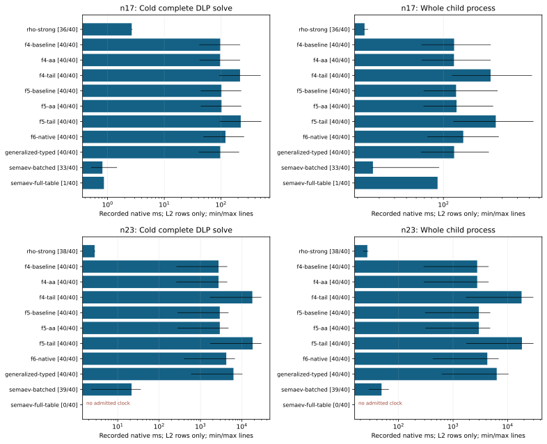

# Complete cold DLP runtime through ecbench

Run 20261019-165520-boolean-recursive-ecbenc-9d61aa, source 0acfc55b7f. Complete one-target cold DLP recovery on dedicated c7i.2xlarge; native ecbench L2 requirement, one worker,8 independent public targets per curve,5 measured rounds plus1 warmup,11 interleaved arms. Sources/specs and complete audit certificates remain adjacent/raw. Missing, failed and below-level rows are retained; a launch is not a result.

All methods within each session share the same public targets and standard polynomial subspace: dimension5 at n17 and6 at n23. These bases differ from the component experiment's Frobenius-invariant bases. The curve identities are icv1-f2m17-tm101-00378d4e and icv1-f2m23-tm5197-1f85e9e1. This two-size panel is not a scaling claim.

The pipeline solve clock includes factor-base construction, oracle prepare, relation collection, linear algebra, target descent/recovery and internal verification. Whole child process additionally includes adapter construction, report metadata, common workload construction and startup. Both clocks are recorded; the native harness's comparison gate uses the pipeline solve clock. Independent parent verification/replay, compilation and warmup are outside these clocks.

F4/F5 baseline uses the prior recursive policy with qualified GF2 kernels. Sources0acfc55b7f/71c4c99d85 use candidate matrix_runtime=quadratic-tail; corrected source9bed104b0a uses adaptive-quadratic-tail, with a different method identity. F6 names kernel_runtime=native-v1. Generalized typed roots and both Semaev table backends participate. Environment-override refusal remains intact; no admission threshold is relaxed.

Wall ratios below are B/A from ecbench's own paired bootstrap and A/A gate. Admission, completeness and outside_noise must all support a gain; partial/failed sessions do not become successful comparisons. Process medians are supplementary observed clocks, not a replacement gate.

Counted S, generic floor and matched strong rho are retained in table-n*.txt and ecbench-summary.json. Gray assignments are explicitly counted unpriced; reference native unpriced counters are retained too. Sensitivity bands at0/0.1/1 GAE per recorded operation are diagnostic and deduplicate generalized solver-count aliases. An unquantified counter stays unquantified. No ratio of lower bounds is a full-cost ranking.

Exact original-output and replay checks, query-count comparisons, source/binary hashes, failures and job resources remain in the evidence. All-L2 coverage is separate from execution/verification completeness; a fully verified session can have below-level timing rows. Low-sample clocks are descriptive; no threshold is relaxed. New matrix policies stay opt-in; no external-fastest, other-hardware or rho-beating claim is made.

n17: 528 total records, 88 warmups; replay audit OK True; all requested L2 timing coverage False.

n17 f4: candidate/baseline pipeline wall 2.2673, CI95 [2.228161831919641, 2.2774882139987653], gate admitted, outside A/A noise True. Ratios above1 are regressions, below1 are reductions in time; admission/completeness still govern interpretation.

n17 f5: candidate/baseline pipeline wall 2.1947, CI95 [2.1672102399596103, 2.223400789544616], gate admitted, outside A/A noise True. Ratios above1 are regressions, below1 are reductions in time; admission/completeness still govern interpretation.

n23: 528 total records, 88 warmups; replay audit OK True; all requested L2 timing coverage False.

n23 f4: candidate/baseline pipeline wall 6.5737, CI95 [6.56333553393357, 6.591094514060304], gate admitted, outside A/A noise True. Ratios above1 are regressions, below1 are reductions in time; admission/completeness still govern interpretation.

n23 f5: candidate/baseline pipeline wall 6.2148, CI95 [6.202408767259975, 6.225611004921411], gate admitted, outside A/A noise True. Ratios above1 are regressions, below1 are reductions in time; admission/completeness still govern interpretation.

## Recorded clocks and admission

|n|Arm|Solve ms|Process ms|Verified|L2|Requested|All L2|
|---|---|---|---|---|---|---|---|
|17|rho-strong|2.6638|22.7818|40|36|40|False|
|17|f4-baseline|96.8280|122.1154|40|40|40|True|
|17|f4-aa|96.4936|121.8268|40|40|40|True|
|17|f4-tail|216.7685|242.0721|40|40|40|True|
|17|f5-baseline|101.7174|126.7612|40|40|40|True|
|17|f5-aa|102.1956|127.8513|40|40|40|True|
|17|f5-tail|222.9573|266.7999|40|40|40|True|
|17|f6-native|119.9306|145.0248|40|40|40|True|
|17|generalized-typed|96.9606|122.1977|40|40|40|True|
|17|semaev-batched|0.8113|26.6584|40|33|40|False|
|17|semaev-full-table|0.8623|89.5996|40|1|40|False|
|23|rho-strong|2.7651|26.7752|40|38|40|False|
|23|f4-baseline|2736.7244|2764.5258|40|40|40|True|
|23|f4-aa|2735.7468|2765.9796|40|40|40|True|
|23|f4-tail|17981.2337|18011.3930|40|40|40|True|
|23|f5-baseline|2933.7356|2963.8713|40|40|40|True|
|23|f5-aa|2937.0158|2967.3401|40|40|40|True|
|23|f5-tail|18262.5992|18293.1179|40|40|40|True|
|23|f6-native|4210.5229|4240.7998|40|40|40|True|
|23|generalized-typed|6285.0703|6310.7315|40|40|40|True|
|23|semaev-batched|21.6131|48.7818|40|39|40|False|
|23|semaev-full-table|missing|missing|40|0|40|False|

## Native harness comparisons; B/A

|n|Pair|Wall gate|Median ratio|CI95|Outside noise|Below L2|
|---|---|---|---|---|---|---|
|17|f4|admitted|2.2673|2.2282..2.2775|True|0|
|17|f5|admitted|2.1947|2.1672..2.2234|True|0|
|17|rho-f4-tail|admitted|86.5500|75.9717..101.2833|True|4|
|17|rho-f5-tail|admitted|88.7481|77.3244..103.9905|True|4|
|17|rho-f6-native|admitted|47.6281|40.2044..52.3683|True|4|
|17|rho-generalized-typed|admitted|38.7422|32.8392..42.2406|True|4|
|17|rho-semaev-batched|admitted|0.3090|0.2891..0.3327|True|10|
|17|rho-semaev-full-table|descriptive|0.4035|missing|None|39|
|23|f4|admitted|6.5737|6.5633..6.5911|True|0|
|23|f5|admitted|6.2148|6.2024..6.2256|True|0|
|23|rho-f4-tail|admitted|6380.3279|4677.1999..7380.0729|True|2|
|23|rho-f5-tail|admitted|6480.1291|4739.9090..7495.2008|True|2|
|23|rho-f6-native|admitted|1494.0203|1095.4924..1729.1124|True|2|
|23|rho-generalized-typed|admitted|2230.1848|1658.1652..2585.5553|True|2|
|23|rho-semaev-batched|admitted|7.6036|6.5636..8.9156|True|3|
|23|rho-semaev-full-table|descriptive|7.7986|missing|None|40|

## Partly priced S sensitivity; all entries diagnostic

|n|Arm|0 GAE/op|0.1 GAE/op|1 GAE/op|Lower bound|Unknown entries|
|---|---|---|---|---|---|---|
|17|rho-strong|4.0416|4.185|5.4753|True|0|
|17|f4-baseline|43.799|43.799|43.799|False|0|
|17|f4-aa|43.799|43.799|43.799|False|0|
|17|f4-tail|143.67|143.74|144.29|True|0|
|17|f5-baseline|43.731|43.731|43.731|False|0|
|17|f5-aa|43.731|43.731|43.731|False|0|
|17|f5-tail|142.99|143.05|143.6|True|0|
|17|f6-native|33.082|33.082|33.082|False|0|
|17|generalized-typed|16.421|1080.1|10653|True|0|
|17|semaev-batched|17.317|17.317|17.317|False|0|
|17|semaev-full-table|18.083|18.083|18.083|False|0|
|23|rho-strong|0.88552|0.95031|1.5335|True|0|
|23|f4-baseline|72.251|72.251|72.251|False|0|
|23|f4-aa|72.251|72.251|72.251|False|0|
|23|f4-tail|1138.9|1138.9|1139.2|True|0|
|23|f5-baseline|72.228|72.228|72.228|False|0|
|23|f5-aa|72.228|72.228|72.228|False|0|
|23|f5-tail|1137.1|1137.2|1137.5|True|0|
|23|f6-native|65.541|65.541|65.541|False|0|
|23|generalized-typed|43.007|16897|1.6859e+05|True|0|
|23|semaev-batched|43.709|43.709|43.709|False|0|
|23|semaev-full-table|44.039|44.039|44.039|False|0|

## Explicit unpriced operation ledgers; different units are not equated

|n|Arm|Unit|Samples|Median count|Min|Max|
|---|---|---|---|---|---|---|
|17|rho-strong|canonicalisations_uncharged|40|192.0|64|356|
|17|rho-strong|partition_hashes_uncharged|40|148.5|30|306|
|17|rho-strong|table_inserts_uncharged|40|9.0|2|20|
|17|rho-strong|table_queries_uncharged|40|10.0|3|22|
|17|f4-tail|quadratic_tail_assignments_uncharged|40|132.0|4|426|
|17|f5-tail|quadratic_tail_assignments_uncharged|40|132.0|4|426|
|17|generalized-typed|generalized_assignments_uncharged|40|2613760.0|1051648|5709824|
|23|rho-strong|canonicalisations_uncharged|40|672.0|160|1217|
|23|rho-strong|partition_hashes_uncharged|40|594.5|119|1105|
|23|rho-strong|table_inserts_uncharged|40|39.5|12|79|
|23|rho-strong|table_queries_uncharged|40|40.5|13|80|
|23|f4-tail|quadratic_tail_assignments_uncharged|40|599.0|12|2000|
|23|f5-tail|quadratic_tail_assignments_uncharged|40|599.0|12|2000|
|23|generalized-typed|generalized_assignments_uncharged|40|355270656.0|33546240|580587520|

## Admitted phase clocks; recorded ms

|n|Arm|Phase|Median ms|Min ms|Max ms|Samples|
|---|---|---|---|---|---|---|
|17|f4-baseline|factor_base|0.1379|0.1318|0.1626|40|
|17|f4-baseline|linear_algebra|0.0093|0.0023|0.0142|40|
|17|f4-baseline|oracle_setup|0.0430|0.0398|0.0630|40|
|17|f4-baseline|relations|96.6016|41.2053|217.4618|40|
|17|f4-baseline|verify|0.0020|0.0016|0.0025|40|
|17|f4-aa|factor_base|0.1369|0.1334|0.1625|40|
|17|f4-aa|linear_algebra|0.0093|0.0023|0.0140|40|
|17|f4-aa|oracle_setup|0.0427|0.0405|0.0483|40|
|17|f4-aa|relations|96.2727|41.5140|216.9719|40|
|17|f4-aa|verify|0.0021|0.0016|0.0033|40|
|17|f4-tail|factor_base|0.1373|0.1306|0.1563|40|
|17|f4-tail|linear_algebra|0.0097|0.0025|0.0133|40|
|17|f4-tail|oracle_setup|0.0425|0.0402|0.0626|40|
|17|f4-tail|relations|216.5320|92.6474|500.9037|40|
|17|f4-tail|verify|0.0020|0.0017|0.0027|40|
|17|f5-baseline|factor_base|0.1383|0.1308|0.1678|40|
|17|f5-baseline|linear_algebra|0.0092|0.0026|0.0168|40|
|17|f5-baseline|oracle_setup|0.0427|0.0396|0.0485|40|
|17|f5-baseline|relations|101.4892|43.6727|227.3611|40|
|17|f5-baseline|verify|0.0020|0.0016|0.0024|40|
|17|f5-aa|factor_base|0.1372|0.1316|0.1512|40|
|17|f5-aa|linear_algebra|0.0094|0.0026|0.0130|40|
|17|f5-aa|oracle_setup|0.0419|0.0395|0.0478|40|
|17|f5-aa|relations|101.9722|43.7178|228.1939|40|
|17|f5-aa|verify|0.0020|0.0017|0.0026|40|
|17|f5-tail|factor_base|0.1384|0.1310|0.1535|40|
|17|f5-tail|linear_algebra|0.0093|0.0023|0.0153|40|
|17|f5-tail|oracle_setup|0.0421|0.0394|0.0573|40|
|17|f5-tail|relations|222.7332|94.5572|515.3173|40|
|17|f5-tail|verify|0.0021|0.0017|0.0048|40|
|17|f6-native|factor_base|0.1360|0.1311|0.1615|40|
|17|f6-native|linear_algebra|0.0096|0.0025|0.0142|40|
|17|f6-native|oracle_setup|0.0425|0.0393|0.0619|40|
|17|f6-native|relations|119.7100|48.7445|255.4314|40|
|17|f6-native|verify|0.0020|0.0016|0.0026|40|
|17|generalized-typed|factor_base|0.1377|0.1312|0.1515|40|
|17|generalized-typed|linear_algebra|0.0089|0.0027|0.0211|40|
|17|generalized-typed|oracle_setup|0.0417|0.0391|0.0470|40|
|17|generalized-typed|relations|96.7393|40.2845|208.5688|40|
|17|generalized-typed|verify|0.0020|0.0017|0.0024|40|
|17|semaev-batched|factor_base|0.1447|0.1388|0.1754|33|
|17|semaev-batched|linear_algebra|0.0063|0.0022|0.0081|33|
|17|semaev-batched|oracle_setup|0.0148|0.0132|0.0182|33|
|17|semaev-batched|relations|0.6123|0.3125|1.2736|33|
|17|semaev-batched|verify|0.0021|0.0017|0.0030|33|
|17|semaev-full-table|factor_base|0.1364|0.1364|0.1364|1|
|17|semaev-full-table|linear_algebra|0.0053|0.0053|0.0053|1|
|17|semaev-full-table|oracle_setup|0.2175|0.2175|0.2175|1|
|17|semaev-full-table|relations|0.4713|0.4713|0.4713|1|
|17|semaev-full-table|verify|0.0017|0.0017|0.0017|1|
|23|f4-baseline|factor_base|0.1559|0.0555|0.1698|40|
|23|f4-baseline|linear_algebra|0.0205|0.0033|0.0304|40|
|23|f4-baseline|oracle_setup|0.0736|0.0700|0.0915|40|
|23|f4-baseline|relations|2736.5140|260.9896|4447.7940|40|
|23|f4-baseline|verify|0.0040|0.0034|0.0049|40|
|23|f4-aa|factor_base|0.1572|0.0587|0.1748|40|
|23|f4-aa|linear_algebra|0.0200|0.0034|0.0352|40|
|23|f4-aa|oracle_setup|0.0749|0.0714|0.0820|40|
|23|f4-aa|relations|2735.5267|259.8684|4446.8064|40|
|23|f4-aa|verify|0.0040|0.0034|0.0102|40|
|23|f4-tail|factor_base|0.1570|0.0610|0.1901|40|
|23|f4-tail|linear_algebra|0.0296|0.0037|0.0487|40|
|23|f4-tail|oracle_setup|0.0754|0.0701|0.0941|40|
|23|f4-tail|relations|17980.9470|1692.1750|29546.7284|40|
|23|f4-tail|verify|0.0039|0.0034|0.0058|40|
|23|f5-baseline|factor_base|0.1556|0.0570|0.1873|40|
|23|f5-baseline|linear_algebra|0.0207|0.0031|0.0297|40|
|23|f5-baseline|oracle_setup|0.0739|0.0704|0.0933|40|
|23|f5-baseline|relations|2933.5276|278.8703|4776.1124|40|
|23|f5-baseline|verify|0.0040|0.0035|0.0051|40|
|23|f5-aa|factor_base|0.1561|0.0583|0.1803|40|
|23|f5-aa|linear_algebra|0.0198|0.0052|0.0392|40|
|23|f5-aa|oracle_setup|0.0745|0.0718|0.0834|40|
|23|f5-aa|relations|2936.7961|279.3681|4765.4594|40|
|23|f5-aa|verify|0.0040|0.0034|0.0047|40|
|23|f5-tail|factor_base|0.1559|0.0603|0.2443|40|
|23|f5-tail|linear_algebra|0.0297|0.0047|0.0469|40|
|23|f5-tail|oracle_setup|0.0735|0.0704|0.0851|40|
|23|f5-tail|relations|18262.3150|1720.3922|29746.0744|40|
|23|f5-tail|verify|0.0040|0.0033|0.0056|40|
|23|f6-native|factor_base|0.1561|0.0597|0.1836|40|
|23|f6-native|linear_algebra|0.0220|0.0033|0.0346|40|
|23|f6-native|oracle_setup|0.0747|0.0697|0.0836|40|
|23|f6-native|relations|4210.3045|399.5331|6834.3177|40|
|23|f6-native|verify|0.0040|0.0035|0.0053|40|
|23|generalized-typed|factor_base|0.1557|0.0561|0.1788|40|
|23|generalized-typed|linear_algebra|0.0221|0.0031|0.0336|40|
|23|generalized-typed|oracle_setup|0.0725|0.0677|0.0855|40|
|23|generalized-typed|relations|6284.8052|595.9769|10358.3040|40|
|23|generalized-typed|verify|0.0040|0.0034|0.0049|40|
|23|semaev-batched|factor_base|0.1636|0.1586|0.1936|39|
|23|semaev-batched|linear_algebra|0.0151|0.0027|0.0230|39|
|23|semaev-batched|oracle_setup|0.0287|0.0267|0.0406|39|
|23|semaev-batched|relations|21.3609|2.0463|35.8618|39|
|23|semaev-batched|verify|0.0040|0.0034|0.0053|39|
