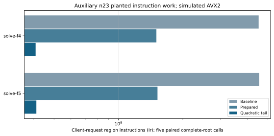

# Complete-root instruction profiles

Original n23 planted seed230, F4/F5 complete-root calls. Five interleaved baseline/prepared/quadratic-tail profiles per arm; every root set verifies equal. Local Xeon6975P-C, Valgrind3.19, merged threads, one worker, simulated AVX2. This is instruction-count evidence and supplies no native time, cycles or IPC.

The first-tail implementation reduces median call Ir from4.525/4.556 billion to410.240/413.511 million for F4/F5. Prepared-only medians are1.505/1.523 billion. All five rounds per arm complete without failures. These are different implementations' complete instruction work; elimination word counts alone omit the newly explicit Gray assignments.

The hot-function annotation identifies remaining matrix reduction, column lookup and direct packing work. LOOKUP_PROTOCOL.md freezes a subsequent dispatch refinement before its profiles. Neither profile batch reprices the dedicated native or ecbench clocks. Sources: profiles-summary.json, runs/profiles raw data, binary/source manifests and PROFILE_PROTOCOL.md.

## Recorded complete-call medians

|Arm|Baseline Ir|Prepared Ir|First-tail Ir|Five pairs|
|---|---|---|---|---|
|solve-f4|4525036969.0|1505322837.0|410239680.0|True|
|solve-f5|4555545353.0|1523302717.0|413511483.0|True|
