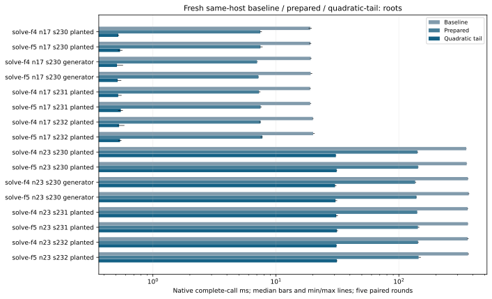
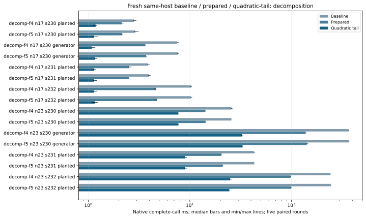
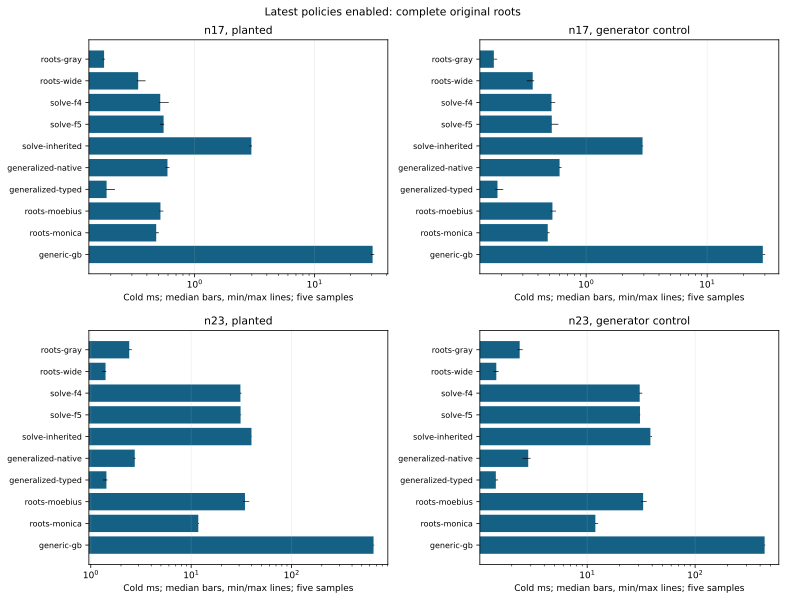
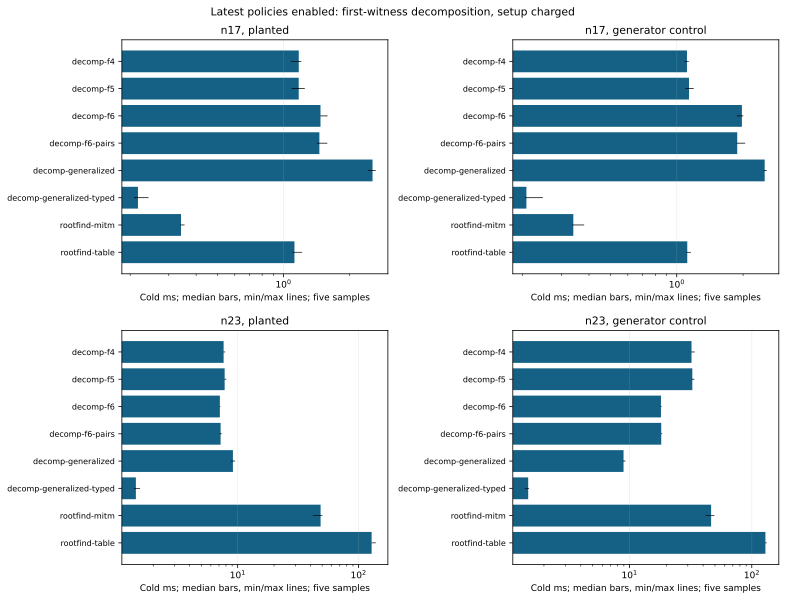

# Native F4/F5, F6 and root solvers

Run 20261019-174306-boolean-final-native-c19491, source 71c4c99d85. Dedicated c7i.2xlarge, one worker and a reserved complete physical core; four-worker controls reserve two cores/SMT siblings. Exact source/compiler/CPU/ISA and binary manifests remain in the raw tree. Baseline: frozen a78 algorithm with all three previously qualified GF2 switches. Candidate: identity-bound prepared construction and bounded quadratic-tail policies.

Original n17/n23 fixtures have16/22 Boolean variables on icv1-f2m17-tm101-00378d4e / icv1-f2m23-tm5197-1f85e9e1. Planted seed230 and fixed generator control plus planted holdouts231/232; random=true means generator here. n19's36-variable admission gap remains separate. No fixture or baseline is replaced by the full-DLP standard subspaces.

All eighteen arms are rerun with this source's declared policies. Complete original roots and first-witness decomposition remain separate; common curve/base construction is outside component timings. Fresh target ANF, solving, lifting and internal verification are charged to decomposition; Semaev fresh table setup is charged once. Independent original-root/group audits run after elapsed capture.

Five paired rounds, first eligible of at most three attempts, exact original outputs, exact3125-resample CI and max(2%, twice A/A noise) gate. Rejected attempts retained: 42. All four multiworker controls neutral: False. Every slower/neutral/missing cell remains in native-summary.json.

Prepared is a combined active-layout/top-degree/linear-tail/direct-packing ablation. Quadratic-tail retains an algebraic root reduction, then exhaustively completes at most16 free quadratic variables using the existing Gray kernel; original coordinates, root order, caps and verification remain enforced. This is a hybrid engineering change, not a novel enumeration algorithm. Other split rules/custom node oracles keep recursion.

The matrix switches stay opt-in. Source/protocols: 71c4c99d85, PROTOCOL.md and the frozen runner/protocols in the raw tree. Sources0acfc55b7f,71c4c99d85 and9bed104b0a are separate experiments. The final adaptive variants preserve cheap degree-two refutations below16 original variables; legacy policy names remain for replay. Full-table setup uses the same exact sorted tuples serially under an explicit one-worker resource contract. No cross-host pooling, external-fastest, Arm64/GPU, whole-IC/rho or hard-family8x conclusion follows from component calls.

## All paired recursive-solver outcomes

|Arm|n|Seed|Target|Before ms|Candidate ms|Ratio|Decision|
|---|---|---|---|---|---|---|---|
|solve-f4|17|230|P|19.0433|0.5230|36.4262|faster|
|solve-f5|17|230|P|19.0645|0.5410|34.9293|faster|
|decomp-f4|17|230|P|2.8103|1.1800|2.4125|faster|
|decomp-f5|17|230|P|2.8951|1.1361|2.5483|faster|
|solve-f4|17|230|G|19.2129|0.5104|37.5709|faster|
|solve-f5|17|230|G|19.1774|0.5172|37.3063|faster|
|decomp-f4|17|230|G|7.4807|1.0807|6.9349|faster|
|decomp-f5|17|230|G|7.6357|1.1576|6.6283|faster|
|solve-f4|17|231|P|18.9787|0.5221|36.0089|faster|
|solve-f5|17|231|P|19.0205|0.5485|35.2860|faster|
|decomp-f4|17|231|P|3.8810|1.1438|3.4884|faster|
|decomp-f5|17|231|P|3.9436|1.1421|3.5078|faster|
|solve-f4|17|232|P|20.0080|0.5309|37.3349|faster|
|solve-f5|17|232|P|20.0931|0.5408|37.3194|faster|
|decomp-f4|17|232|P|10.3217|1.1396|8.8925|faster|
|decomp-f5|17|232|P|10.2864|1.1557|8.8741|faster|
|solve-f4|23|230|P|353.0631|30.7438|11.5141|faster|
|solve-f5|23|230|P|356.0642|31.2119|11.4176|faster|
|decomp-f4|23|230|P|25.6580|7.6948|3.3291|faster|
|decomp-f5|23|230|P|25.6280|7.7112|3.3250|faster|
|solve-f4|23|230|G|364.4468|30.2591|12.0442|faster|
|solve-f5|23|230|G|370.1105|30.5390|12.1193|faster|
|decomp-f4|23|230|G|365.5542|32.5337|11.2291|faster|
|decomp-f5|23|230|G|369.6305|33.0418|11.2503|faster|
|solve-f4|23|231|P|362.3945|30.9733|11.6411|faster|
|solve-f5|23|231|P|364.1260|31.3525|11.6387|faster|
|decomp-f4|23|231|P|42.8421|8.9794|4.7591|faster|
|decomp-f5|23|231|P|43.0150|8.9591|4.8093|faster|
|solve-f4|23|232|P|362.7818|31.1121|11.7160|faster|
|solve-f5|23|232|P|365.5863|31.3206|11.7610|faster|
|decomp-f4|23|232|P|242.9192|24.9913|9.6493|faster|
|decomp-f5|23|232|P|244.2206|24.4465|10.0022|faster|

## Latest native complete-call ms (sample count)

|Boundary|Method|n17 planted|n17 generator|n23 planted|n23 generator|
|---|---|---|---|---|---|
|complete_roots|roots-gray|0.1758 (5)|0.1727 (5)|2.4166 (5)|2.3692 (5)|
|complete_roots|roots-wide|0.3383 (5)|0.3618 (5)|1.4033 (5)|1.4385 (5)|
|complete_roots|solve-f4|0.5168 (5)|0.5172 (5)|30.9280 (5)|30.6685 (5)|
|complete_roots|solve-f5|0.5513 (5)|0.5200 (5)|31.0546 (5)|30.8427 (5)|
|complete_roots|solve-inherited|2.9738 (5)|2.9246 (5)|39.8591 (5)|38.5066 (5)|
|complete_roots|generalized-native|0.5937 (5)|0.6032 (5)|2.7420 (5)|2.8431 (5)|
|complete_roots|generalized-typed|0.1845 (5)|0.1851 (5)|1.4317 (5)|1.4242 (5)|
|complete_roots|roots-moebius|0.5189 (5)|0.5265 (5)|34.3487 (5)|32.9940 (5)|
|complete_roots|roots-monica|0.4784 (5)|0.4815 (5)|11.7774 (5)|11.9060 (5)|
|complete_roots|generic-gb|30.4903 (5)|28.8389 (5)|655.0972 (5)|440.5415 (5)|
|decomposition|decomp-f4|1.1755 (5)|1.1130 (5)|7.6494 (5)|32.1721 (5)|
|decomposition|decomp-f5|1.1749 (5)|1.1368 (5)|7.8036 (5)|32.6622 (5)|
|decomposition|decomp-f6|1.4770 (5)|1.9750 (5)|7.1248 (5)|18.1051 (5)|
|decomposition|decomp-f6-pairs|1.4596 (5)|1.8809 (5)|7.2238 (5)|18.1888 (5)|
|decomposition|decomp-generalized|2.5516 (5)|2.5056 (5)|9.1352 (5)|8.9492 (5)|
|decomposition|decomp-generalized-typed|0.2171 (5)|0.2081 (5)|1.4367 (5)|1.4867 (5)|
|decomposition|rootfind-mitm|0.3412 (5)|0.3395 (5)|48.5848 (5)|46.5130 (5)|
|decomposition|rootfind-table|1.1235 (5)|1.1163 (5)|128.4924 (5)|129.2967 (5)|

## Four-worker matrix controls

|Arm|n|Before ms|After ms|Ratio|Decision|
|---|---|---|---|---|---|
|matrix-f4|17|7.7348|7.5342|1.0266|neutral|
|matrix-f5|17|8.0655|8.0306|1.0335|neutral|
|matrix-f4|23|59.4430|61.9066|0.9633|slower|
|matrix-f5|23|59.4071|57.8192|1.0010|neutral|

## Instrumented matrix phase medians, ms; separate nonadditive observations

|Arm|n|Target|Policy|Build ms|Reduce ms|Readback ms|Calls|
|---|---|---|---|---|---|---|---|
|solve-f4|17|P|baseline|8.8756|9.1566|0.3874|126.0|
|solve-f4|17|P|prepared|2.5933|4.5430|0.0327|63.0|
|solve-f4|17|P|quadratic-tail|0.2818|0.1263|0.0003|1.0|
|solve-f5|17|P|baseline|9.0522|9.0178|0.3794|126.0|
|solve-f5|17|P|prepared|2.7632|4.4632|0.0284|63.0|
|solve-f5|17|P|quadratic-tail|0.2983|0.1259|0.0002|1.0|
|decomp-f4|17|P|baseline|1.0943|0.9383|0.0395|12.0|
|decomp-f4|17|P|prepared|0.8315|0.5480|0.0020|6.0|
|decomp-f4|17|P|quadratic-tail|0.2281|0.1265|0.0003|1.0|
|decomp-f5|17|P|baseline|1.1079|0.9476|0.0393|12.0|
|decomp-f5|17|P|prepared|0.8489|0.5313|0.0017|6.0|
|decomp-f5|17|P|quadratic-tail|0.2289|0.1237|0.0002|1.0|
|solve-f4|17|G|baseline|9.1485|9.1817|0.3733|126.0|
|solve-f4|17|G|prepared|2.6173|4.1115|0.0272|63.0|
|solve-f4|17|G|quadratic-tail|0.2807|0.1141|0.0003|1.0|
|solve-f5|17|G|baseline|9.2479|9.0682|0.3728|126.0|
|solve-f5|17|G|prepared|2.7807|4.1329|0.0240|63.0|
|solve-f5|17|G|quadratic-tail|0.2867|0.1129|0.0003|1.0|
|decomp-f4|17|G|baseline|3.2190|3.2356|0.1311|44.0|
|decomp-f4|17|G|prepared|1.3047|1.5018|0.0085|22.0|
|decomp-f4|17|G|quadratic-tail|0.2178|0.1108|0.0003|1.0|
|decomp-f5|17|G|baseline|3.3063|3.2220|0.1311|44.0|
|decomp-f5|17|G|prepared|1.3687|1.5260|0.0080|22.0|
|decomp-f5|17|G|quadratic-tail|0.2270|0.1124|0.0002|1.0|
|solve-f4|23|P|baseline|154.2482|185.5118|5.8229|1022.0|
|solve-f4|23|P|prepared|37.9914|100.1398|0.2870|511.0|
|solve-f4|23|P|quadratic-tail|10.4035|15.9620|0.0060|63.0|
|solve-f5|23|P|baseline|157.6023|185.3282|5.8600|1022.0|
|solve-f5|23|P|prepared|39.3776|100.4474|0.2741|511.0|
|solve-f5|23|P|quadratic-tail|10.7040|16.1410|0.0041|63.0|
|decomp-f4|23|P|baseline|10.8990|11.8709|0.3695|64.0|
|decomp-f4|23|P|prepared|4.8868|6.9019|0.0191|32.0|
|decomp-f4|23|P|quadratic-tail|2.9993|2.2132|0.0014|7.0|
|decomp-f5|23|P|baseline|10.9725|11.7113|0.3691|64.0|
|decomp-f5|23|P|prepared|4.9918|6.9335|0.0173|32.0|
|decomp-f5|23|P|quadratic-tail|3.0309|2.2381|0.0007|7.0|
|solve-f4|23|G|baseline|161.5615|188.6295|5.9307|1022.0|
|solve-f4|23|G|prepared|38.9588|93.4667|0.2582|511.0|
|solve-f4|23|G|quadratic-tail|10.6806|15.1731|0.0055|63.0|
|solve-f5|23|G|baseline|166.4366|190.6396|5.9664|1022.0|
|solve-f5|23|G|prepared|41.3334|94.3479|0.2541|511.0|
|solve-f5|23|G|quadratic-tail|11.0164|15.1026|0.0033|63.0|
|decomp-f4|23|G|baseline|161.6477|188.7095|5.9108|1022.0|
|decomp-f4|23|G|prepared|39.0343|93.8238|0.2510|511.0|
|decomp-f4|23|G|quadratic-tail|10.4695|15.3318|0.0034|63.0|
|decomp-f5|23|G|baseline|165.9340|188.4201|5.8962|1022.0|
|decomp-f5|23|G|prepared|40.9341|95.0892|0.2610|511.0|
|decomp-f5|23|G|quadratic-tail|10.8517|15.3872|0.0034|63.0|
