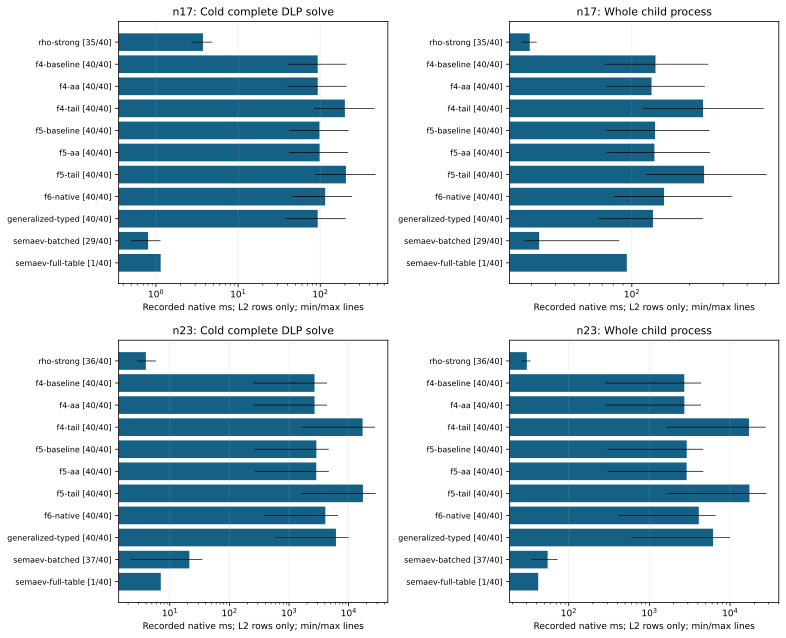

# Complete cold DLP runtime through ecbench

Run 20261019-174315-boolean-final-ecbench-25cc20, source 71c4c99d85. Complete one-target cold DLP recovery on dedicated c7i.2xlarge; native ecbench L2 requirement, one worker,8 independent public targets per curve,5 measured rounds plus1 warmup,11 interleaved arms. Sources/specs and complete audit certificates remain adjacent/raw. Missing, failed and below-level rows are retained; a launch is not a result.

All methods within each session share the same public targets and standard polynomial subspace: dimension5 at n17 and6 at n23. These bases differ from the component experiment's Frobenius-invariant bases. The curve identities are icv1-f2m17-tm101-00378d4e and icv1-f2m23-tm5197-1f85e9e1. This two-size panel is not a scaling claim.

The pipeline solve clock includes factor-base construction, oracle prepare, relation collection, linear algebra, target descent/recovery and internal verification. Whole child process additionally includes adapter construction, report metadata, common workload construction and startup. Both clocks are recorded; the native harness's comparison gate uses the pipeline solve clock. Independent parent verification/replay, compilation and warmup are outside these clocks.

F4/F5 baseline uses the prior recursive policy with qualified GF2 kernels. Sources0acfc55b7f/71c4c99d85 use candidate matrix_runtime=quadratic-tail; corrected source9bed104b0a uses adaptive-quadratic-tail, with a different method identity. F6 names kernel_runtime=native-v1. Generalized typed roots and both Semaev table backends participate. Environment-override refusal remains intact; no admission threshold is relaxed.

Wall ratios below are B/A from ecbench's own paired bootstrap and A/A gate. Admission, completeness and outside_noise must all support a gain; partial/failed sessions do not become successful comparisons. Process medians are supplementary observed clocks, not a replacement gate.

Counted S, generic floor and matched strong rho are retained in table-n*.txt and ecbench-summary.json. Gray assignments are explicitly counted unpriced; reference native unpriced counters are retained too. Sensitivity bands at0/0.1/1 GAE per recorded operation are diagnostic and deduplicate generalized solver-count aliases. An unquantified counter stays unquantified. No ratio of lower bounds is a full-cost ranking.

Exact original-output and replay checks, query-count comparisons, source/binary hashes, failures and job resources remain in the evidence. All-L2 coverage is separate from execution/verification completeness; a fully verified session can have below-level timing rows. Low-sample clocks are descriptive; no threshold is relaxed. New matrix policies stay opt-in; no external-fastest, other-hardware or rho-beating claim is made.

n17: 528 total records, 88 warmups; replay audit OK True; all requested L2 timing coverage False.

n17 f4: candidate/baseline pipeline wall 2.1615, CI95 [2.1395826336351726, 2.1927699402827145], gate admitted, outside A/A noise True. Ratios above1 are regressions, below1 are reductions in time; admission/completeness still govern interpretation.

n17 f5: candidate/baseline pipeline wall 2.1155, CI95 [2.0821687846214223, 2.133465917871537], gate admitted, outside A/A noise True. Ratios above1 are regressions, below1 are reductions in time; admission/completeness still govern interpretation.

n23: 528 total records, 88 warmups; replay audit OK True; all requested L2 timing coverage False.

n23 f4: candidate/baseline pipeline wall 6.3963, CI95 [6.374242969640284, 6.412638088211264], gate admitted, outside A/A noise True. Ratios above1 are regressions, below1 are reductions in time; admission/completeness still govern interpretation.

n23 f5: candidate/baseline pipeline wall 6.0804, CI95 [6.063029417443889, 6.086417851352189], gate admitted, outside A/A noise True. Ratios above1 are regressions, below1 are reductions in time; admission/completeness still govern interpretation.

## Recorded clocks and admission

|n|Arm|Solve ms|Process ms|Verified|L2|Requested|All L2|
|---|---|---|---|---|---|---|---|
|17|rho-strong|3.7365|29.3152|40|35|40|False|
|17|f4-baseline|93.1034|132.9379|40|40|40|True|
|17|f4-aa|93.1480|126.7359|40|40|40|True|
|17|f4-tail|199.4259|235.4926|40|40|40|True|
|17|f5-baseline|97.8361|132.1757|40|40|40|True|
|17|f5-aa|98.3205|131.2446|40|40|40|True|
|17|f5-tail|205.3710|238.4111|40|40|40|True|
|17|f6-native|114.7783|147.3245|40|40|40|True|
|17|generalized-typed|93.0190|128.9489|40|40|40|True|
|17|semaev-batched|0.8028|32.8160|40|29|40|False|
|17|semaev-full-table|1.1417|94.1875|40|1|40|False|
|23|rho-strong|3.9677|30.2493|40|36|40|False|
|23|f4-baseline|2678.9874|2711.1398|40|40|40|True|
|23|f4-aa|2681.4155|2713.8800|40|40|40|True|
|23|f4-tail|17138.2669|17170.6120|40|40|40|True|
|23|f5-baseline|2873.5406|2907.5252|40|40|40|True|
|23|f5-aa|2862.7236|2896.9232|40|40|40|True|
|23|f5-tail|17373.4405|17407.0452|40|40|40|True|
|23|f6-native|4067.4085|4099.9347|40|40|40|True|
|23|generalized-typed|6126.6127|6159.9945|40|40|40|True|
|23|semaev-batched|21.2930|54.8103|40|37|40|False|
|23|semaev-full-table|7.0579|41.9045|40|1|40|False|

## Native harness comparisons; B/A

|n|Pair|Wall gate|Median ratio|CI95|Outside noise|Below L2|
|---|---|---|---|---|---|---|
|17|f4|admitted|2.1615|2.1396..2.1928|True|0|
|17|f5|admitted|2.1155|2.0822..2.1335|True|0|
|17|rho-f4-tail|admitted|51.9373|46.9349..65.1904|True|5|
|17|rho-f5-tail|admitted|53.6985|48.2097..67.3411|True|5|
|17|rho-f6-native|admitted|29.4145|24.9855..37.1320|True|5|
|17|rho-generalized-typed|admitted|23.8976|20.2568..30.4485|True|5|
|17|rho-semaev-batched|admitted|0.2082|0.1850..0.2437|True|14|
|17|rho-semaev-full-table|descriptive|0.2870|missing|None|39|
|23|f4|admitted|6.3963|6.3742..6.4126|True|0|
|23|f5|admitted|6.0804|6.0630..6.0864|True|0|
|23|rho-f4-tail|admitted|4714.9990|3320.1775..5394.5115|True|4|
|23|rho-f5-tail|admitted|4794.1400|3365.9942..5423.8279|True|4|
|23|rho-f6-native|admitted|1124.1737|793.9122..1270.3334|True|4|
|23|rho-generalized-typed|admitted|1688.8656|1206.0619..1922.7368|True|4|
|23|rho-semaev-batched|admitted|6.1800|4.3536..6.6396|True|6|
|23|rho-semaev-full-table|descriptive|4.9896|missing|None|40|

## Partly priced S sensitivity; all entries diagnostic

|n|Arm|0 GAE/op|0.1 GAE/op|1 GAE/op|Lower bound|Unknown entries|
|---|---|---|---|---|---|---|
|17|rho-strong|4.0416|4.185|5.4753|True|0|
|17|f4-baseline|43.799|43.799|43.799|False|0|
|17|f4-aa|43.799|43.799|43.799|False|0|
|17|f4-tail|143.67|143.74|144.29|True|0|
|17|f5-baseline|43.731|43.731|43.731|False|0|
|17|f5-aa|43.731|43.731|43.731|False|0|
|17|f5-tail|142.99|143.05|143.6|True|0|
|17|f6-native|33.082|33.082|33.082|False|0|
|17|generalized-typed|16.421|1080.1|10653|True|0|
|17|semaev-batched|17.317|17.317|17.317|False|0|
|17|semaev-full-table|18.083|18.083|18.083|False|0|
|23|rho-strong|0.88552|0.95031|1.5335|True|0|
|23|f4-baseline|72.251|72.251|72.251|False|0|
|23|f4-aa|72.251|72.251|72.251|False|0|
|23|f4-tail|1138.9|1138.9|1139.2|True|0|
|23|f5-baseline|72.228|72.228|72.228|False|0|
|23|f5-aa|72.228|72.228|72.228|False|0|
|23|f5-tail|1137.1|1137.2|1137.5|True|0|
|23|f6-native|65.541|65.541|65.541|False|0|
|23|generalized-typed|43.007|16897|1.6859e+05|True|0|
|23|semaev-batched|43.709|43.709|43.709|False|0|
|23|semaev-full-table|44.039|44.039|44.039|False|0|

## Explicit unpriced operation ledgers; different units are not equated

|n|Arm|Unit|Samples|Median count|Min|Max|
|---|---|---|---|---|---|---|
|17|rho-strong|canonicalisations_uncharged|40|192.0|64|356|
|17|rho-strong|partition_hashes_uncharged|40|148.5|30|306|
|17|rho-strong|table_inserts_uncharged|40|9.0|2|20|
|17|rho-strong|table_queries_uncharged|40|10.0|3|22|
|17|f4-tail|quadratic_tail_assignments_uncharged|40|132.0|4|426|
|17|f5-tail|quadratic_tail_assignments_uncharged|40|132.0|4|426|
|17|generalized-typed|generalized_assignments_uncharged|40|2613760.0|1051648|5709824|
|23|rho-strong|canonicalisations_uncharged|40|672.0|160|1217|
|23|rho-strong|partition_hashes_uncharged|40|594.5|119|1105|
|23|rho-strong|table_inserts_uncharged|40|39.5|12|79|
|23|rho-strong|table_queries_uncharged|40|40.5|13|80|
|23|f4-tail|quadratic_tail_assignments_uncharged|40|599.0|12|2000|
|23|f5-tail|quadratic_tail_assignments_uncharged|40|599.0|12|2000|
|23|generalized-typed|generalized_assignments_uncharged|40|355270656.0|33546240|580587520|

## Admitted phase clocks; recorded ms

|n|Arm|Phase|Median ms|Min ms|Max ms|Samples|
|---|---|---|---|---|---|---|
|17|f4-baseline|factor_base|0.1426|0.1345|0.1710|40|
|17|f4-baseline|linear_algebra|0.0121|0.0041|0.0225|40|
|17|f4-baseline|oracle_setup|0.0509|0.0486|0.0668|40|
|17|f4-baseline|relations|92.8382|39.8707|207.8025|40|
|17|f4-baseline|verify|0.0020|0.0017|0.0095|40|
|17|f4-aa|factor_base|0.1429|0.1373|0.2398|40|
|17|f4-aa|linear_algebra|0.0125|0.0038|0.0232|40|
|17|f4-aa|oracle_setup|0.0508|0.0481|0.0612|40|
|17|f4-aa|relations|92.8854|39.7144|208.9281|40|
|17|f4-aa|verify|0.0021|0.0016|0.0105|40|
|17|f4-tail|factor_base|0.1438|0.1372|0.1653|40|
|17|f4-tail|linear_algebra|0.0117|0.0038|0.0199|40|
|17|f4-tail|oracle_setup|0.0513|0.0477|0.0597|40|
|17|f4-tail|relations|199.1587|84.2992|458.0556|40|
|17|f4-tail|verify|0.0021|0.0017|0.0069|40|
|17|f5-baseline|factor_base|0.1426|0.1353|0.2570|40|
|17|f5-baseline|linear_algebra|0.0108|0.0060|0.0221|40|
|17|f5-baseline|oracle_setup|0.0515|0.0483|0.0649|40|
|17|f5-baseline|relations|97.5765|42.1526|220.9630|40|
|17|f5-baseline|verify|0.0021|0.0017|0.0099|40|
|17|f5-aa|factor_base|0.1422|0.1329|0.1568|40|
|17|f5-aa|linear_algebra|0.0158|0.0064|0.0207|40|
|17|f5-aa|oracle_setup|0.0509|0.0479|0.0935|40|
|17|f5-aa|relations|98.0624|41.7243|217.6222|40|
|17|f5-aa|verify|0.0021|0.0016|0.0096|40|
|17|f5-tail|factor_base|0.1431|0.1351|0.1612|40|
|17|f5-tail|linear_algebra|0.0124|0.0036|0.0244|40|
|17|f5-tail|oracle_setup|0.0510|0.0490|0.0772|40|
|17|f5-tail|relations|205.0939|86.5878|471.3343|40|
|17|f5-tail|verify|0.0021|0.0017|0.0112|40|
|17|f6-native|factor_base|0.1432|0.1346|0.2701|40|
|17|f6-native|linear_algebra|0.0134|0.0034|0.0247|40|
|17|f6-native|oracle_setup|0.0493|0.0459|0.0786|40|
|17|f6-native|relations|114.5068|45.7136|243.7838|40|
|17|f6-native|verify|0.0021|0.0016|0.0122|40|
|17|generalized-typed|factor_base|0.1423|0.1357|0.1720|40|
|17|generalized-typed|linear_algebra|0.0149|0.0044|0.0206|40|
|17|generalized-typed|oracle_setup|0.0477|0.0451|0.1339|40|
|17|generalized-typed|relations|92.7673|37.3378|203.2972|40|
|17|generalized-typed|verify|0.0021|0.0016|0.0086|40|
|17|semaev-batched|factor_base|0.1484|0.1424|0.1738|29|
|17|semaev-batched|linear_algebra|0.0089|0.0041|0.0132|29|
|17|semaev-batched|oracle_setup|0.0157|0.0143|0.0184|29|
|17|semaev-batched|relations|0.5867|0.2946|0.9212|29|
|17|semaev-batched|verify|0.0021|0.0016|0.0032|29|
|17|semaev-full-table|factor_base|0.1716|0.1716|0.1716|1|
|17|semaev-full-table|linear_algebra|0.0120|0.0120|0.0120|1|
|17|semaev-full-table|oracle_setup|0.3119|0.3119|0.3119|1|
|17|semaev-full-table|relations|0.6013|0.6013|0.6013|1|
|17|semaev-full-table|verify|0.0021|0.0021|0.0021|1|
|23|f4-baseline|factor_base|0.1597|0.0643|0.1939|40|
|23|f4-baseline|linear_algebra|0.0333|0.0055|0.0566|40|
|23|f4-baseline|oracle_setup|0.0796|0.0755|0.0951|40|
|23|f4-baseline|relations|2678.7347|252.3234|4340.5816|40|
|23|f4-baseline|verify|0.0039|0.0033|0.0179|40|
|23|f4-aa|factor_base|0.1626|0.0610|0.2657|40|
|23|f4-aa|linear_algebra|0.0298|0.0061|0.0583|40|
|23|f4-aa|oracle_setup|0.0796|0.0742|0.0951|40|
|23|f4-aa|relations|2681.1132|251.3995|4331.1143|40|
|23|f4-aa|verify|0.0039|0.0033|0.0157|40|
|23|f4-tail|factor_base|0.1628|0.0679|0.1948|40|
|23|f4-tail|linear_algebra|0.0421|0.0049|0.1207|40|
|23|f4-tail|oracle_setup|0.0807|0.0757|0.0899|40|
|23|f4-tail|relations|17137.9602|1583.1918|27752.8807|40|
|23|f4-tail|verify|0.0040|0.0034|0.0182|40|
|23|f5-baseline|factor_base|0.1614|0.0634|0.1992|40|
|23|f5-baseline|linear_algebra|0.0323|0.0058|0.0510|40|
|23|f5-baseline|oracle_setup|0.0798|0.0749|0.0923|40|
|23|f5-baseline|relations|2873.2932|266.6973|4632.5200|40|
|23|f5-baseline|verify|0.0039|0.0034|0.0187|40|
|23|f5-aa|factor_base|0.1614|0.0633|0.1964|40|
|23|f5-aa|linear_algebra|0.0315|0.0098|0.0526|40|
|23|f5-aa|oracle_setup|0.0804|0.0748|0.1979|40|
|23|f5-aa|relations|2862.4205|269.0584|4641.4401|40|
|23|f5-aa|verify|0.0041|0.0032|0.0176|40|
|23|f5-tail|factor_base|0.1612|0.0647|0.1864|40|
|23|f5-tail|linear_algebra|0.0355|0.0089|0.0615|40|
|23|f5-tail|oracle_setup|0.0789|0.0753|0.0912|40|
|23|f5-tail|relations|17373.1240|1608.3349|28340.2713|40|
|23|f5-tail|verify|0.0040|0.0034|0.0184|40|
|23|f6-native|factor_base|0.1601|0.0641|0.2976|40|
|23|f6-native|linear_algebra|0.0369|0.0055|0.0637|40|
|23|f6-native|oracle_setup|0.0768|0.0728|0.1028|40|
|23|f6-native|relations|4067.1103|379.4825|6615.5331|40|
|23|f6-native|verify|0.0040|0.0036|0.0198|40|
|23|generalized-typed|factor_base|0.1607|0.0653|0.3056|40|
|23|generalized-typed|linear_algebra|0.0310|0.0049|0.0610|40|
|23|generalized-typed|oracle_setup|0.0751|0.0718|0.0872|40|
|23|generalized-typed|relations|6126.3234|569.2020|9997.0456|40|
|23|generalized-typed|verify|0.0039|0.0032|0.0051|40|
|23|semaev-batched|factor_base|0.1698|0.1621|0.2594|37|
|23|semaev-batched|linear_algebra|0.0194|0.0033|0.0347|37|
|23|semaev-batched|oracle_setup|0.0292|0.0275|0.0368|37|
|23|semaev-batched|relations|21.0244|1.9585|34.7290|37|
|23|semaev-batched|verify|0.0039|0.0032|0.0105|37|
|23|semaev-full-table|factor_base|0.0745|0.0745|0.0745|1|
|23|semaev-full-table|linear_algebra|0.0091|0.0091|0.0091|1|
|23|semaev-full-table|oracle_setup|0.4131|0.4131|0.4131|1|
|23|semaev-full-table|relations|6.5128|6.5128|6.5128|1|
|23|semaev-full-table|verify|0.0034|0.0034|0.0034|1|
