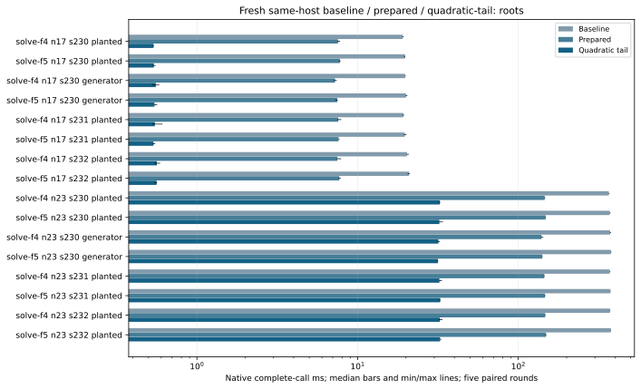
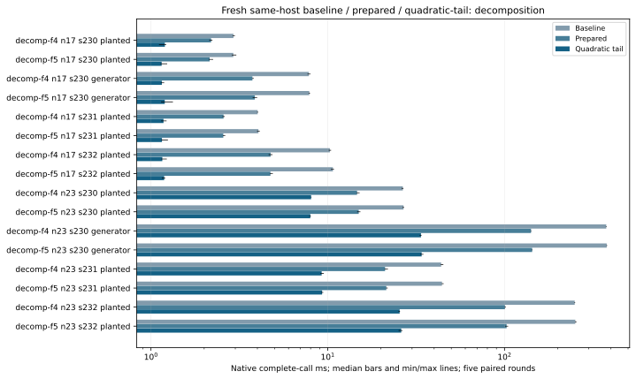

# Native F4/F5, F6 and root solvers

Run 20261019-190236-boolean-adaptive-native-d28a77, source 9bed104b0a. Dedicated c7i.2xlarge, one worker and a reserved complete physical core; four-worker controls reserve two cores/SMT siblings. Exact source/compiler/CPU/ISA and binary manifests remain in the raw tree. Baseline: frozen a78 algorithm with all three previously qualified GF2 switches. Candidate: identity-bound prepared construction and bounded quadratic-tail policies.

Original n17/n23 fixtures have16/22 Boolean variables on icv1-f2m17-tm101-00378d4e / icv1-f2m23-tm5197-1f85e9e1. Planted seed230 and fixed generator control plus planted holdouts231/232; random=true means generator here. n19's36-variable admission gap remains separate. No fixture or baseline is replaced by the full-DLP standard subspaces.

All eighteen arms are rerun with this source's declared policies. Complete original roots and first-witness decomposition remain separate; common curve/base construction is outside component timings. Fresh target ANF, solving, lifting and internal verification are charged to decomposition; Semaev fresh table setup is charged once. Independent original-root/group audits run after elapsed capture.

Five paired rounds, first eligible of at most three attempts, exact original outputs, exact3125-resample CI and max(2%, twice A/A noise) gate. Rejected attempts retained: 40. All four multiworker controls neutral: True. Every slower/neutral/missing cell remains in native-summary.json.

Prepared is a combined active-layout/top-degree/linear-tail/direct-packing ablation. Quadratic-tail retains an algebraic root reduction, then exhaustively completes at most16 free quadratic variables using the existing Gray kernel; original coordinates, root order, caps and verification remain enforced. This is a hybrid engineering change, not a novel enumeration algorithm. Other split rules/custom node oracles keep recursion.

The matrix switches stay opt-in. Source/protocols: 9bed104b0a, PROTOCOL.md and the frozen runner/protocols in the raw tree. Sources0acfc55b7f,71c4c99d85 and9bed104b0a are separate experiments. The final adaptive variants preserve cheap degree-two refutations below16 original variables; legacy policy names remain for replay. Full-table setup uses the same exact sorted tuples serially under an explicit one-worker resource contract. No cross-host pooling, external-fastest, Arm64/GPU, whole-IC/rho or hard-family8x conclusion follows from component calls.

## All paired recursive-solver outcomes

|Arm|n|Seed|Target|Before ms|Candidate ms|Ratio|Decision|
|---|---|---|---|---|---|---|---|
|solve-f4|17|230|P|19.1212|0.5369|35.6046|faster|
|solve-f5|17|230|P|19.7560|0.5390|36.6558|faster|
|decomp-f4|17|230|P|2.9276|1.1984|2.4902|faster|
|decomp-f5|17|230|P|2.9228|1.1492|2.5456|faster|
|solve-f4|17|230|G|19.7640|0.5545|35.6418|faster|
|solve-f5|17|230|G|20.0131|0.5440|36.7548|faster|
|decomp-f4|17|230|G|7.8249|1.1523|6.7928|faster|
|decomp-f5|17|230|G|7.8630|1.1968|6.6347|faster|
|solve-f4|17|231|P|19.2579|0.5475|35.1766|faster|
|solve-f5|17|231|P|19.6641|0.5362|36.5913|faster|
|decomp-f4|17|231|P|4.0124|1.1773|3.3832|faster|
|decomp-f5|17|231|P|4.0555|1.1543|3.4485|faster|
|solve-f4|17|232|P|20.2883|0.5631|36.5337|faster|
|solve-f5|17|232|P|20.8924|0.5612|37.5904|faster|
|decomp-f4|17|232|P|10.2842|1.1591|9.0028|faster|
|decomp-f5|17|232|P|10.6986|1.1877|9.0156|faster|
|solve-f4|23|230|P|365.4568|32.4994|11.2209|faster|
|solve-f5|23|230|P|371.0485|32.2656|11.5008|faster|
|decomp-f4|23|230|P|26.6001|8.0531|3.3003|faster|
|decomp-f5|23|230|P|26.8354|7.9718|3.3690|faster|
|solve-f4|23|230|G|372.9637|31.8003|11.7343|faster|
|solve-f5|23|230|G|376.9289|31.6133|11.9231|faster|
|decomp-f4|23|230|G|376.4585|33.6907|11.2094|faster|
|decomp-f5|23|230|G|378.6604|33.9865|11.2168|faster|
|solve-f4|23|231|P|371.1977|32.3034|11.4721|faster|
|solve-f5|23|231|P|374.1379|32.6527|11.4581|faster|
|decomp-f4|23|231|P|43.8187|9.2394|4.7426|faster|
|decomp-f5|23|231|P|44.2896|9.2923|4.8347|faster|
|solve-f4|23|232|P|372.3018|32.4804|11.4624|faster|
|solve-f5|23|232|P|376.4863|32.5846|11.5649|faster|
|decomp-f4|23|232|P|249.6084|25.5159|9.7947|faster|
|decomp-f5|23|232|P|251.6068|26.0410|9.6692|faster|

## Latest native complete-call ms (sample count)

|Boundary|Method|n17 planted|n17 generator|n23 planted|n23 generator|
|---|---|---|---|---|---|
|complete_roots|roots-gray|0.1763 (5)|0.1887 (5)|2.4222 (5)|2.6600 (5)|
|complete_roots|roots-wide|0.3505 (5)|0.3499 (5)|1.5199 (5)|1.5208 (5)|
|complete_roots|solve-f4|0.5325 (5)|0.5546 (5)|32.3955 (5)|31.7698 (5)|
|complete_roots|solve-f5|0.5384 (5)|0.5503 (5)|32.3086 (5)|31.8293 (5)|
|complete_roots|solve-inherited|2.9710 (5)|2.9921 (5)|41.0426 (5)|39.7848 (5)|
|complete_roots|generalized-native|0.6481 (5)|0.6235 (5)|2.8599 (5)|2.6983 (5)|
|complete_roots|generalized-typed|0.1864 (5)|0.1874 (5)|1.5138 (5)|1.5616 (5)|
|complete_roots|roots-moebius|0.5459 (5)|0.5481 (5)|35.1703 (5)|35.4786 (5)|
|complete_roots|roots-monica|0.5044 (5)|0.5261 (5)|12.5095 (5)|12.5085 (5)|
|complete_roots|generic-gb|31.1077 (5)|30.3052 (5)|683.4834 (5)|456.7527 (5)|
|decomposition|decomp-f4|1.1847 (5)|1.1897 (5)|7.9602 (5)|33.3862 (5)|
|decomposition|decomp-f5|1.1653 (5)|1.1867 (5)|7.9927 (5)|33.8387 (5)|
|decomposition|decomp-f6|1.5680 (5)|2.0172 (5)|7.6039 (5)|18.4249 (5)|
|decomposition|decomp-f6-pairs|1.5511 (5)|2.0109 (5)|7.5319 (5)|18.5602 (5)|
|decomposition|decomp-generalized|2.5994 (5)|2.6576 (5)|9.4829 (5)|9.3980 (5)|
|decomposition|decomp-generalized-typed|0.2254 (5)|0.2309 (5)|1.5980 (5)|1.6203 (5)|
|decomposition|rootfind-mitm|0.3573 (5)|0.3580 (5)|46.2176 (5)|46.0340 (5)|
|decomposition|rootfind-table|1.1700 (5)|1.1550 (5)|134.0259 (5)|133.0683 (5)|

## Four-worker matrix controls

|Arm|n|Before ms|After ms|Ratio|Decision|
|---|---|---|---|---|---|
|matrix-f4|17|8.0974|7.6580|1.0345|neutral|
|matrix-f5|17|7.9634|8.6035|1.0104|neutral|
|matrix-f4|23|60.2267|60.3187|1.0115|neutral|
|matrix-f5|23|58.4961|58.6101|1.0049|neutral|

## Instrumented matrix phase medians, ms; separate nonadditive observations

|Arm|n|Target|Policy|Build ms|Reduce ms|Readback ms|Calls|
|---|---|---|---|---|---|---|---|
|solve-f4|17|P|baseline|8.8964|9.1975|0.3906|126.0|
|solve-f4|17|P|prepared|2.6233|4.5930|0.0324|63.0|
|solve-f4|17|P|quadratic-tail|0.2919|0.1264|0.0003|1.0|
|solve-f5|17|P|baseline|9.2812|9.3071|0.3891|126.0|
|solve-f5|17|P|prepared|2.8517|4.5901|0.0289|63.0|
|solve-f5|17|P|quadratic-tail|0.2962|0.1252|0.0003|1.0|
|decomp-f4|17|P|baseline|1.1210|0.9685|0.0396|12.0|
|decomp-f4|17|P|prepared|0.8520|0.5393|0.0022|6.0|
|decomp-f4|17|P|quadratic-tail|0.2304|0.1263|0.0003|1.0|
|decomp-f5|17|P|baseline|1.1093|0.9562|0.0395|12.0|
|decomp-f5|17|P|prepared|0.8517|0.5248|0.0019|6.0|
|decomp-f5|17|P|quadratic-tail|0.2282|0.1260|0.0002|1.0|
|solve-f4|17|G|baseline|9.3767|9.4614|0.3842|126.0|
|solve-f4|17|G|prepared|2.6764|4.2383|0.0269|63.0|
|solve-f4|17|G|quadratic-tail|0.2933|0.1171|0.0003|1.0|
|solve-f5|17|G|baseline|9.6866|9.4661|0.3861|126.0|
|solve-f5|17|G|prepared|2.8719|4.2658|0.0242|63.0|
|solve-f5|17|G|quadratic-tail|0.2995|0.1180|0.0003|1.0|
|decomp-f4|17|G|baseline|3.3386|3.3576|0.1371|44.0|
|decomp-f4|17|G|prepared|1.3378|1.5510|0.0088|22.0|
|decomp-f4|17|G|quadratic-tail|0.2255|0.1176|0.0003|1.0|
|decomp-f5|17|G|baseline|3.4257|3.3285|0.1363|44.0|
|decomp-f5|17|G|prepared|1.4139|1.5459|0.0080|22.0|
|decomp-f5|17|G|quadratic-tail|0.2353|0.1176|0.0003|1.0|
|solve-f4|23|P|baseline|159.8091|191.8960|6.0619|1022.0|
|solve-f4|23|P|prepared|39.0778|103.4899|0.2849|511.0|
|solve-f4|23|P|quadratic-tail|10.8679|16.8551|0.0063|63.0|
|solve-f5|23|P|baseline|163.6334|193.0544|6.1095|1022.0|
|solve-f5|23|P|prepared|40.6718|103.8710|0.2704|511.0|
|solve-f5|23|P|quadratic-tail|11.0028|16.6557|0.0044|63.0|
|decomp-f4|23|P|baseline|11.2678|12.3148|0.3824|64.0|
|decomp-f4|23|P|prepared|4.9917|7.0951|0.0190|32.0|
|decomp-f4|23|P|quadratic-tail|3.1113|2.3100|0.0014|7.0|
|decomp-f5|23|P|baseline|11.5059|12.2149|0.3832|64.0|
|decomp-f5|23|P|prepared|5.1991|7.1437|0.0173|32.0|
|decomp-f5|23|P|quadratic-tail|3.0834|2.2995|0.0009|7.0|
|solve-f4|23|G|baseline|165.4343|193.0466|6.0516|1022.0|
|solve-f4|23|G|prepared|39.9080|96.1717|0.2549|511.0|
|solve-f4|23|G|quadratic-tail|11.1639|15.9021|0.0059|63.0|
|solve-f5|23|G|baseline|169.5292|193.0257|6.0629|1022.0|
|solve-f5|23|G|prepared|41.6756|96.0039|0.2487|511.0|
|solve-f5|23|G|quadratic-tail|11.3115|15.6300|0.0039|63.0|
|decomp-f4|23|G|baseline|166.8718|193.8212|6.0476|1022.0|
|decomp-f4|23|G|prepared|39.4889|95.8989|0.2466|511.0|
|decomp-f4|23|G|quadratic-tail|10.7112|15.9513|0.0035|63.0|
|decomp-f5|23|G|baseline|169.9726|192.9853|6.0428|1022.0|
|decomp-f5|23|G|prepared|41.4014|96.1738|0.2527|511.0|
|decomp-f5|23|G|quadratic-tail|11.0830|15.9250|0.0038|63.0|

## Full-table four-worker cold-call controls

|Arm|n|Before ms|After ms|Ratio|Decision|
|---|---|---|---|---|---|
|rootfind-table|17|1.3923|1.3404|1.0583|neutral|
|rootfind-table|23|63.2043|63.1086|0.9923|neutral|
