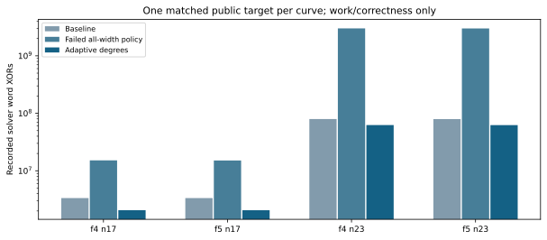

# Cheap degree-two refutations: local work screen

Source frozen-adaptive-screen/koblitz_groebner.rs (pre-version guarded source). Same registered curves, standard bases and public target0/round1 as the full panel; one warmup and one measured round, four arms per curve. All16 executions verify, including8 warmups; all8 measured replays reproduce. Gate passed: True. The native replay-all mode excludes warmups. This corrects earlier prose equating total verified records with measured replays. No L0 elapsed-time or pipeline speedup claim follows.

The failed all-width degree-three policy spends3.000 billion word XORs on the n23 F4 target; the guarded policy spends62.421 million, against79.418 million baseline. The old native full-pipeline regression remains in its own report; logical work counts here are not native wall time.

Both original16/22-variable fixtures retain identical complete roots and all checked deterministic counters against source71c4c99d85. The final corrected policy receives its own identity; pre-version screen records keep their sealed bytes and frozen-source replay. Sources: the adjacent Rust-prepared summary, ADAPTIVE_PROTOCOL.md and the raw screen tree.

## Matched target work

|n|Engine|Calls|Baseline XORs|Failed XORs|Adaptive XORs|Queries/answer equal|
|---|---|---|---|---|---|---|
|17|f4|2398|3355654|15190651|2062875|True|
|17|f5|2398|3350611|15107801|2058669|True|
|23|f4|135075|79417986|3000248688|62421379|True|
|23|f5|135075|79343067|2994993068|62338849|True|
