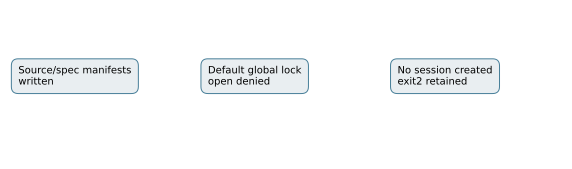

# Local screen preflight failure

The first L0 screen stopped before creating a session: /tmp/crypto-bench.lock was not writable, exit2. Source/spec/binary manifests and stderr remain in runs/adaptive-screen. No solver result or elapsed-time comparison was produced.

The separate retry uses a private workspace lock, --cpus none and --allow-busy for correctness/work only. No isolation gate is bypassed for a native claim; the dedicated final panels retain their original gates. Both attempts remain evidence.

