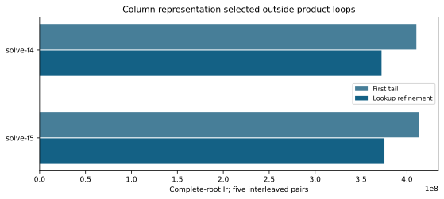

# Column-index dispatch refinement

Same original n23 planted complete-root fixture and first-tail policy in both binaries. The representation dispatch moves outside the product term loop; all three lookup types preserve exact support, fallback, root order, caps and deterministic work counters.

The frozen profile gate requires five complete pairs and more than2% lower median Ir on both arms. Retain refinement: True. All rows and failures remain in lookup-summary.json. This is not native-time qualification; retained changes require fresh full native/ecbench panels.

Valgrind merged-thread simulated AVX2 Ir, one worker; binary hashes, commands and original audits in runs/lookup-profiles/. Source: LOOKUP_PROTOCOL.md. No cross-host ratio multiplication or runtime extrapolation.

The refined F4 matrix driver accounts for51.69% of complete-call Ir in the retained function annotation. That symbol includes inlined work and does not isolate reduction from construction; the native build/reduce/readback timers provide the phase diagnosis. Annotation: records/f4-refined-hot-functions.txt.

## Frozen instruction gate

|Arm|Before Ir|After Ir|Pairs|Retain|
|---|---|---|---|---|
|solve-f4|410274935.0|372330814.0|5|True|
|solve-f5|413437743.0|375493171.0|5|True|
