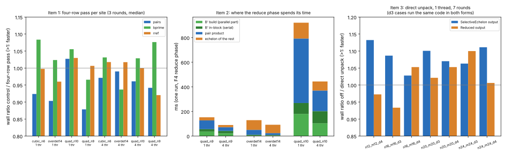

# F4/F5 follow-ups: four candidate speedups, none promoted (2026-10-29)

Four leads were proposed after the Arm64 defaults study (`research/arm64_f4_defaults_20261022`):
1. F_p F4 on small and medium systems;
2. F_p F4 scaling to 4 threads;
3. F5 direct unpack enabled only where it wins;
4. inherited-F4 `insert`.

Each was profiled, an exact candidate was built where one existed, and every candidate was timed against its same-binary control. **No code change is landed: none gave a speedup that held across the cases and thread counts measured.** The candidate patch for items 1–2 is kept as `runs/item1/candidate_bprime_fused_and_split.diff`.

Report: [`REPORT.pdf`](REPORT.pdf) (source `REPORT.typ`). Graph: [`fig_followups.svg`](fig_followups.svg), from `plot.py` over `runs/`.

Host: one shared 4-vCPU Intel Xeon @ 2.10 GHz with AVX2 and no AVX-512, unpinned (L0), `host.txt`. Code: `main` at `91902d0ca3`, plus the candidates described below. msolve 0.6.5 from the Ubuntu package.

## 1. F_p F4, small and medium systems

- **The gap to msolve has closed on this host.** At 1 thread, `f4_fp` is:
  - level with msolve on `quad_n8` (47.8 against 47.4 ms);
  - faster on `quad_n7`, `quad_n9`, `cubic_n5`, `cubic_n6`, `quart_n4`, `quad_n10` and `overdet_n12` (`runs/item1/msolve_vs_ours_1t.tsv`).

  msolve's figures are process wall times, so they include start-up.
- **Profile.** On `quad_n9` at 1 thread, 44 % of instructions are in `add_lazy_avx2`, the u32 × factor → u64 multiply-accumulate. It is called from three places:
  - the pair-row product `D − C·B'`;
  - building `B' = A⁻¹B`;
  - the echelon step `rref32_deferred`.
- **Candidate.** A four-row pass (`add_lazy4_avx2`): each 64-bit accumulator is loaded and stored once per four products instead of once per product.
  - Building `B'` uses it directly.
  - The pair product reorders its updates by row to use it.
  - The echelon step computes each group's four factors exactly first, by a small triangular solve.
  - Bases were identical on all 18 systems in every arm, at 1 and 4 threads (`runs/item1/basis_fingerprints.txt`).
- **Instructions fall; time does not.**
  - The multiply-accumulate kernels went from 976 M to 633 M instructions, and the whole run from 2.20 G to 1.89 G (`runs/item1/callgrind_*`).
  - Wall time per site, 3 rounds, control ÷ candidate (`runs/item1/ab_sites.txt`):
    - pair product: 0.88–1.03, mostly slower. Ordering by row loses the reuse of each `B'` tile across the 64 rows of a block.
    - building `B'`: 0.94–1.08.
    - echelon step: 0.92–1.03.
  - With `B'` alone, at 4 threads: 0.90–1.02 (`runs/item2/ab_split.txt`, arm `s0f1`).
  - The loop is limited by reading four pivot rows, not by instruction count.

## 2. F_p F4 at 4 threads

- **Where the time goes.** At 4 threads, the reduce phase is still 66–84 % of `f4_fp` on the medium systems (`runs/item2/step_phases_ms.tsv`). Inside it (`runs/item2/reduce_parts_ms.tsv`):
  - the pair product scales 2.4–3.1×;
  - building `B'` scales only 1.2–1.3×, because its in-block dependency loop runs on one thread: 19 of 42 ms on `quad_n9`, 98 of 202 ms on `quad_n10`;
  - the echelon step scales 1.16–1.75×.
- **Candidate.** Run that serial loop column tile by column tile, in parallel (`finish_block_by_columns`). The chain along the rows stays in order inside each tile, so every entry and every counted operation stays the same.
- **Result.** It is no faster:
  - whole run: 0.87–1.02 against the control (`runs/item2/ab_split.txt`);
  - `B'` phase alone: 239–264 against 214–216 ms on `quad_n10` (`runs/item2/bprime_split_ms.tsv`).

  The phase is spread over 149–347 blocks of about 0.3 ms each, so handing work to other threads costs about as much as it shares.
- **Left open.** A different `B'` algorithm, such as larger blocks, a blocked triangular solve, or pipelining across blocks, is not tried here.

## 3. F5 direct unpack, enabled where it wins

The decision rule and its amendment were written before each run: `runs/item3/DECISION_RULE.md`.

- **Exploratory run.** 5 rounds, Reduced and SelectiveEchelon output, 1 and 4 threads (`runs/item3/raw/`). Direct unpack looked faster only for SelectiveEchelon output at 1 thread: 7/7 cases, 1.01–1.15× in wall time.
- **Confirmation.** 7 rounds, SelectiveEchelon output, 1 thread (`runs/item3/confirm/`): 7/7 cases, geometric mean 1.084×. This passes the rule.
- **Amendment, Reduced output.** For the degree-3 cases and every case below 20 variables, SelectiveEchelon runs exactly the same code as Reduced output. The same check for Reduced output at 1 thread (`runs/item3/confirm0/`) gives 5/7 cases and a geometric mean of 1.019×, which fails.
- **Decision.** The three degree-3 cases run identical code in both runs, yet read 1.087 against 0.933, 1.101 against 1.021, and 1.063 against 1.100. That disagreement is up to about 15 %, larger than the effect. The SelectiveEchelon pass is therefore not credible, and direct unpack stays opt-in (`KIC_F5_UNPACK_DIRECT=1`).
- **Exactness.** Rows, row space, terms, rank and word counts were identical in every arm and round.

## 4. Inherited F4 `insert`

- **Profile.** `f6_ic_probe`, K0/2^23, engine `f4` (`runs/item4/callgrind_K0_23_f4.txt`, plus a line-level build not committed):
  - `insert`: 28 % of instructions;
  - `specialise_shared`: 22 %;
  - the BMI2 eager rewrite: 13 %.
- **Inside `insert`, the cost has no single hotspot.**
  - the pivot XORs are about 0.7 G of about 3 G instructions;
  - the rest is spread over slice indexing, leading-word scans, pivot lookups and per-row bookkeeping;
  - allocation is about 5 % and zeroing about 4 % of the whole run.
- **AVX2 XOR.** A version of `xor_words` compiled for AVX2 gave identical outputs but slightly more instructions (9.39 G against 9.31 G, `runs/item4/callgrind_xor_avx2_*.txt`). Not kept.
- **Not tried.** Doing fewer XORs means changing the reduction itself. That changes the counted word operations, which ecbench records under an accounting version, and needs its own study.

## What would be worth trying next

- A `B'` construction with real parallelism, for item 2.
- Allocation reuse in inherited-F4 specialisation: about 9 % of instructions are allocation and zeroing.
- Any of these needs a quieter host than this shared VM. The arm-to-arm effects here are 3–8 %, about the size of its round-to-round noise.

Conductor isn't installed in this container, so the `conductor check` step was not run. These measurements ran locally, as development checks, rather than through Iso Lab on EKS, so none of them is a benchmark claim. There is no `benchmarks/README.md` row, because there is no speedup to admit and no rho reference.
