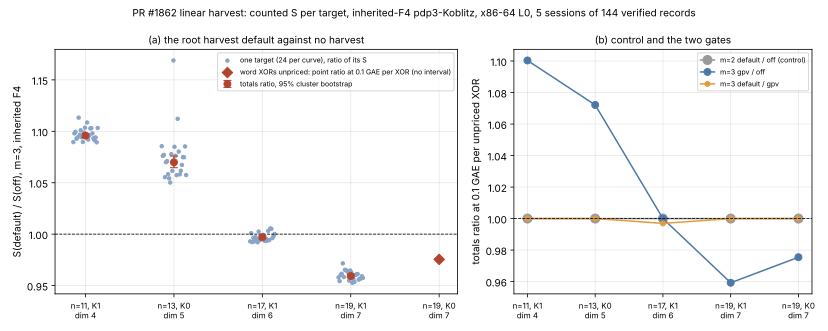

# Re-measuring the PR #1862 harvest default on m = 3 (2026-10-24)

Status: **measured.** The protocol ([`PROTOCOL.md`](PROTOCOL.md)) was frozen
and committed before any session of this study existed. Five sessions of 144
records each, every record `verified`, every session audited with
`ecbench verify --replay-all` (144 of 144 replays identical, 0 problems).
Counts only (isolation L0, x86-64); no wall-time claim. Class: **mixed, by
size** (below). No leaderboard row moves.

## Question

PR #1862 made the root linear-row harvest of `koblitz_groebner` the default
for inherited F4. On the one workload the pricing-jump bisect saw
(`research/f4_pricing_jump_20261018/`), K_0 at n = 13, it raised counted solver
word XORs by about 7%. Is that typical?

## Method

One new method parameter, `linear_harvest`, on the `pdp3-koblitz` oracle
(`src/bin/ecbench/pdp3_koblitz.rs`): `off` (the engine before #1862),
`default` (the library default now), `gpv` (#1862's gate alone), `every`.
Omitted, behaviour, counters and method ids are unchanged. It is refused
under the rootfind and matrix engines, and an integration test
(`tests/ecbench.rs`, `pdp3_koblitz_linear_harvest_is_a_method_parameter_not_an_environment_switch`)
pins that `omitted` and `default` give identical counts, `off` differs, and the
refusals hold. (The old opt-out `KIC_LINEAR_HARVEST` cannot be used under
ecbench: `pdp3-koblitz` refuses `KIC_*` because it would change the search
without changing the method's identity.)

Five specs, one per curve (the factor-base dimension is per arm), 24 public
targets each, arms `rho-strong` (reference), `f4-m3-off` (baseline),
`f4-m3-default`, `f4-m3-gpv`, and as a negative control `f4-m2-off`,
`f4-m2-default`. Native `ecbench` at commit `8db015f16`, binary sha256
`aa246d23…a2db`, opt-level 1.

| spec | curve | dim | session |
|---|---|---:|---|
| `SPEC-K1n11` | `icv1-f2m11-t67-05f5aa36` | 4 | `ECBS1hfe37f1753f1f` |
| `SPEC-K0n13` | `icv1-f2m13-t181-515ee569` | 5 | `ECBS1h11d30cd9b363` |
| `SPEC-K1n17` | `icv1-f2m17-tm101-00378d4e` | 6 | `ECBS1h462f5170ec1b` |
| `SPEC-K1n19` | `icv1-f2m19-tm797-9c54981b` | 7 | `ECBS1h7fc60b21f43b` |
| `SPEC-K0n19` | `icv1-f2m19-t797-b6cf2467` | 7 | `ECBS1h954b7559cfb8` |

Analysis is `ecbench compare --json` on each pair, `ecbench table` and
`ecbench band` (`analysis/`); `plot.py` draws the graph from those files and
computes nothing.

## Results

**Control passed.** At m = 2 the harvest never fires: `f4-m2-default / f4-m2-off`
is 1.0000 with interval [1.000, 1.000] on all five curves, and equal word XORs
on the unpriced curve.

**m = 3, default against off** (totals ratio of `S` over 24 paired targets;
interval is the harness's cluster bootstrap):

| curve | ratio | 95% interval | targets up / down | per-target range | mean S off → default | S / rho-strong off → default |
|---|---:|---|---|---|---|---|
| n = 11, K1 | **1.0958** | [1.0940, 1.0980] | 24 / 0 | 1.089 – 1.113 | 403.5 → 442.1 | 7.17 → 7.86 |
| n = 13, K0 | **1.0699** | [1.0646, 1.0759] | 24 / 0 | 1.050 – 1.169 | 517.0 → 553.1 | 36.9 → 39.5 |
| n = 17, K1 | **0.9969** | [0.9955, 0.9985] | 6 / 18 | 0.992 – 1.006 | 1678.1 → 1672.9 | 424.1 → 422.8 |
| n = 19, K1 | **0.9593** | [0.9576, 0.9611] | 0 / 24 | 0.953 – 0.972 | 3004.4 → 2882.1 | 1248 → 1198 |
| n = 19, K0 (word XORs unpriced) | S unchanged (1.0000); at 0.1 or 1 GAE per XOR **0.9755** | none (point, indicative) | 0 / 0 (S flat) | – | S 4.859 both (a lower bound) | 1.62 both |

- **The sign depends on size.** The harvest raises counted `S` by about 10%
  and 7% at n = 11 and 13, on every one of the 24 targets, and lowers it by
  4.1% at n = 19 (K1), on every target; at n = 17 it is a 0.3% gain with an
  interval that excludes 1 and mixed per-target signs.
- **gpv against default.** `gpv` equals `default` at n = 11, 13 and 19, and
  at n = 17 `gpv` equals `off` (ratio 1.0000): the whole n = 17 gain comes from
  PR #1891's root-rank gate, which fires there and on none of the other four
  curves of this study.
- **Scale.** Every priced F4 arm sits 7 to 1,250 times the strong rho in `S`.
  The harvest moves that gap by at most 10%. Nothing here brings inherited F4
  closer to rho.

## Classification (AGENTS.md §3)

- n = 11 and 13: the default is a **regression** against no harvest (counted
  `S` and the ratio to the floor and to rho both rise).
- n = 19 (K1): an **engineering** gain of 4.1% against no harvest (`S` falls,
  the ratio to the floor stays flat); n = 17: 0.3%, an interval that excludes 1
  but mixed per-target signs, reported and too small to call a result.
- Read the other way, against the *current* default: switching the harvest
  **off** at n = 11 and 13 would lower counted `S` by about 8.7% and 6.5%
  (1 / 1.0958 and 1 / 1.0699), a measured but small improvement to a
  diagnostic arm. It is not a row of tables A–C, it is not a speed claim, and
  with four sizes it supports no scaling rule; `benchmarks/` and the
  leaderboard are therefore **not** updated. A size-dependent gate is the
  natural follow-up, and it needs its own preregistered measurement at more
  sizes (n = 15, 21, 23 and the other K_1 sizes).

## Limits

- Counts only, from a deterministic harness: wall time, cache effects and
  other hosts are not measured. The aarch64 `solver_ops` offset
  (`research/inherited_f4_replay_determinism_20261018/`) is not examined here.
- Four priced sizes and one unpriced size, 24 targets each; intervals resample
  targets within a curve and say nothing about other curves. No exponent is
  fitted.
- The hypothesis was formed after a two-target smoke run (scratch, not
  committed) that already showed the sign changing with size; the 24-target
  sessions use different target seeds and every number above is from them.
- `K0n19` has no pinned `ns_per_word_xor`, so its word XORs are unpriced and
  its `S` is a lower bound; its 0.9755 is a band point ratio only.

## Process facts (the director assessed `executed_with_deviations`)

All five sessions and audits are intact; the deviations are in how they were
produced and none touches session or audit content.

1. Card 1 stopped at its first audit step because `audits/` did not exist
   (a card defect); the K0n13 session it produced is complete and untouched.
2. Card 2 was refused by `tools/task_card.py` (stale pinned commit after I
   committed): no step ran, no receipt.
3. Card 3 was killed by the executor's 30-minute background limit during the
   K1n19 audit and left no receipt. The sessions and audits it produced
   (K0n13 audit, K1n11, K1n17, K1n19 runs, K1n11 and K1n17 audits) are
   evidenced by the files and their stdout copies, not by a receipt. A commit
   (`a3c8f1749`) was made while it ran; the pinned-commit check happens at start.
4. Cards 4, 5 and 6 (K1n19 audit, K0n19 run, K0n19 audit) ran one command each.
   Their executors returned `refused` by applying a stop rule written for
   run commands to a verify command (4, 6) or to a run whose summary line is on
   stderr under `--quiet` (5). Every command exited 0 and every audit reads OK.
   Relay verbatim was not assessed for them.
5. The stop rule's "last stdout line" wording is wrong for `--quiet` runs:
   every run command's stdout file is empty.

## Proposals (not applied)

- A size-dependent harvest gate, measured at more sizes with its own
  preregistration (the rank gate of #1891 already shows the idea works at n = 17).
- Fix `tools/task_card.py` cards for `--quiet` runs (stderr) and create
  `audits/` in the card's first step.

## Files

[`PROTOCOL.md`](PROTOCOL.md), `SPEC-*.json`, `SPEC.sha256`, `sessions/` (five
sessions), `audits/` (five `--replay-all` receipts), `cards/` (six cards,
receipts and stdout), `analysis/` (every `compare`, `table`, `band` output),
`plot.py`, `harvest_ratio.svg`, `harvest_ratio.png`, `REPORT.typ`, `REPORT.pdf`.

