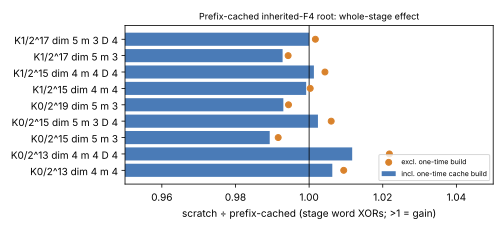

# Prefix-cached inherited-F4 root: exact, and a null (0.989–1.006×)

2026-11-09. **Class: engineering, stage diagnostic** (inherited-F4
decomposition stage only, not an end-to-end ECDLP measurement). All numbers
here are `[pcc:unverified]` single-host runs.

## Question

Caching (F4Remake replay) and dynamic programming (inherited F4) are both
already built, and both are measured:
`research/gaudry_quartic_replay_20261013` (2.0–4.7 %),
`research/pdp_shape_replay_20261015` (0.95–0.98×), and
`src/cryptanalysis/inherited_f4.rs`. One case of target-independent
precomputation had not been built for the binary chain. The 2026-11-06 log
says "argued, not built" for the `gaudry-x-bin` route, which is a different
route.

For a chain of `m ≥ 3` summands, `S₃(x₁,x₂,e₁), …, S₃(e_{m−2},x_m,x_R)`,
only the last link reads the target. The first `(m − 2)·n` generators, and
every Macaulay row built from them, are the same for every target. F4Remake
can only skip zero rows. Here the *pivot* rows of the target-free part
could be reduced once and reused. The earlier write-up said "the rows that
become pivots can't be skipped: their values depend on the target". For
these rows that is false, so this was the one form of caching left to test.

## What was built

- `src/cryptanalysis/inherited_f4/prefix.rs`:
  `ReducedBasis::from_system_with_prefix`.
  - The prefix rows are built once per (prefix, degree, multiplier policy,
    occurring mask) and brought to RREF. They are then cut into blocks of
    8 pivots, each with a Four Russians table of all 256 sums.
  - Per target, the code builds the link's rows and reduces each one
    against the cached prefix: one table XOR per block. The residuals are
    then brought to echelon form on the repository kernel.
  - The root spans exactly the from-scratch row space, on exactly its
    columns.
- Hook: `KIC_F4_PREFIX_ROOT=1`, or `set_prefix_root(true)`, which is off by
  default. It applies to the first reduction of a solve. The chain
  decomposer marks the prefix length (`set_prefix_hint`).
- Accounting is in the stage unit. Each target is charged:
  - the copy of the prefix rows into its basis;
  - a pivot-bit read per link row;
  - every table XOR;
  - the residual echelon.

  The one-time work (prefix RREF and tables) is charged to the first root
  and is also reported separately.
- `examples/f4_prefix_probe.rs` has three modes: `shape`, `root` and
  `stage`. `stage` interleaves the two arms per target in alternating
  order and asserts identical verdicts, splits and reductions.

## Result

Commands: `target/release/examples/f4_prefix_probe {shape,root,stage}` on the
cells below (`raw/`, `summarize.py` → `summary.json`, figure).

| cell | targets | prefix rows / root rows | root share of stage | scratch ÷ prefix (incl. one-time) | (excl. one-time) | CPU ms scratch / prefix |
|:--|--:|--:|--:|--:|--:|--:|
| K0/2^13 dim 4 m 4 | 6 | 26 / 254 | 7 % | 1.006 | 1.009 | 87 / 88 |
| K0/2^15 dim 5 m 3 | 8 | 15 / 325 | 28 % | 0.989 | 0.992 | 32 / 34 |
| K0/2^19 dim 5 m 3 | 6 | 19 / 493 | 19 % | 0.993 | 0.994 | 57 / 59 |
| K1/2^15 dim 4 m 4 | 4 | 30 / 327 | 3 % | 0.999 | 1.000 | 248 / 255 |
| K1/2^17 dim 5 m 3 | 8 | 17 / 408 | 19 % | 0.993 | 0.994 | 61 / 62 |



- **Exact.** Every root had the same row space as the from-scratch root
  (`root` mode asserts this). Every decomposition had identical verdicts,
  splits and reductions (`stage` mode asserts this). The prefix was
  identical across every target probed.
- **No gain.** The ratio is 0.989–1.006×, within ±1.1 % of parity on every
  cell. CPU time follows the same pattern.

## Why the lever is empty

The structure is the reverse of what the target-independence argument
assumes:

- **The target-free links are the cubic ones.** `S₃(x₁,x₂,e₁)` is cubic in
  unknowns. At the root degree `D = 3` it takes no multipliers, so it
  contributes only its `n` generators as rows.
- **The target link is the dense one.** Fixing `x_R` drops
  `S₃(e_{m−2},x_m,x_R)` to quadratic. At `D = 3` it is multiplied by every
  variable in its support.
- **So the cacheable share is small:** 4–5 % of the root rows at `m = 3`
  and 8–10 % at `m = 4`.
- **The root itself is only part of the stage:** 3–28 % of the stage's
  word XORs. The ceiling is therefore about 1 % of the stage, and the
  per-target bookkeeping (copying prefix rows, reading pivot bits) uses it
  up.
- **Below the root nothing is target-free.** The first splits fix `x_m`,
  which lives in the target link.

This agrees with the earlier conclusion from a third direction. Caching
changes the cost per candidate, not the number of candidates. Here even
the constant-factor ceiling is about 1 %, because target independence
sits in the low-multiplicity, high-degree part of the system.

## Decision

Recorded null. `KIC_F4_PREFIX_ROOT` stays off and is kept as a control.
The oracle is unchanged by default. No leaderboard or `benchmarks/` row is
added, because there is no improvement to land.

A larger `D` (4 or more) would give the cubic prefix linear multipliers
and raise its share. The inherited engine does not use `D ≥ 4` on these
cells (`max_degree: 3`), so that would be a different and costlier
operating point. It is not pursued here.

## Follow-up: root degree D = 4 (2026-11-09)

At D = 4 the cubic prefix takes linear multipliers, so the cacheable share
grows. Commands are the same as above with `--degree 4 --max-degree 4`.
These cells have at least 24 variables, so the engine builds only the top
degree. Raw files are named `raw/*D4.jsonl`. `[pcc:unverified]`

| cell | prefix rows / root rows | root share of stage | scratch ÷ prefix (incl. one-time) | (excl.) | stage XORs, D = 4 ÷ D = 3 (scratch) | splits D = 3 → D = 4 |
|:--|--:|--:|--:|--:|--:|--:|
| K0/2^13 dim 4 m 4 | 664 / 2568 | 11 % | 1.012 | 1.022 | 118× | 650 → 373 |
| K1/2^15 dim 4 m 4 | 821 / 3629 | 3 % | 1.001 | 1.004 | 188× | 1846 → 920 |
| K0/2^15 dim 5 m 3 | 355 / 3422 | 28 % | 1.002 | 1.006 | 147× | 200 → 84 |
| K1/2^17 dim 5 m 3 | 415 / 4733 | 21 % | 1.000 | 1.002 | 188× | 247 → 114 |

- **Exact again.** Row spaces are equal, and verdicts, splits and
  reductions are identical between the two arms.
- **The cacheable share grows as predicted:** 26–23 % of root rows at
  m = 4 and 9–10 % at m = 3. On the m = 4 cells the per-target root work
  falls by about 20 % (for example 15.2 M → 12.1 M XORs on K0/2^13).
- **The stage barely moves:** 1.000–1.012× including the one-time build,
  and 1.002–1.022× excluding it. Below the root, the stage is dominated by
  specialisation and re-reduction, which the cache does not touch.
- **D = 4 is the wrong operating point.** It halves the splits, but the
  stage costs 118–188× more word XORs than D = 3 from scratch. The best
  D = 4 cell (1.022×) is therefore still about 115× worse than the
  production D = 3 baseline.

**Decision:** the null stands at both degrees. Raising D makes the prefix
cacheable, but it costs two orders of magnitude more than the cache can
save.

## Reproduce

```
cargo build --release --example f4_prefix_probe
P=target/release/examples/f4_prefix_probe
$P shape --a 0 --n 15 --dim 5 --m 3 --targets 2
$P root  --a 0 --n 15 --dim 5 --m 3 --targets 8
$P stage --a 0 --n 15 --dim 5 --m 3 --targets 8
python3 research/f4_prefix_root_20261109/summarize.py   # from this directory
```

Host: a shared cloud container with 4 vCPU. Word XORs are deterministic
and CPU times are indicative only.
