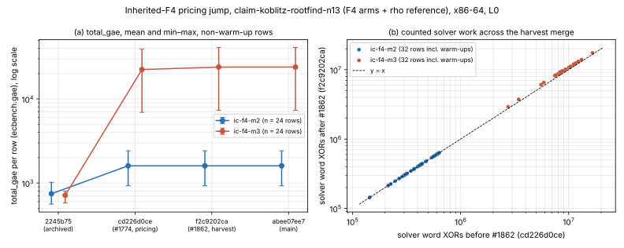

# Inherited-F4 pricing jump between `2245b75` and `main`, 2026-10-18

Status: **explained; accounting plus one algorithm change; no bug found.**
Class (AGENTS.md §3): **accounting** (PR #1774) and **algorithm** (PR #1862,
a counted-work *increase* on this workload). Neither is an improvement, and
nothing here changes the index-calculus baseline (tables A–C). No leaderboard
row moves, because the leaderboard reads recorded values; see "Affected rows".

## Question

Re-running the committed spec of session `ECBS1hfd5bf1885227`
(`research/ecbench_frontier_20261013`,
`docs/ecbench/specs/claim-koblitz-rootfind-n13.json`) with the archived
commit `2245b75` and with `main` on x86-64 gave very different `total_gae`
for the inherited-F4 rows (m2 target 0 warm-up 983 → 1,949; m3 target 0
warm-up 671 → 25,819). Why, and are today's baseline rows mispriced?

## Method

Host: this container, x86-64 (AMD EPYC 9V74, 4 vCPU), rustc 1.97.0,
`--cpus none --allow-busy` (isolation L0; only counts are used, never wall
time). Every build: `cargo build --release --bin ecbench`, opt-level 1, no
LTO, one shared `CARGO_TARGET_DIR`, in a sparse worktree (`research/` holds
only `*.rs`, `Cargo.toml` and the `include_str!` inputs; a missing input is a
compile error, never a silent difference). Counts do not depend on
optimisation level (`research/inherited_f4_replay_determinism_20261018`).

1. **Reproduce.** The full spec (224 records) was run with `2245b75` and with
   `main` (`abee07ee7`). Both numbers reproduce exactly: m2 target 0 warm-up
   982.628 → 1,949.912 GAE, m3 target 0 warm-up 671.404 → 25,818.785 GAE.
2. **Reduced spec.** `bisect/f4only.json` is the same spec with only the
   arms `rho-strong` (the reference), `ic-f4-m3` and `ic-f4-m2`. Its F4
   signature equals the full spec's, byte for byte, on both endpoints, so
   each bisect step runs 96 records (about 15 s).
3. **Signature.** `bisect/sig.py` reduces a session to the 64 F4 rows: arm,
   target, round, warm-up, `total_gae`, `lower_bound`, `unpriced`, every
   phase's `gae`, and the relations phase's `solver_ops`, `solver_calls`,
   `trials`, `relations`, `adds`, `doubles`; the step's id is its SHA-256
   prefix.
4. **Bisect.** `bisect/drive.py` walks the 303 first-parent commits of
   `2245b75..origin/main` (with `2245b75` prepended, 304 points) and
   recursively bisects every interval whose ends differ, so it finds every
   change point (one that changes and then reverts inside an interval with
   equal ends would be missed; none of the 16 evaluated points suggests one).
   `bisect/inner.py` then built the single commits inside the two culprit
   merges.

## Bisect log

From `bisect/drive.log` and `bisect/inner.log` (index = position in
`bisect/commits.json`, 0 = `2245b75`, 303 = `main`):

| index | commit | signature | note |
|---:|---|---|---|
| 0 | `2245b7596` | `69a5576f9885` | archived commit |
| 303 | `abee07ee7` | `becf95c66869` | main |
| 151 | `de0c93914` | `becf95c66869` | |
| 75 | `5a609cf40` | `6bdf74984e2a` | |
| 37 | `770f6a692` | `69a5576f9885` | |
| 56 | `45efe3b33` | `6bdf74984e2a` | |
| 46 | `bc82d128f` | `6bdf74984e2a` | |
| 41 | `00680d594` | `6bdf74984e2a` | |
| 39 | `cd226d0ce` | `6bdf74984e2a` | merge of PR #1774 |
| 38 | `6ea104b4b` | `69a5576f9885` | **change 1: 38 → 39** |
| 113 | `1b874fccb` | `becf95c66869` | |
| 94 | `0c44d2453` | `6bdf74984e2a` | |
| 103 | `b906df024` | `becf95c66869` | |
| 98 | `3c0646ba9` | `becf95c66869` | |
| 96 | `f2c9202ca` | `becf95c66869` | merge of PR #1862 (same sources as 98) |
| 95 | `e15e29dbd` | `6bdf74984e2a` | **change 2: 95 → 96** |
| inner | `3f4a87aae` → `c8b1594f6` | `69a5…` → `6bdf…` | single commit of #1774 |
| inner | `df1fbcf67` → `d1d034d94` | `6bdf…` → `becf…` | single commit of #1862 |

Exactly two change points; the per-step signatures are in `bisect/sigs/`,
and five steps' full sessions (0, 39, 95, 96, 303) are in `records/`.

## Culprits and classification

### 1. `c8b1594f6` (PR #1774, merged as `cd226d0ce`, 2026-10-14): accounting

"ecbench rootfind faster cycles 1–2: price F4 word XORs". `run_pipeline`
(`src/cryptanalysis/ic_framework/mod.rs`) priced the solver's work at the
pinned `ns_per_word_xor` only when `op_unit == "word XORs"`. Inherited F4
reports `word XORs (elimination, specialisation and linear elimination
only)`, so the match failed. The term was priced at wall time instead, and
`ecbench` (`methods.rs`, `ic_report`) removes wall-priced solver terms and
lists them as `solver_word_XORs_(…)_uncharged` with `lower_bound: true`.
The commit matches by prefix (`is_word_xor_op_unit`), so the pinned ratio in
`docs/ic/calibration.json` now applies. For `koblitz/icv1-f2m13-t181-515ee569` that
ratio is 0.002304 GAE per word XOR, unchanged since before `2245b75`.

Evidence that this is accounting only. Across this merge, every F4 row has
the same `solver_ops`, calls, trials, relations, adds and doubles, and the
same `gae` in every phase other than relations. The relations-phase increase
divided by `solver_ops` is 0.0023040 on all 64 rows. Each record goes from
`lower_bound: true` to `lower_bound: false`.

The PR text called the result "complete-S parity vs F4 (apples-to-apples)".
That is the intended reading: the F4 rows were lower bounds before and are
complete counts after. It is a correction. It neither raises nor lowers the
work the solver does.

### 2. `d1d034d94` (PR #1862, merged as `f2c9202ca`, 2026-10-15): algorithm

"koblitz_groebner: harvest root linear rows by default (KIC_LINEAR_HARVEST=0
opts out)". At the root of a solve whose input passes the gate
(generators per occurring variable below 0.961; PR #1891 later OR-ed in a
root-rank gate), the multi-variable linear rows of the node basis are added
to the system and eliminated. This changes the splitting tree. Per `ic-f4-m3`
row (target 0, round 0, warm-up): reductions 1,886 → 1,917,
propagations 2,800 → 2,619, eliminated 1,940 → 1,790, splits 808 → 808,
infeasible branches 763 → 763, and counted word XORs
10,305,435 → 10,914,662. Over the 32 m3 rows the ratio
after/before is median 1.0715, range [1.0485, 1.1109]. Every m3 row rises.
`ic-f4-m2` is unchanged on all 32 rows: its systems do not pass the gate.

This is an algorithm change: the solver now does more counted work. It is not
a bug: the roots are unchanged (every record is `verified`), and the counter
charges word XORs the solver really performs. On this workload it is a
**regression** of about 7% in relations-phase work for m3. PR #1862 reported
"advances where the gate fires, matches elsewhere, no regression" on its own
held-out cells, and this spec was not among them. Whether to keep the
default is a separate decision; see "Proposal". `ecbench` passes no
`KIC_*` variable to its child (the session's `child_env` is scrubbed), so
the opt-out cannot be applied per spec.

### Totals per state (non-warm-up rows, n = 24 per arm; derived: arithmetic mean of recorded `total_gae`)

| state | `ic-f4-m2` mean total_gae | `ic-f4-m3` mean total_gae | m3 mean word XORs | lower bound |
|---|---:|---:|---:|---|
| `2245b75` | 744.8 | 712.9 | 9,399,300 | yes |
| after #1774 (`cd226d0ce`) | 1,600.3 | 22,368.9 | 9,399,300 | no |
| after #1862 (`f2c9202ca`) = main | 1,600.3 | 23,937.6 | 10,080,165 | no |

Most of the m3 jump is accounting (712.9 → 22,368.9). The algorithm change
adds a further 7.0% (22,368.9 → 23,937.6).

*Figure (`pricing_jump.svg`, `pricing_jump.png`; source `plot.py`, data
`bisect/sigs/`). (a) Mean and min–max `total_gae` of the 24 non-warm-up rows
per arm at the archived commit, after each culprit merge, and at main.
(b) Counted solver word XORs for every F4 row (warm-ups included) before
against after PR #1862. The m2 rows sit on y = x; the m3 rows sit above it.*

## Affected rows

`docs/ic/leaderboard.json` is built from recorded study files
(`scripts/build_ic_leaderboard.py`, `SOURCES`). It does not re-run anything,
so **no leaderboard row moves and the leaderboard was not regenerated**.
Tables A–C (Koblitz one-target, prime/random-binary, Koblitz batch) use no
inherited-F4 or word-XOR-priced arm and are unaffected. The rows that carry
inherited-F4 `S` are outside tables A–C and are labelled "stage diagnostic
with solver word XORs unpriced (S is a lower bound)":
`f6_ecbench_ladder_diagnostic`, `f4_f5_f6_cross_family_diagnostic`, and the
replay block of `latest_frontier_audit`. Their sessions were recorded before
#1774 (2026-10-05 and 2026-10-11, x86-64). The label is correct for the
binaries that recorded them. On today's `main` they would read very
differently wherever the curve has a pinned `ns_per_word_xor`.

Measured: each committed spec was re-run with `main` (`abee07ee7`) on this
host (`leaderboard_rerun/`). The table compares the archived and new mean
`S` over non-warm-up rows; the mean is derived and is not the median
statistic in the leaderboard JSON.

| source session | arm | n | archived mean S (LB) | main mean S | main lower bound? | main session |
|---|---|---:|---:|---:|---|---|
| ladder n13 (icv1-f2m13-t181-515ee569) | ic-f4 | 24 | 16.27 | **488.89** | no | `ECBS1hbb2585335b05` |
| ladder n13 | ic-f6 | 24 | 861.0 | **1,182.3** | no | ″ |
| ladder n13 | rho-strong | 24 | 22.02 | 22.02 | (rho) | ″ |
| ladder n19 | ic-f4 | 24 | 4.916 | 4.916 | yes | `ECBS1h5f87c0957b1c` |
| ladder n23 (icv1-f2m23-t5197-69e76b73) | ic-f4 | 24 | 2.134 | **9,479.7** | no | `ECBS1h580ef089f568 (F4 arm and rho only)` |
| cross-family K13 | inherited-f4 | 8 | 16.49 | **634.12** | no | `ECBS1h4badc043049a` |
| cross-family K13 | f6-ic | 8 | 1,161.1 | **1,572.1** | no | ″ |
| cross-family K13 | matrix-f4 | 8 | 16.44 | **113,830** | no | ″ |
| cross-family K13 | matrix-f5 | 8 | 16.44 | **73,606** | no | ″ |
| cross-family R13 | inherited-f4 | 8 | 18.45 | 18.45 | yes | `ECBS1hf61afeafc4fe` |
| cross-family K19 | inherited-f4 | 8 | 4.957 | 4.957 | yes | `ECBS1h2a286b4fe268` |
| cross-family R19 | inherited-f4 | 8 | 3.368 | 3.368 | yes | `ECBS1h97b6e8dd801d` |

Rho rows are byte-identical in counts. The n23 re-run used the spec without
its `ic-f6` arm (`leaderboard_rerun/SPEC-n23-f4only.json`; that arm took
about 66 minutes when it was recorded). Dropping arms left the remaining
arms' records unchanged on the n13 claim spec (Method, step 2), and here the
24 rho rows match the archive exactly. As a ratio of means, the ladder's
`f4_s_lower_over_rho` (leaderboard 1.105 at m = 13 and 2.091 at m = 23)
would be about 488.89 / 22.02 ≈ 22 and 9,479.7 / 1.073 ≈ 8,800 on today's
binary. That is not an improvement or a regression of
the method: it is the same word-XOR work, now charged.

Two hazards follow, and both are accounting:

1. **Before/after.** An inherited-F4 (or matrix-F4/F5, F6-IC) `S` recorded
   before `cd226d0ce` is not comparable with one recorded after it on a curve
   with a pinned `ns_per_word_xor`. That includes the archived frontier
   session `ECBS1hfd5bf1885227`.
2. **Across curves.** On today's binary, the same engine is fully priced on
   curves with a pinned ratio (here icv1-f2m13-t181-515ee569 and icv1-f2m23-t5197-69e76b73) and still a lower
   bound on the others (K19 = `icv1-f2m19-t797`, R13, R19). A ladder that
   mixes them compares a complete count with a lower bound. Each record says
   which it is (`lower_bound`, `unpriced`).

The re-runs also show `solver_ops` differences against the archived
inherited-F4 and F6 rows even where pricing did not change (n19, K19, R13,
R19). Both archived hosts were x86-64, so this is code drift between the
recording commits (2026-10-05/11) and main. #1862 explains it for this
spec; the other sessions were not bisected. It does not move their `S`,
which excludes word XORs on those curves.

## What changed in the repository

- `src/cryptanalysis/ic_framework/mod.rs`: documentation only, on
  `is_word_xor_op_unit` (where the solver pricing is defined). It records
  when the pricing changed, what the records looked like before, and the
  two comparability hazards. No counted quantity changes.
- This directory.

## Proposal (not applied)

- Version the method identity of word-XOR-priced IC arms with the pricing
  rule, so an `ecbench compare` across `cd226d0ce` refuses instead of
  comparing a lower bound with a complete count.
- Re-measure the #1862 harvest default on the m3 pdp3-Koblitz spec (a paired
  spec with `KIC_LINEAR_HARVEST` as a method parameter rather than an
  environment variable). On this spec the default costs about 7% more counted
  solver work.

## Files

- `bisect/`: `drive.py` (orchestrates builds and runs; computes no result),
  `inner.py`, `sig.py`, `f4only.json` (the reduced spec), `commits.json`,
  `cache.json` (signature per commit), `changes.json`, `drive.log`,
  `inner.log`, `sigs/` (the signature of every evaluated step).
- `records/<step>/`: full sessions (`records.jsonl`, `session.json`,
  `spec.json`, `host.json`) at steps 0, 39, 95, 96 and 303.
- `leaderboard_rerun/`: `compare.json`, `cmp.py`, and the main-binary
  sessions of the leaderboard sources.
- `plot.py`, `pricing_jump.svg`, `pricing_jump.png`, `REPORT.typ`, `REPORT.pdf`.
- Endpoint full-spec session ids on this host (not committed; reproduced by
  the reduced spec): `2245b75` `ECBS1hbe337273061b`, main `ECBS1h3d02b5ea6bf7`.
- Conductor: the control plane could not be started (port 8080 in use), and
  its MCP endpoint later returned 401. No task card was taken.
