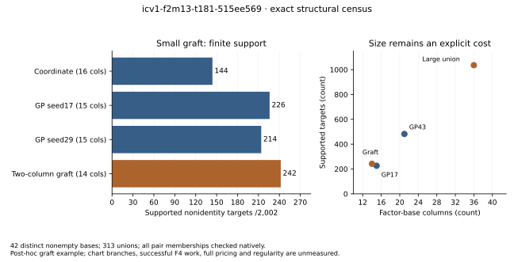
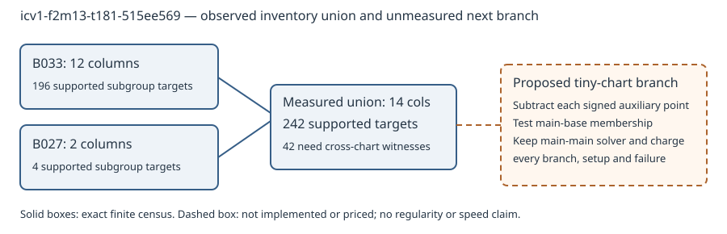

# Factor-base leads: small chart grafts and cofactor fibres

**New bounded screen, 2026-10-19.** The concrete next candidate is a small
auxiliary-chart graft on `icv1-f2m13-t181-515ee569`: 14 columns support 242
of the 2,002 nonidentity subgroup targets, compared with 226 for the earlier
15-column GP seed 17 base. This is exact finite support, **not a solver-speed
or degree-of-regularity improvement**. The graft was selected after viewing
the screen; there is no fresh holdout confirmation.

[PDF report](reports/run-20261019/report.pdf) · [Frozen protocol](PROTOCOL.md) ·
[All compact cases and protocol selections](summary.json) ·
[Native screen](screen/src/main.rs) · [Input provenance](inputs/index.json)

## What ran

The user asked for new leads after the completed shape study. We froze the
protocol and source in commit `4bce792529a2ed81103a91809f65853e9ccde213`, then
committed the otherwise ignored standalone Cargo lock in
`6811c867f8b86aa3880d48aa8ddaa5f37efed89c`, before execution.

The 60 original configurations contain one retained empty-inventory failure
and 59 nonempty records, deduplicated to 42 exact signed point sets. The
native screen measured those 42 singletons and all 313 within-curve two-base
unions: 355 cases, no capped case. Unions are set unions without trimming,
projection or invented points. Several union cases can themselves have the
same point set; they are correlated construction cases, not independent
replicates. No new random-target or F4 campaign ran.

Every one of 62,986 unique unordered point pairs, including repeated points,
was checked by actual group addition and direct multiplication of its sum by
prime subgroup order r. The cofactor-image classifier agreed in every case.
Every completed singleton reproduced the earlier independent Rust census.
The new program adapts that published audit's polynomial-basis arithmetic;
it is **not a new independent arithmetic implementation or host certificate**.

| Exact model | r | Distinct singletons | Union cases | Unique pair checks |
| --- | ---: | ---: | ---: | ---: |
| `icv1-f2m7-tm13-ac10a42c` | 71 | 17 | 136 | 4,278 |
| `icv1-f2m9-tm5-4a3ea183` | 37 | 3 | 3 | 465 |
| `icv1-f2m13-t181-515ee569` | 2,003 | 19 | 171 | 43,365 |
| `icv1-f2m31-tm90707-c95f16f5` | 1,439,393 | 3 | 3 | 14,878 |

Exact EC1, full curve UID, field, subgroup, generator, FB1 and derivation
metadata remain in each byte-preserved [input inventory](inputs/). The four
registry rows are copied exactly from source `819d6b172c8a58983bf1b2463fe24576f3f58094`.

## Lead 1: graft a tiny auxiliary chart onto a structured base

For `icv1-f2m13-t181-515ee569`, the exploratory pair `B027+B033` combines:

- `B033`: Frobenius-squared, dimension 5, seed 17; 12 columns, support 196.
- `B027`: trace-zero/Frobenius, dimension 4, seed 29; 2 columns, support 4.
- Union: 14 columns, support 242. The separate supports cover 200 targets;
  **42 additional targets require cross-chart witnesses**.

The original factor-base metadata and exact signed points are in
[the auxiliary inventory](inputs/secondary-FBS1h4bf4af0d0254ed199f61.json) and
[the main inventory](inputs/secondary-FBS1hae30f2792728a6935df4.json).
The union has 28 signed points. Its useful homogeneous witness-difference
rank is 3, the same as GP seed 17; higher coverage did not establish better
independent relation collection.

**Proposed next implementation:** for this tiny chart, test the four signed
auxiliary points by subtracting each from the target and checking exact main
base membership. Preserve the main-main decomposition arm and auxiliary-only
cases. Charge those point operations, membership tests, setup, failures and
extra logarithm columns; the census is not an online oracle. A general
union solver has up to four ordered chart-pair branches, or three with
correct symmetry handling. Neither fast path is implemented or costed here.
The draft [follow-up card](../../backlog/XP-20261019-factor-base-chart-grafts/card.json)
remains unrun, zero-funded and unleased.



The preregistered maximum-cross-target selection is larger: `B031+B041`,
36 columns, support 1,036, versus 654 from the union of its singleton supports;
382 targets are new cross contributions. It must not be substituted for a
15-column reference without charging its size. At 21 or fewer columns, no
screened union exceeds the 21-column GP seed 43 singleton's support 482.
The 14-column graft is a separately labeled post-hoc example, not one of the
protocol's three primary selection rules.

## Lead 2: select shapes by useful cofactor-fibre collisions

On `icv1-f2m31-tm90707-c95f16f5`, coordinate `B000` has 68 signed points
and 68 distinct images under multiplication by r. All 34 identity pairs are
retained, but there are zero nonidentity subgroup pairs. Random `B001` has 48
signed points, 48 images, 24 identity pairs and the same zero support.
Their 58-column union supports just2 targets; coordinate plus the structured
`B002` supports 4 with 62 columns. Every degree 31 case has useful homogeneous
collision rank 0. These are exact bounded negatives, not a nonexistence proof.

**Proposed next selection criterion:** search low-degree chart parameters
for compatible cofactor-image fibres containing more than only inverse
pairs. Require actual nonidentity subgroup support before online solving.
Charge construction, scalar checks and any fibre index as setup. Simply
cofactor-projecting every point may destroy the inexpensive membership
representation and is not an established solution. The existing cofactor
follow-up card is unchanged and unrun.

## Lead 3: screen witness diversity separately from coverage

For `icv1-f2m13-t181-515ee569`, the protocol's highest-rank union is
`B034+B041`: 38 columns, support 758 and useful same-target-difference rank 36.
The maximum-cross union above has 36 columns, support 1,036 and rank 35.
More support, more columns and more relations are different objectives.

The rank here is over differences of two signed incidence vectors for the
**same target**, modulo r. Zero prime-projection columns are removed in the
useful rank. It is neither the earlier training rank nor rank per unit of
online work. The active witness-pair graph is also recorded; connectivity
alone does not prove linear independence or a usable logarithm system.
Proposed use: reject redundant witnesses before expensive relation processing,
then measure fresh incremental rank and complete native cost. No rank-aware
online witness selector was executed in this screen.



## Prior art and remaining obligations

These are new leads from this repository's finite screen, not claims of
worldwide novelty. Related work already studies structured factor bases and
algebraic symmetries:

- Gorla and Massierer, [Index calculus in the trace zero variety](https://eprint.iacr.org/2014/318), addresses extension degrees3 and 5. That regime does not validate this degree 31 fixture or wide prime-degree challenges.
- Faugère, Huot, Joux, Renault and Vitse, [Symmetrized summation polynomials using small-order torsion](https://www.iacr.org/archive/eurocrypt2014/84410158/84410158.pdf), uses torsion symmetries to compact decomposition systems. A compatible fibre histogram is not such an implemented solver. The primary archive search exposed its abstract; opening the PDF returned 403 in this session.
- Euler and Petit, [New results on quasi-subfield polynomials](https://arxiv.org/abs/1909.11326), supplies structured-root-set families and existence restrictions; its abstract explicitly does not establish a resulting ECDLP speedup. Sparse near-subfield membership is a separate literature-led direction, untested here.

No new general algebraic theorem or polynomial identity is claimed. Direct
finite subgroup checks, rather than an assumed cofactor formula, decide all
reported support. No Lean proof or IDC1 polynomial certificate is claimed;
the native census is not kernel-checked formal arithmetic. Certified
regularity, bounded successful F4 work for these unions, complete native
pricing, fastest matched external references, fresh target confirmation and
83/130-bit applicability remain open. The
[obstruction record](../../problems/factor-base-shape-to-successful-work.md)
keeps those obligations distinct.

## Execution, validation and reproduction

The director card and assessment are under [cards/](cards/). Its exact
single native command completed at pinned source 6811c867, with all 70 bindings,
output hashes and write scope checked. The first tool-process launch failed
before native execution; the executor then requested and received the exact
repository-root location. The same card ran once. The canonical post-run
`check-relay` CLI has an output-as-input lint defect; its failure is retained,
and unchanged canonical verification functions checked the relay and digests.
No card, canonical tool or census was edited to work around that defect.

Native tests, lint/build and root library validation are recorded in
[VALIDATION.md](VALIDATION.md). [Setup observations](SETUP_OBSERVATIONS.md)
retain the failed preparation/staging attempts and unavailable coordination
checks. No limits, assertions, coverage or old ignores were relaxed.

Build the research diagnostic once, then invoke its executable directly:

```sh
cargo build --locked --release --manifest-path research/factor_base_chart_complements_20261019/screen/Cargo.toml
research/factor_base_chart_complements_20261019/screen/target/release/factor-base-chart-screen screen research/factor_base_chart_complements_20261019 /tmp/new-chart-census.json
```

This is a study verifier, not a replacement public launcher. The user's
installed `factor-base-sweep` CLI remains unchanged and requires no Cargo at
runtime. No new release or installation is claimed.

The archive holds all raw census/witness records and validation logs:

```sh
cd research/factor_base_chart_complements_20261019
sha256sum -c runs.tar.xz.sha256
tar -xJf runs.tar.xz
sha256sum -c runs/SHA256SUMS
sha256sum -c SOURCE_SHA256SUMS
jq -f summarize.jq runs/census.json > /tmp/chart-summary.json
cmp summary.json /tmp/chart-summary.json
```

The dedicated replay workflow rebuilds the native screen, checks all input
and archive hashes and reproduces the complete census byte-for-byte on CI.
Local execution of its checks is distinct from a future GitHub pass.

The old study's figures and archives remain frozen. Checked canonical
surfaces: `docs/index-calculus-scoreboard.html`,
`docs/ic/progress-timeline.json`, curve/leaderboard metadata and the prior
study plots. They remain unchanged because no end-to-end cost, regularity
certificate or admitted performance incumbent changed. No benchmark entry
is added: this study measures finite structural counts, not algorithm time.

| Requirement | Status |
| --- | --- |
| New evidence-backed factor-base leads | Completed bounded screen; three specific follow-ups |
| Exact points, origins, rejected/duplicate configurations | Preserved inputs, full census, original archive link |
| Existing unified CLI and sealed evidence | Unchanged |
| Successful solver cost or regularity improvement | Not established; separate follow-up required |
| New research campaign through old draft cards | Not performed; all remain draft/unrun |
