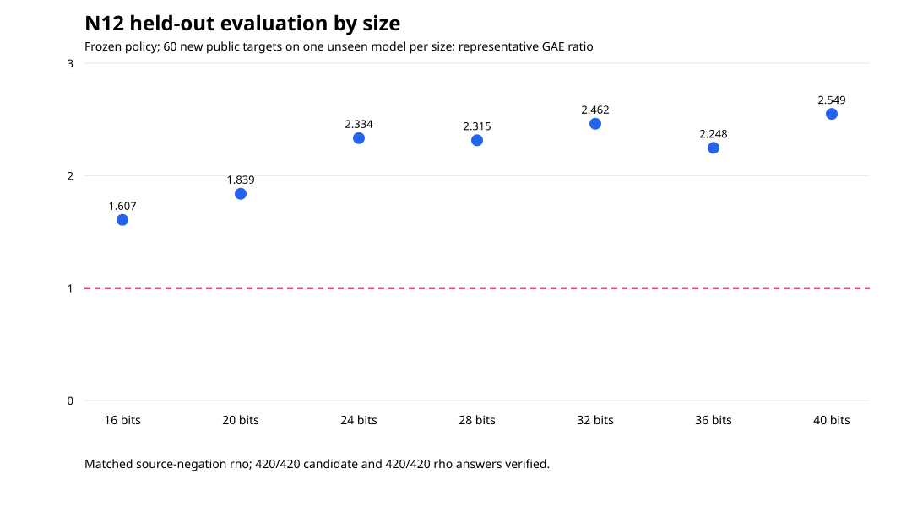

# N12 model-held-out factor-base tuning

The frozen training selector chose a full factor base with 32 jumps (`fb1-any-j32`) from seven prespecified policies. On 14 training curve models and 840 public known-answer targets per policy, its representative cold candidate/matched-rho GAE ratio was **2.558651**. On seven unseen curve models with 420 newly derived targets, the frozen policy's ratio was **2.479905**. All 420 candidate and 420 matched source-negation-rho answers verified by recomputing `kP` on the source curve. The held-out aggregate has **0 winning, 36 losing, 0 tied** cells in the frozen price grid.

The [protocol](PROTOCOL.md) was frozen as SHA-256 `325d0efb2c1e7b7328bd472bda310464f4817d62a5ca3a4ca6481c67cee84c9c` at 2026-10-25 06:11:49 UTC, before the first new training record at 06:12:46 UTC. The split selects the first two lexicographically sorted ICV1 models at each bit size for training and the third for evaluation. Training reused the five-arm independent replication records and ran two additional stricter large-prime policies on the same training targets. Evaluation used a new target/algorithm seed domain, began only after the selector had written `results/selection.json`, and is bound to that file by SHA-256 `08fbcf90d71fc38bbac30d421fd96b0b06f25033673da3ee10f1c833101729e2` in `results/selection.SHA256`.


The graph plots the native selector's representative-cell ratios from [selection.json](results/selection.json). The blue bar is the frozen choice; the dashed line is equal candidate and rho cost. Every policy has 840/840 verified candidate and rho records. The selection rule minimized a ratio of **sums**, with `S/M=0.5`, `I/M=10`, and logical-operation price 0.1 source-addition equivalents. The [training grid](results/training-price-grid.csv) retains all 36 price cells and every loss.

| Training policy (base, large-prime acceptance, jumps) | Candidate/rho |
| --- | ---: |
| `fb1-any-j8` | 2.568068 |
| `fb1-any-j16` | 2.605006 |
| `fb1-any-j32` | **2.558651** |
| `fb2-one-j16` | 3.100207 |
| `fb4-one-j16` | 4.032405 |
| `fb2-both-j16` | 4.597713 |
| `fb4-both-j16` | 8.477121 |



The held-out [target JSONL](results/evaluation-targets.jsonl), [target CSV](results/evaluation-targets.csv), [36-cell price grid](results/evaluation-price-grid.csv), and [summary JSON](results/evaluation-summary.json) retain the seven distinct evaluation models. Each size has one model and 60 targets. The graph uses only recorded representative-cell ratios; all 36 prices per size and model remain in the grid.

| Bits | Evaluation model `p` | Verified candidate/rho | Candidate GAE | Rho GAE | Candidate/rho | Winning/losing cells |
| ---: | ---: | ---: | ---: | ---: | ---: | ---: |
| 16 | 739 | 60/60 | 516,008.48 | 321,148.92 | 1.606758 | 0/36 |
| 20 | 3931 | 60/60 | 1,137,961.82 | 618,722.98 | 1.839211 | 0/36 |
| 24 | 12143 | 60/60 | 3,106,833.95 | 1,330,964.42 | 2.334273 | 0/36 |
| 28 | 49451 | 60/60 | 10,263,081.87 | 4,433,422.11 | 2.314935 | 0/36 |
| 32 | 186583 | 60/60 | 39,644,976.31 | 16,105,867.71 | 2.461524 | 0/36 |
| 36 | 749299 | 60/60 | 149,770,260.88 | 66,636,855.59 | 2.247559 | 0/36 |
| 40 | 2972219 | 60/60 | 640,703,563.26 | 251,349,383.75 | 2.549056 | 0/36 |
| **All** | **7 models** | **420/420** | **845,142,686.57** | **340,796,365.49** | **2.479905** | **0/36** |

The earlier independent replication's **full8 16-bit slice** had 23 winning and 13 losing price cells and representative ratio 0.980993. That prior observation remains in the [replication report](../factor_base_replication_20261024/REPORT.md). N12's held-out 16-bit model used the frozen `fb1-any-j32` choice and had 0 winning and 36 losing cells, ratio 1.606758. The two cohorts and policies are not pooled.

## Execution and validation

The run used source commit `b2bd9f963b87f6919005067c810cba707b873f59`, Rust 1.99.1, and host `ip-172-31-3-58.us-east-2.compute.internal` (Intel Xeon 6975P-C, 32 visible CPUs). The host was shared; no isolation tier was earned. Elapsed time in `results/raw/*.time` is diagnostic only. Costs are cold single-target native operation counts, including construction, transfer, collection, elimination and source verification. Both candidate and rho ran in the same executable and process for each evaluation target.

The exact native commands were:

```sh
cargo build --release --locked --offline --manifest-path research/factor_base_heldout_20261025/Cargo.toml --bins
bash research/factor_base_heldout_20261025/run_train.sh
research/factor_base_heldout_20261025/target/release/select-policy
bash research/factor_base_heldout_20261025/run_evaluation.sh
research/factor_base_heldout_20261025/target/release/analyze-heldout
research/factor_base_heldout_20261025/target/release/validate-heldout
bash research/factor_base_heldout_20261025/build_report.sh
```

The [native validator report](results/validator-report.json) is `ok: true`: 11,760 training candidate/rho source scalar replays, 420 evaluation candidate and 420 evaluation rho source scalar replays, zero train/evaluation model overlap, 252 training and 540 evaluation price cells independently recomputed, phase totals reconciled, prior raw artifact hashes checked, and standardized target JSONL/CSV reconciled. Every new training and evaluation raw file has its exit status and elapsed-time receipt. The [data dictionary](DATA_DICTIONARY.md) defines nulls, units and fields. The [PDF report](REPORT.pdf) contains both inspected graphs.

The descriptive [run report](reports/run-20261025T0612Z/README.md) and its PDF sit beside the raw records. Copies of the PDF and both SVG/PNG graphs are in [benchmarks/20261025-factor-base-heldout](../../benchmarks/20261025-factor-base-heldout/). The canonical leaderboard and benchmark results table were checked and left unchanged because this packet has no independent replay certificate or isolated wall comparison.

## Scope and remaining gates

| Requirement | Status | Evidence |
| --- | --- | --- |
| Freeze model-level split before tuning | Verified complete | Protocol hash and pre-run timestamp; exact ICV1 split independently checked |
| Tune base size, large-prime acceptance and jumps only on training | Verified complete | Seven-policy training grid, 840 targets per policy; selector and SHA-bound choice |
| Run frozen choice on every evaluation target with matched rho | Verified complete | 420/420 candidate and 420/420 same-process rho raw records |
| Verify every source scalar and all prices | Verified complete | Native validator: 12,600 source scalar replays and 792 price cells across training and evaluation |
| Preserve losses and failures | Verified complete for this run | Every policy/scope price cell retained; 0 failures occurred; no losing cell omitted |
| Standardized raw CSV/JSON, graph, PDF | Verified complete | Linked data, two graphs, inspected report PDF and checksum manifest |
| Independent-host replay and isolated wall comparison | Not attempted | No separate host or isolation receipt; no wall-speed claim |
| Leaderboard promotion | Not proposed | Validation-gate replay and isolated wall evidence are absent |

This deterministic model-held-out result does not supply a sampling confidence interval or a claim beyond the fixed public Scholten models, policy set, seed derivation and operation-price contract. It does not change the canonical IC leaderboard.
