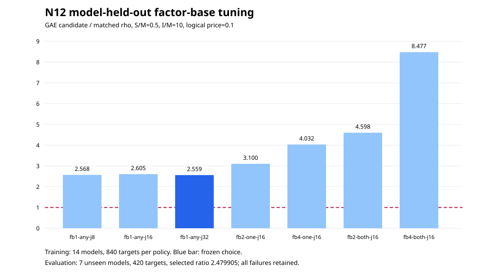

# N12 run 20261025T0612Z

The frozen [protocol](../../PROTOCOL.md) selected two training models and one evaluation model at each of seven bit sizes. Seven training policies each covered 840 targets; the selector chose `fb1-any-j32` at representative candidate/matched-rho ratio 2.558651 and froze selection SHA-256 `08fbcf90d71fc38bbac30d421fd96b0b06f25033673da3ee10f1c833101729e2` before evaluation. The selected policy covered all 420 newly derived evaluation targets, with 420 verified candidate and 420 verified rho answers. Candidate/rho was 2.479905 at the representative price; 0 of 36 aggregate price cells were below rho, 36 were above.

The source run and native validator commands, raw records, price grid, and requirement status are in the [study report](../../REPORT.md). The [run PDF](run-report.pdf) contains both graphs. The pre-study input revision was `b2bd9f963b87f6919005067c810cba707b873f59`; the saved study source matches later commit `a5798517feaac879bce582ff1f0d864a91daa238`. The separately built replay executable has SHA-256 `58a70ac65f088cf24948cfb77e6144e8727296fd1a908cb02a82e7cda2e0e86e`. The original EKS executable bytes and digest have not been recovered, so its source-to-binary link remains open. Host: Intel Xeon 6975P-C, 32 visible CPUs, shared L0. The `.time` files beside new raw JSONL preserve elapsed seconds and exit 0 for every shard. Elapsed time is diagnostic. The native validator passed 11,760 training and 840 evaluation source scalar replays and 792 priced cells. The 16-bit full8 mixed result remains in the separate prior replication packet; it was not pooled into this held-out estimate.
