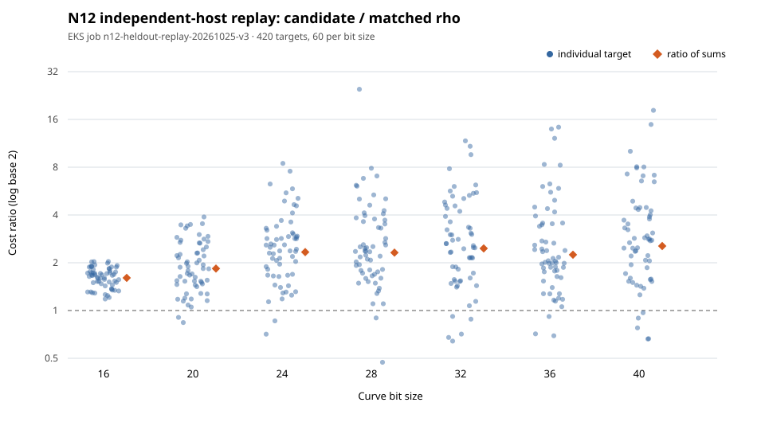

# N12 independent-host replay of the frozen held-out factor-base evaluation

The frozen `fb1-any-j32` policy and matched source-negation rho each returned 420/420 source-verified scalars on seven held-out models. All 420 target identities and full operation-count records match the original run. The seven replay raw JSONL files are byte identical to the originals. At the representative price (`S/M=0.5`, `I/M=10`, logical price `0.1`), the ratio of summed candidate cost to summed rho cost is **2.4799052224835276**. Across the 36 aggregate price cells, the replay has **0 wins, 36 losses, 0 ties**. Nineteen individual target ratios are below one; these remain in the target-level records and graph.

| Bits | Candidate/rho ratio of sums | Verified candidate/rho | Individual target wins | Aggregate grid wins/losses |
| ---: | ---: | ---: | ---: | ---: |
| 16 | 1.606758 | 60/60 | 0 | 0/36 |
| 20 | 1.839211 | 60/60 | 2 | 0/36 |
| 24 | 2.334273 | 60/60 | 2 | 0/36 |
| 28 | 2.314935 | 60/60 | 2 | 0/36 |
| 32 | 2.461524 | 60/60 | 5 | 0/36 |
| 36 | 2.247559 | 60/60 | 3 | 0/36 |
| 40 | 2.549056 | 60/60 | 5 | 0/36 |
| All | 2.479905 | 420/420 | 19 | 0/36 |

The original host was EC2 instance `i-09774109223fde89e` (`ip-172-31-3-58.us-east-2.compute.internal`, `m8i-flex.8xlarge`). The replay ran on instance `i-0df0361be2629437d` (`ip-10-84-78-40.us-east-2.compute.internal`, `c7a.2xlarge`), as recorded in [instance receipts](results/attempts/instances.json). Its Pod UID was `6cf22f89-ac80-47f0-8229-5ce3aa574503`. The EKS Job kept the pinned task-image digest, 2 CPUs, 4 GiB, 3,600-second deadline and zero retries. Each of the 11 frozen input members passed the native SHA-256 check in the Pod before computation. The source workload archive members were extracted byte-for-byte; the selected policy, target/algorithm seed domains, and native `heldout` binary were unchanged.

The first two Jobs produced **zero target results** and are retained. v1 exited before download because the task image lacks `hostname`; v2 stopped at preflight because it lacks `tar`. v3 used per-file S3 transfer, then completed all seven 60-row slices with exit code zero. Their [terminal status and exit receipts](results/attempts/) make the setup failures visible. The [execution amendment](PROTOCOL.md) records the transport change and all hashes.

The native validator independently rebuilt each target from the frozen source workload, checked the candidate and rho scalars by recomputing the source point, reconciled every phase count and source-addition unit, compared the original/replay identities and counts, and recomputed the 36 price cells for the full cohort and each bit-size slice. It reports 420 candidate and 420 rho scalar checks, 420 identity matches, 420 count matches, no unexpected target IDs, and seven byte-identical raw files. A self-check using the original raw files as replay input produced the same 420/420 validation and ratio before the independent output was analyzed.

## Executable provenance recheck, 27 October 2026

The frozen `bin/heldout` was downloaded read-only from the original S3 input
prefix. Its SHA-256, `58a70ac65f088cf24948cfb77e6144e8727296fd1a908cb02a82e7cda2e0e86e`,
matches the preflight receipt and is 1,920,248 bytes. The checked-in
`heldout.rs` and `cost.rs` still match the frozen source hashes. An offline,
locked release build with rustc 1.99.1 from the ordinary checkout path
produced the same-size executable with SHA-256
`c3b5700c39449a7cb5483eb6ff2f6d2d6dc9aa32ccf8b8e4ef9343d07f9245a0`.
Its printable read-only strings differed at the absolute source path. A
second build through the original recorded source path
`/var/tmp/crypto-n12-replay-20261025`, using the same checked-in source and
locked dependencies, produced SHA-256
`58a70ac65f088cf24948cfb77e6144e8727296fd1a908cb02a82e7cda2e0e86e`;
`cmp` against a fresh S3 copy exited zero. This closes the previously open
source-to-executable hash check for this frozen binary. The retained
[machine record](BINARY_REBUILD.json) names both commands, source hashes,
compiler, output hashes, and the path-sensitive first build. No target trial
or cost measurement was rerun; every ratio above is unchanged.

The [standardized target JSONL](results/validated/targets.jsonl), [target CSV](results/validated/targets.csv), [price grid](results/validated/price-grid.csv), [summary JSON](results/validated/summary.json), [raw records](results/raw/), [receipts](results/receipts/), [data dictionary](DATA_DICTIONARY.md), graph, and [PDF](REPORT.pdf) retain every measured loss and the null convention for missing or invalid rows. Costs are cold single-target native operation counts in source-addition equivalents, including setup, transfer, collection, elimination, and verification. Wall-time receipts are diagnostic; the hosts had different hardware and no matched isolation tier. The result describes this frozen seven-model, 420-target cohort and has no population confidence interval.

Rebuild the native validator with `cargo run --release --locked --offline --manifest-path research/factor_base_heldout_replay_20261025/Cargo.toml --bin factor-base-heldout-replay -- SOURCE_BUNDLE_ROOT research/factor_base_heldout_replay_20261025/results research/factor_base_heldout_replay_20261025/results/validated`, using the frozen per-file source bundle documented in the protocol. `bash research/factor_base_heldout_replay_20261025/build_report.sh` regenerates the graph and PDF from the native outputs.
