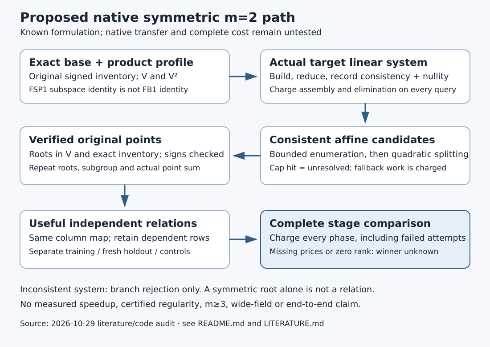

# Next factor-base test: the target-conditioned symmetric kernel

**2026-10-29 · literature and native-code investigation, not an experiment.**
The user selected investigation of the next factor-base lead. This review
identifies a concrete native transfer question. It does **not** establish a
better factor base, a faster solver, certified regularity or a full-cost winner.

The next test should combine the existing product-profile constructor with a
**general-subspace symmetric two-summand oracle**, and charge splitting and
verified independent relations. Selecting a low product dimension alone leaves
the expensive and possibly unsuccessful part of that oracle unmeasured.

## What the investigation established

| Finding | Evidence and status |
| --- | --- |
| The symmetric two-summand formulation and its residual affine search are already known here. | Sibling `pdp-degree-heuristics/sym.py` explicitly describes linear equations and the remaining symmetric solutions that must split. This is prior work, **not a newly discovered algorithm**. |
| The unified sweeper's current binary path uses the direct descended system and F4. | At pinned source `4c87143544eab488543cefacd59a3e86f59c6592`, `engine.rs` calls `polynomials::binary`, then `f4_fp::solve`, with two blocks of subspace coordinates. |
| The other native `linearized` oracle is not evidence of a general-subspace implementation in this CLI. | `three_leads::decompose` uses a selected subfield power, a subfield Artin–Schreier solver and a trace-zero fallback to subtraction. That distinct domain must not be silently generalized. |
| Complete native accounting remains missing. | The current sweeper explicitly emits `unpriced_native_operations_complete=false` and lists system construction, root extraction, inventory and verification costs as missing. |
| Merely returning to GP-versus-random yield searches is not a new lead. | The atlas marks the broad subspace-choice lane exhausted at its measured scale; the specific native linearization-excess transfer remains open. See [sources](LITERATURE.md). |

This is a code-path audit and a proposed implementation/measurement boundary.
No historical Python research code was executed. No experimental data, new
candidate inventory, F4 panel, operation-count comparison or timing was produced.

## The mechanism, and the missing step

For the **binary model** `y² + xy = x³ + a₂x² + b`, the sibling symmetric
implementation writes the standard two-summand equation in `u=x₁+x₂` and
`v=x₁x₂`. Its expression is

```text
u² t² + v t + v² + b = 0,       t = x(R).
```

This formula is quoted from the existing implementation, not presented as a
new identity or a newly certified theorem. Squaring and multiplication by a
fixed target coefficient are linear over F₂. With `u ∈ V` and `v ∈ V^(2)`,
the proposed native adapter therefore forms a target-conditioned binary linear
system in the coordinates of these two product spaces.

**A consistent symmetric solution is not yet a decomposition.** It must lift
to roots of `T² + uT + v` in the original subspace, to the original signed point
inventory, and to points whose sum is the actual target. Repeated roots,
zero coordinates, identity targets and subgroup conditions require explicit
cases. A low-rank or ill-conditioned-looking base is not rejected by assumption.

For a consistent affine system, record its actual nullity `δ`, not just the
static excess `n − dim(V) − dim(V^(2))`. The existing symmetric prior already
identifies the residual candidate count as exponential in this nullity.
The transfer question is whether a native solver can process those candidates,
split and verify them for less **complete** cost than unchanged references.
Neither the excess nor the nullity alone answers that question.



## A bounded, fail-closed implementation contract

1. Keep the exact field, curve, generator, prime subgroup and signed FB1
   inventory. Build canonical bases for `V` and `V^(2)` using the existing
   native profiler. A subspace identity FSP1 is not a point-base identity FB1.
2. Construct and reduce the actual target matrix. An inconsistent system may
   reject this branch; log that reason and all construction/elimination work.
3. On a consistent system, expose the particular solution, kernel dimension
   and deterministic enumeration order. Enumerate only within a frozen cap.
4. Split each symmetric candidate, test roots against the **original** base,
   recover every admissible sign and verify each returned point sum. Charge
   failed splitting, repeated-root handling and verification too.
5. A cap hit is **unresolved**, not a proof of non-decomposition. A separately
   charged direct/F4 fallback can preserve completion; no fallback is free.
6. Feed only verified original-inventory witnesses into the same projected
   relation matrix. Keep dependent rows and separate holdout rank. A method
   that changes which witnesses it returns also changes a possible rank cost.

This would add a second oracle to a matched native investigation; it would
not replace the old CLI defaults or rewrite old executable-bound records.
The adapter is **not implemented by this documentation change**.

## The discriminating comparison

[NEXT_TEST.md](NEXT_TEST.md) makes the experiment's controls, complete work
ledger and stop states concrete. It is a design, **not a frozen executable
protocol or a dispatched card**. The first comparison is bounded `m=2` on the
same small binary models supported by the current sweeper. It does not stand
in for the atlas's separate `m=3/4` closure question.

Compare unchanged direct/F4, the new symmetric adapter, and the existing exact
subtraction/pair reference on identical actual point inventories and targets.
Then compare size-matched profile-selected bases. Separate those two questions:
an oracle improvement on a fixed base is not evidence that a shape is better.

The primary endpoint must include inventory/setup, target encoding, elimination,
all symmetric candidates, splitting, point and subgroup checks, relation-rank
work and unsuccessful queries. Report total work per verified independent
relation across the current symmetric 0/0.1/1 pricing band. Missing costs or
zero useful rank leave that comparison unknown. A stage improvement can count
without beating rho; a fastest claim needs the fastest matched external tools.

## Prior-work limits that remain binding

- The historical m=2 degree fit is not a general degree predictor. It is not
  transferred to this different solver or to m=3/4, degree83 or degree131.
- Exact conservation over all group targets does not establish equal subgroup
  coverage, successful-query probability or independent relation rank.
- Low product growth and geometric-progression structure are known mathematics.
  This review supplies neither a new optimality theorem nor a certified degree
  of regularity. No new IDC1 or Lean theorem is claimed.
- Removing a Gröbner step from m=2 does not remove relation collection, setup or
  the known generic-oracle cost floor. A quick conditioned success is not a
  complete one-target index-calculus speedup.

## Execution status and exact remaining work

| Requested or required item | Status |
| --- | --- |
| Investigate the next factor-base lead against existing results | Completed literature/code review within the cited search scope |
| Concrete native transfer target and falsifiable comparison | Specified; see NEXT_TEST.md |
| New native general-subspace symmetric adapter | Not implemented |
| Current-source correctness and complete native pricing | Not run for a new adapter; no pass claimed |
| Frozen protocol, isolated experiment and independent replay | Not attempted; prerequisites remain open |
| A better base, certified regularity or wide-field gain | Not established |

No experiment was launched, so no experiment export or checkpoint success is
claimed. The current runtime reports no ready outbound identity, secrets or
runtime variables; that is **not** proof that every named AWS profile or
possible GitHub submission route is unavailable. No authentication retry or
old chat-key use was attempted. The prior storage authorization remains valid;
it is not a new permission blocker. A tested native adapter, a supported
commit-built execution route and a current successful checkpoint are needed
before a new measured panel. Old XP cards remain unchanged and unrun.

The Conductor pre-edit check was attempted and returned127, `command not found`;
the current `docs/CONDUCTOR.md` describes this unavailable-tool condition.
No lease is claimed. Primary-paper retrieval also hit403; [LITERATURE.md](LITERATURE.md)
distinguishes sources actually read from that access gap.

The old scientific figures and canonical scoreboard/leaderboard remain unchanged:
there is no new measured cost, accepted incumbent, registered model, relation
yield or regularity result to plot. This search gets its own diagram and PDF.
No benchmark row or `VALIDATION.json` is created.
