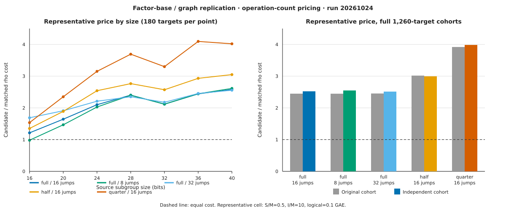

# Independent factor-base / graph replication

Run `20261024T2258Z-factor-base-replication` executed the frozen five-arm
factor-base and large-prime graph protocol on a second cohort of 1,260 public
known-answer targets. The native producer wrote 6,300 candidate records and
6,300 paired source-negation-rho results. Every candidate and rho answer was
checked by recomputing the scalar multiple on the source curve.

The [protocol](PROTOCOL.md) was frozen before target generation. Target scalars
and algorithm seeds use separate SHA-256 domains over the curve ICV1 identity,
size and target index. The independent validator found zero algorithm-seed,
planted-scalar and target-point overlaps with the original 1,260-target cohort.



The graph plots native-analyzer output from
[`results/graph-data.csv`](results/graph-data.csv) and
[`results/original-vs-replication.csv`](results/original-vs-replication.csv).
The dashed line is equal candidate and rho cost. Each size point contains 180
targets. The right panel compares complete 1,260-target cohorts.

## Observed full-cohort operation costs

The table uses the frozen representative price `S/M = 0.5`, `I/M = 10`, and
`0.1` source-addition equivalents per logical operation. Candidate and rho GAE
are sums over 1,260 targets. The band is the minimum and maximum aggregate ratio
over all 36 frozen pricing cells.

| Arm | Candidate GAE | Rho GAE | Candidate / rho | 36-cell band | Wins / losses / ties | Processed divisors |
| --- | ---: | ---: | ---: | ---: | ---: | ---: |
| Full base, 16 jumps | 2,661,363,462.21 | 1,054,951,912.44 | 2.522734 | 1.386374–13.514033 | 0 / 36 / 0 | 219,259,871 |
| Full base, 32 jumps | 2,651,510,985.59 | 1,054,951,912.44 | 2.513395 | 1.383840–13.440233 | 0 / 36 / 0 | 218,282,418 |
| Full base, 8 jumps | 2,689,869,404.38 | 1,054,951,912.44 | 2.549755 | 1.401397–13.639329 | 0 / 36 / 0 | 221,972,970 |
| Half base, 16 jumps | 3,159,731,681.85 | 1,054,951,912.44 | 2.995143 | 1.715544–16.504039 | 0 / 36 / 0 | 272,004,613 |
| Quarter base, 16 jumps | 4,203,242,635.26 | 1,054,951,912.44 | 3.984298 | 2.388390–22.870499 | 0 / 36 / 0 | 387,233,280 |

One size-only slice contains mixed pricing outcomes: full base with eight jumps
at 16 bits has 23 winning and 13 losing cells, a representative ratio of
0.980993, and a 0.790906–2.450390 band. Every other arm/size slice has zero
winning cells. The complete per-slice and per-cell values are retained in
[`results/summary.json`](results/summary.json) and
`results/price-grid.csv`.

## Original and replication cohorts

| Arm | Original ratio | Replication ratio | Ratio delta | Original divisors | Replication divisors | Divisor delta |
| --- | ---: | ---: | ---: | ---: | ---: | ---: |
| Full base, 16 jumps | 2.448830 | 2.522734 | +0.073904 | 219,581,773 | 219,259,871 | −321,902 |
| Full base, 32 jumps | 2.453278 | 2.513395 | +0.060117 | 219,864,588 | 218,282,418 | −1,582,170 |
| Full base, 8 jumps | 2.447173 | 2.549755 | +0.102582 | 220,092,171 | 221,972,970 | +1,880,799 |
| Half base, 16 jumps | 3.017732 | 2.995143 | −0.022589 | 282,983,105 | 272,004,613 | −10,978,492 |
| Quarter base, 16 jumps | 3.919193 | 3.984298 | +0.065105 | 392,583,830 | 387,233,280 | −5,350,550 |

These are two deterministic cohorts with one algorithm seed per target. No
sampling interval is assigned. The table records cohort differences without a
significance claim.

## Execution and validation

The exact producer command was:

```text
cargo build --release --locked --offline \
  --manifest-path research/factor_base_replication_20261024/Cargo.toml --bins
bash research/factor_base_replication_20261024/run.sh
```

The analyzer and validator commands were:

```text
research/factor_base_replication_20261024/target/release/analyze-replication
research/factor_base_replication_20261024/target/release/validate-replication
```

The validator independently recomputed 6,300 target/seed derivations, 12,600
source scalar checks, the common 1,260-target set, 40 arm/slice summaries and
all 36 pricing cells per summary. Its result is `ok: true` in
[`results/validator-report.json`](results/validator-report.json). All 35 raw
files contain 180 records. Their process receipts record exit status 0; elapsed
time is diagnostic because the host is shared and no isolation tier was earned.

## Requirement status and limits

| Requirement | Status | Evidence |
| --- | --- | --- |
| Independently seeded 1,260-target cohort | Verified complete | Protocol plus validator: zero seed/scalar/point overlaps |
| Five arms over every target | Verified complete | 6,300/6,300 candidate records |
| Matched rho cost and source verification | Verified complete | 6,300/6,300 paired rho records; 12,600 recomputed source checks |
| All costs, wins and losses | Verified complete | 1,440 rows in the 36-cell grid; per-slice summary |
| Standard raw data, graph and PDF | Verified complete | Data dictionary, artifact manifest, SVG/PNG and inspected PDF |
| Independent-host deterministic replay | Not attempted | No second host receipt |
| Isolated wall-time or fastest-external-tool comparison | Not attempted | Operation counts only; wall receipts are diagnostic |
| Leaderboard promotion | Not proposed | Validation-gate replay and matched isolated wall evidence are absent |

No result here changes a canonical leaderboard or security claim. The observed
values apply to the fixed public Scholten models, target derivation, collector,
rho implementation and 36-cell pricing contract in this protocol.
